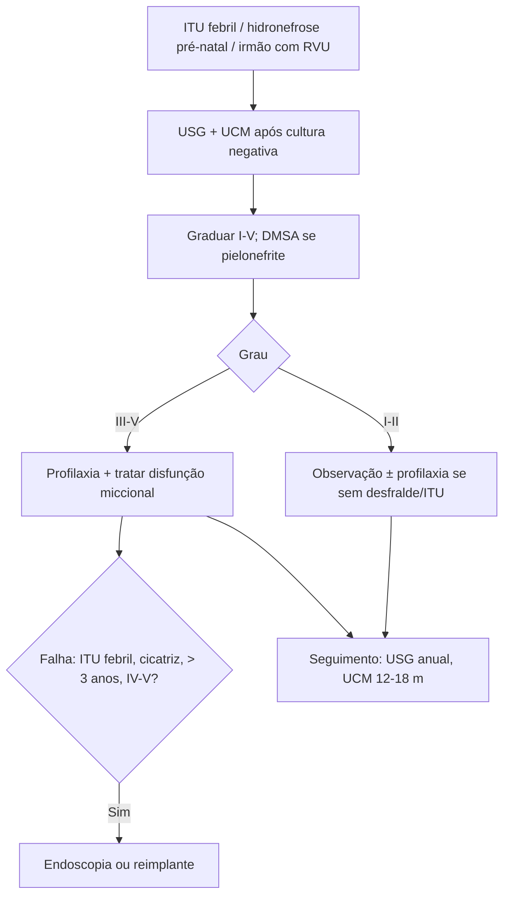

# Refluxo Vesicoureteral (RVU)

> Resumo em palavras próprias do Whitebook (Condutas Cirúrgicas > Cirurgia Urológica), sem fisiopatologia, autoria e referências. Confira detalhes e doses na fonte: https://whitebook.pebmed.com.br/conteudo/?id=46112&categoryId=207&subcategoryId=214

**Definição:** fluxo retrógrado anômalo de urina da bexiga ao ureter e, às vezes, ao sistema pielocalicial. Primário (anomalia congênita da junção ureterovesical) ou secundário. Importância: nefropatia de refluxo (cicatrizes, hipertensão, doença renal crônica) e ITU.

## Etiologia
- **Primário:** forma mais comum; ureter intravesical curto com falha do mecanismo antirrefluxo; predisposição familiar; baixo grau tende a resolver espontaneamente.
- **Secundário:** uropatia congênita (ureter ectópico, divertículo paraureteral, ureterocele), adquirida (cirurgia prévia, obstrução de colo/uretra), funcional (neuropática ou não), inflamatória (ITU, cistite crônica, litíase, corpo estranho).

## Epidemiologia
0,4–1,8% das crianças; 10× mais em brancos; mais em meninos até 1 ano, 5–6× mais em meninas após 2 anos; diminui com a idade. ~6% dos casos de IRC terminal em crianças/jovens; 5ª causa de IRC pediátrica. Presente em 30–40% das ITU altas; 10–40% dos neonatos com hidronefrose pré-natal. Risco maior com história em pais/irmãos. Manejo ainda controverso.

## Clínica
Sem sinais próprios; suspeitar em ITU alta (febril) recorrente, febre isolada/vômitos/letargia em lactentes, disúria/urgência/incontinência em maiores com disfunção miccional, hipertensão ou perda de função em casos avançados, ou hidronefrose pré-natal.

## Diagnóstico
- Urina e urocultura em todo RN com hidronefrose; creatinina (repetir após 24 h; ~0,4 mg/dL em neonato saudável); eletrólitos (rim displásico).
- **Uretrocistografia miccional (UCM):** padrão para diagnóstico; fazer após tratar a ITU, com cultura negativa; mostra grau, contorno vesical, uretra, esvaziamento; resíduo aumentado sugere obstrução.
- **USG:** hidronefrose, parênquima, tamanho renal (displásicos pequenos e ecogênicos); ureter dilatado com hidronefrose sugere RVU, sem ureter visível sugere obstrução da JUP.
- **Cintilografia (DMSA):** melhor para cortical, função, cicatrizes; fazer ≥ 6 meses após pielonefrite; menor captação sugere displasia.
- **Disfunção miccional (suspeita de RVU secundário):** urofluxometria com resíduo, eletromiografia perineal; urodinâmica em casos selecionados.
- **UCM + USG:** toda criança com ITU febril (> 38 °C) e todo menino circuncidado ou com prepúcio normal com ITU sintomática. Rastreio com UCM em filhos e irmãos de pessoas com RVU.
- **Graus (I–V):** I só ureter; II ureter, pelve e cálices sem dilatação; III dilatação leve e cálices levemente alterados; IV dilatação moderada; V pelve gravemente dilatada, ureter tortuoso, cálices severamente alterados.
- **Diferenciais:** estenose da JUP, válvula de uretra posterior, bexiga neurogênica, instabilidade do detrusor.
- **Seguimento:** cirurgião pediátrico/urologista e nefrologista; USG anual; UCM a cada 12–18 meses; cintilografia 6 meses após pielonefrite.

## Tratamento
Metas: crescimento renal normal, prevenir ITU/pielonefrite e insuficiência renal. Baixo grau resolve espontaneamente; graus IV–V podem resolver se sem infecção. Manter urina estéril, corrigir disfunção miccional. Instabilidade do detrusor: anticolinérgicos, controle de ingesta, observação da micção.
- **Não cirúrgico (± profilaxia):** profilaxia diária ou intermitente se criança sem desfralde com ITU prévia (qualquer grau), disfunção vesical/intestinal associada, ou graus III–V. Sem dose ótima; opinião de especialistas ¼–⅓ da dose terapêutica. Cefalexina 10–15 mg/kg/dia à noite; SMX-TMP (> 3 meses) 1–2 mg/kg/dia (TMP); nitrofurantoína (> 3 meses) 1–2 mg/kg/dia; amoxicilina 5 mg/kg/dia. Treinamento vesical; tratar disfunção miccional (anticolinérgico, alfabloqueador, constipação, biofeedback); seguimento seriado com urocultura, função renal, PA, UCM, USG, DMSA.
- **Endoscópico:** injeção de gel biocompatível no túnel ureteral (cria coaptação); menos invasivo e mais barato; sucesso inicial menor, repetível. Gel ideal: não imunológico, biodegradável, durável, fácil de injetar, sem migração. Problemas: deslocamento da bolha, perda de volume, saída; investigar disfunção vesical antes. Complicações: hematúria grave, obstrução, recidiva, refluxo contralateral.
- **Cirúrgico (reimplante ureteral):** graus IV–V; refluxo persistente apesar de > 3 anos de tratamento; ITU avançada sob profilaxia; atraso do crescimento renal; alergias que impeçam profilaxia; desejo/não adesão de interromper profilaxia; pielonefrite de repetição; cicatriz progressiva sob profilaxia com anomalia da junção; megaureter obstrutivo com refluxo; divertículo vesical com refluxo. Princípios: túnel submucoso com comprimento:diâmetro 4:1, sem modelagem se 4:1, preservar adventícia e vascularização, ressecar a junção se estenótica. Técnicas: Lich-Gregoir (extravesical), Politano-Leadbetter, Cohen (intravesicais), abordagem infra-hiatal ou mista.
- Contraindicado como 1ª linha no RVU secundário: tratar antes a disfunção do detrusor (instabilidade, síndrome de Hinman). Pré-operatório: consentimento (refluxo persistente, estenose, refluxo contralateral, obstrução, infecção, sangramento), urina estéril. Pós: antibiótico IV até dieta, anticolinérgico/diazepam para espasmo, alta em 1–2 dias; profilaxia até confirmar resolução por imagem.

## Fluxograma (refeito, a partir do texto; o original traz figuras de UCM e classificação)

