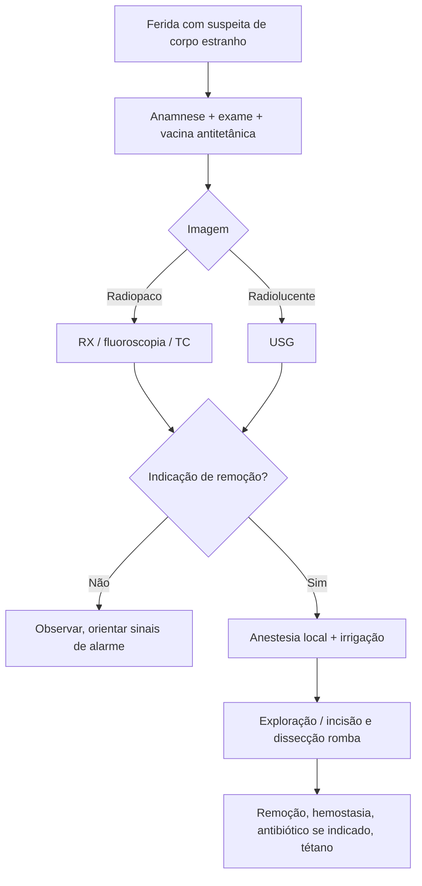

# Remoção de Corpo Estranho em Ferida

> Resumo em palavras próprias do Whitebook (Condutas Cirúrgicas > Cirurgia Geral e do Aparelho Digestivo), sem fisiopatologia, autoria e referências. Confira detalhes e doses na fonte: https://whitebook.pebmed.com.br/conteudo/?id=45417&categoryId=207&subcategoryId=211

**Definição:** corpos estranhos em partes moles surgem de traumas penetrantes ou escoriações e causam desconforto, deformidade, atraso de cicatrização, infecção local ou sistêmica, além de trauma secundário às tentativas de remoção. A identificação depende do tipo e local da ferida, do tempo e do mecanismo.

**Objetivos:** segurança do paciente, preservação de estruturas nobres, prevenção de infecção e redução de morbidade tardia.

## Avaliação clínica
- **Anamnese:** mecanismo (perfuração, laceração, trituração; alta ou baixa velocidade), material (farpa de madeira, metal, vidro, orgânico), profundidade e local, dor persistente, sangramento, perda de função (déficit motor/sensitivo), sinais de infecção, tempo desde o trauma, vacinação antitetânica, alergias, comorbidades e medicações.
- **Exame:** exploração manual cuidadosa para não empurrar o corpo estranho; tamanho e profundidade, trajetória provável, perfusão e sensibilidade distais, amplitude de movimento e força, sinais de infecção. Apresentação tardia: celulite localizada, abscesso ou inflamação; infecção local recorrente sugere corpo estranho — perguntar sobre trauma prévio.

## Exames de imagem
Indicados se há suspeita de corpo estranho subcutâneo ou para avaliar nervos, vasos e tendões próximos; nem sempre o corpo é visualizado.
- **RX simples** (AP e perfil): objetos radiopacos (vidro, metal, pedra, cerâmica).
- **Fluoroscopia (arco em C):** visão em tempo real, facilita a retirada de radiopacos.
- **TC:** objetos profundos, alguns radiolucentes; reação tecidual, abscesso, anatomia; útil para metal e vidro.
- **USG:** tempo real, edema e abscesso; objeto hiperecoico com sombra acústica; guia a retirada; melhor para radiotransparentes (madeira, plástico, fragmentos orgânicos).

## Quando remover / dificuldades
- **Indicações:** comprometimento neurovascular, proximidade ou ameaça a estruturas nobres, infecção, corpo estranho intra-articular, deformidade estética, déficit funcional, dor crônica, desejo do paciente.
- **Fatores de dificuldade:** inserção profunda; risco de lesão neurovascular na retirada; posição mal informada (exploração em sala cirúrgica); hemostasia inadequada (discrasias); deformidade estética.
- **Riscos do procedimento:** ampliar a ferida ou criar outra, dissecar tecidos, cauterizar, infecção de partes moles, lesão neurovascular adicional.

## Técnica
- **Anestesia:** lidocaína (com ou sem epinefrina) ou bupivacaína, tópica ou bloqueio regional; sedação associada se paciente pouco cooperativo ou ferida extensa.
- **Limpeza:** irrigação exaustiva com SF 0,9%, de preferência sob pressão (seringa ou água encanada).
- **Retirada:** não há técnica única. Feridas abertas devem ser exploradas; fechadas, incisadas e com dissecção romba até o objeto, evitando grande lesão tecidual.
- **Antibiótico:** considerar com material orgânico, sinais de infecção, mordedura, imunossupressão, feridas profundas ou muito contaminadas. Atualizar o **tétano** se necessário.

## Complicações
Infecção (celulite, abscesso), granuloma de corpo estranho, lesão vascular ou nervosa, fragmentos retidos, osteomielite (sobretudo corpo profundo ou tardio).

## Fluxograma (refeito, a partir do texto; o texto original não traz uma figura)

