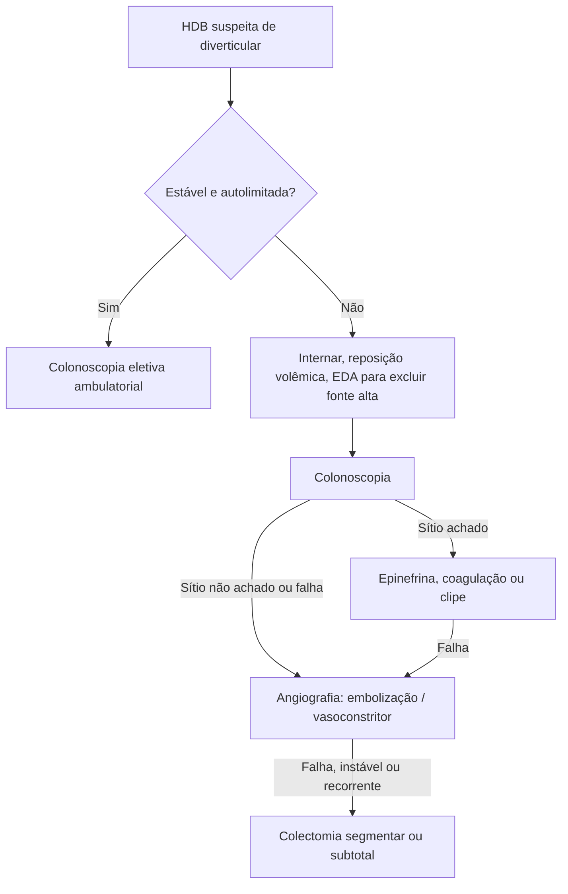

# Sangramento Diverticular

> Resumo em palavras próprias do Whitebook (Condutas Cirúrgicas > Cirurgia Geral e do Aparelho Digestivo), sem fisiopatologia, autoria e referências. Confira detalhes e doses na fonte: https://whitebook.pebmed.com.br/conteudo/?id=23250&categoryId=207&subcategoryId=211

**Definição:** hemorragia digestiva baixa (HDB) associada à doença diverticular; principal causa de HDB, com cerca de **30–50%** dos sangramentos retais maciços. Sinônimos: hemorragia/hematorragia diverticular, sangramento por diverticulose.

**Local:** 50–90% dos divertículos que sangram estão no cólon direito.

## Quadro clínico
- HDB indolor, geralmente sangue vivo (hematoquesia) ou raias de sangue nas fezes, autolimitada. Sangramento maciço: hipotensão postural, tontura, síncope.
- Exame físico em geral normal; pode haver dor leve e sangue na luva ao toque retal.

## Diagnóstico
- **Laboratório:** normal, exceto anemia em hemorragia maciça com mais de 24 h.
- **EDA:** para excluir fonte alta.
- **Colonoscopia:** exame de escolha — localiza e trata o sítio, exclui outras causas e avalia a extensão.
- **Diferenciais:** câncer de cólon, DII, úlcera péptica/duodenal, angiodisplasia, hemorroidas, fissura anal, gastroenterites.

## Conduta
- **Estável e autolimitado:** acompanhamento ambulatorial com proctologista e colonoscopia eletiva.
- **Instável, recorrente ou contínuo:** internar, ressuscitar e tratar endoscopicamente.
- **Terapia endoscópica:** injeção de epinefrina, coagulação ou clipagem.
- **Angiografia:** se a colonoscopia não achar o sítio ou o tratamento endoscópico falhar; detecta sangramento ativo ≥ 0,5 mL/min; embolização ou infusão de vasoconstritor.
- **Cirurgia:** colectomia segmentar, ou subtotal na doença pancolônica com sítio não identificado.
- **Indicações cirúrgicas:** instabilidade apesar de reanimação agressiva; falha endoscópica/angiográfica; sangramentos recorrentes.

## Fluxograma (refeito, a partir do texto; o texto original não traz uma figura)

