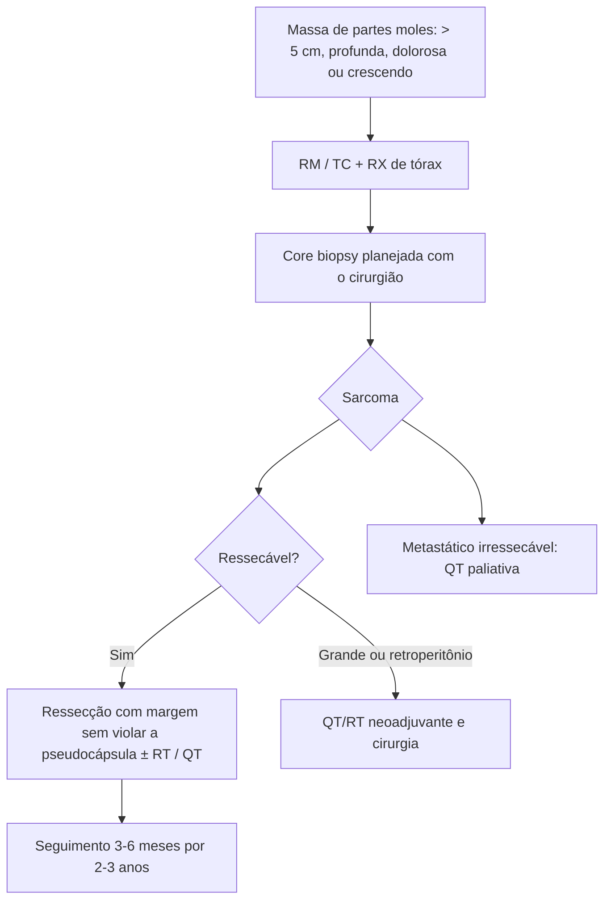

# Sarcoma de Partes Moles

> Resumo em palavras próprias do Whitebook (Condutas Cirúrgicas > Cirurgia Oncológica), sem fisiopatologia, autoria e referências. Confira detalhes e doses na fonte: https://whitebook.pebmed.com.br/conteudo/?id=39184&categoryId=207&subcategoryId=212

**Definição:** grupo raro e heterogêneo de tumores malignos mesenquimais; ~1% das neoplasias do adulto e 10% das da infância. Em geral surgem de novo (não de lesão benigna). Tipos: lipossarcoma, sarcoma sinovial, leiomiossarcoma, rabdomiossarcoma, fibrossarcoma, angiossarcoma.

## Clínica
- Qualquer local, mais nas extremidades (~46% em coxas, nádegas e virilhas). Massa dolorosa de crescimento gradual; coxa e retroperitônio chegam a grandes volumes; parestesia ou edema por compressão; febre e emagrecimento raros.
- **Sinais de gravidade:** profundidade (marcador mais sensível de malignidade), depois > 5 cm e crescimento rápido. Metástase hematogênica, sobretudo pulmão; linfonodos raramente.
- **Fatores:** Li-Fraumeni, neurofibromatose 1, retinoblastoma, radio/quimioterapia prévias, carcinógenos químicos, irritação crônica, linfedema, HIV e HHV-8 (Kaposi).
- **Exame:** tamanho, profundidade, fixação, comprometimento neural, edema.

## Diagnóstico
- RX (osso, calcificações); RM superior para extremidades, tronco, cabeça e pescoço; TC para retroperitônio; PET-CT não rotineiro. RX de tórax em todos; TC de tórax se RX alterado ou alto risco (> 5 cm e profundo, grau intermediário/alto); TC de abdome/pelve no lipossarcoma mixoide/de células redondas (não de rotina); RX/TC óssea se sintomas; RM de SNC no angiossarcoma cardíaco e no sarcoma alveolar de partes moles.
- **Biópsia essencial:** a incisional (citogenética, translocações) foi substituída pela **core biopsy**, preferida (poucas complicações, alta acurácia; guiada por TC/USG em lesões profundas). **Indicações:** massa > 5 cm, dolorosa, em crescimento, qualquer tamanho abaixo da fáscia, ou recorrência após excisão.
- **Diferenciais:** lipoma, metástase de carcinoma, melanoma, linfoma.
- **Estadiamento:** T1 ≤ 5 cm; T2 > 5–10; T3 > 10–15; T4 > 15 cm. N0/N1; M0/M1. Grau: G1 pontuação de mitose + necrose 2–3; G2 4–5; G3 6–8. Estágios prognósticos (a fonte lista as combinações sem numerá-las; confira): grupo mais favorável T1 N0 M0 G1/GX; seguintes T2–T4 N0 G1/GX; T1 G2–3; T2 G2–3; T3–T4 G2–3; por fim N1 ou M1 qualquer G.

## Seguimento
Anamnese e exame a cada 3–6 meses por 2–3 anos, depois anual; RX de tórax a cada 6–12 meses (outra versão: com RX a cada 3–6 meses por 2–3 anos, depois a cada 6 meses por 2 anos, depois anual); imagem periódica do sítio primário conforme o risco de recidiva local.

## Tratamento
- **Cirurgia** é o único tratamento potencialmente curativo; evitar romper a pseudocápsula.
- **Radioterapia:** em tumores grandes pode-se associar QT + RT neoadjuvantes e cirurgia; RT adjuvante em alguns casos.
- **Sistêmico:** QT neoadjuvante pode reduzir tumores de retroperitônio e viabilizar ressecção; QT adjuvante após R0 é controversa, considerar em alto risco, sobretudo extremidades e tronco. Doença metastática irressecável: QT paliativa isolada ou com cirurgia/RT.
- **Prognóstico:** estágio, grau e tamanho são os fatores independentes principais; também sítio, idade e subtipo.
- A fonte inclui um atlas de radiologia.

## Fluxograma (refeito, a partir do texto; o original não traz algoritmo)

