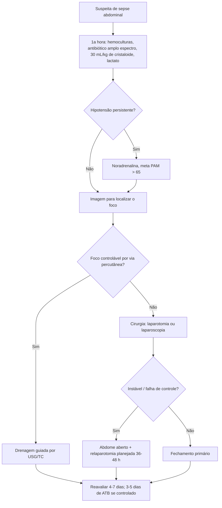

# Sepse Intra-abdominal

> Resumo em palavras próprias do Whitebook (Condutas Cirúrgicas > Cirurgia Geral e do Aparelho Digestivo), sem fisiopatologia, autoria e referências. Confira detalhes e doses na fonte: https://whitebook.pebmed.com.br/conteudo/?id=22588&categoryId=207&subcategoryId=211

**Definição:** resposta inflamatória sistêmica mediada por citocinas a infecção de foco abdominal. A infecção intra-abdominal (IIA) é uma das principais causas de sepse e uma emergência médica; apendicite aguda é a causa mais comum. Infecção em geral polimicrobiana, após cirurgia prévia, perfuração de víscera oca ou contaminação (paracentese).

## Quadro clínico
- Febre, queda do estado geral, taquicardia, taquipneia, disfunção GI (anorexia, náuseas, vômitos, distensão, diarreia); alarme: hipotensão, hipoperfusão (enchimento capilar > 2 s), oligoanúria, alteração de consciência.
- Dor abdominal aguda, abdome em tábua, descompressão dolorosa, massa (abscesso, plastrão). Idosos, diabéticos e imunossuprimidos podem ter clínica discreta.
- **Diagnóstico** clínico-laboratorial; exames não devem retardar ressuscitação e antibiótico; imagem para localizar o foco.
- **qSOFA:** consciência alterada (Glasgow < 15), FR ≥ 22, PAS ≤ 100 (1 ponto cada); **≥ 2** indica pior desfecho. Não diagnostica sepse; é preditor de prognóstico.

## Classificação
- **Origem:** comunitária (sem fatores para multirresistentes) × associada à assistência (após 48 h de internação, internação nos últimos 90 dias, terapia invasiva ambulatorial em 30 dias, multirresistentes).
- **Gravidade:** não complicada (um órgão, sem peritônio; controlada com cirurgia, radiologia ou antibiótico isolado) × complicada (órgãos adjacentes e peritônio; exige cirurgia + antibiótico).
- **Peritonite:** primária (sem perda de integridade do TGI; sem foco; monomicrobiana; ex. PBE); **secundária** (a mais comum; perda da integridade do TGI — apendicite, colecistite, diverticulite complicada, úlcera perfurada; polimicrobiana); **terciária** (persistência/recorrência após tratar a secundária; multirresistentes e fungos).

## Tratamento
Emergência: seguir *bundles* de sepse; iniciar estabilização na **1ª hora**.
- **Bundle da 1ª hora:** 2 sets de hemocultura (aeróbio/anaeróbio), idealmente antes do antibiótico, sem atrasá-lo; antimicrobiano de amplo espectro precoce; lactato como marcador de hipóxia tecidual (não de perfusão); reanimação volêmica; vasopressor quando necessário.
- **Volume:** cristaloide **30 mL/kg**, iniciar em até 1 h e completar em 3 h (mais agressivo se houver disfunção); evitar hiperidratação (edema esplâncnico, hipertensão intra-abdominal, translocação, hipoperfusão); medir pressão intra-abdominal em casos selecionados; guiar por elevação passiva de membros, cava por USG, variação da pressão de pulso (VM). **PAM > 65 mmHg** nas primeiras 6 h; parar se não melhorar a perfusão; sinais de sobrecarga: crepitação bibasal, disfunção cardíaca, edema; tempo de enchimento capilar como adjuvante no choque séptico.
- **Vasoativos:** noradrenalina primeira linha; dobutamina se disfunção miocárdica ou hipoperfusão persistente apesar de volume e PAM adequados.
- **Controle do foco** (tempo é essencial): drenagem percutânea guiada por USG/TC ou cirurgia (laparotomia, laparoscopia).
- **Antibiótico:** choque séptico — imediatamente ou em ≤ 1 h; sepse possível sem choque — investigar e iniciar em ≤ 3 h. Empírico, desescalonar por cultura; considerar comunitária × nosocomial, perfil local, ajuste de dose (função renal, diálise, volume).
  - **Comunitária:** cobrir gram-negativos entéricos (*E. coli*), bacilos facultativos, estreptococo entérico e anaeróbios (*B. fragilis*; delgado/cólon). Monoterapia: amoxicilina-clavulanato, cefoxitina, moxifloxacino, ertapenem, tigeciclina; ou associar a metronidazol: cefazolina, cefuroxima, ceftriaxona, cefotaxima, cipro/levofloxacino. Não usar ampicilina-sulbactam para *E. coli* comunitária; sem cobertura empírica para *Candida* ou *Enterococcus*.
  - **Grave / assistência à saúde:** adicionar *Enterococcus*; piperacilina-tazobactam, imipeném, meropeném, ou cipro/levofloxacino/cefepime/ceftazidima + metronidazol; atenção à resistência a quinolonas; sem cobertura de rotina para MRSA ou fungo.
  - **Multirresistentes:** guiado pela CCIH: meropeném, imipeném, pip-tazo, ceftazidima ou cefepime + metronidazol; pode precisar de aminoglicosídeo, polimixina, colistina; novos agentes (ceftolozana-tazobactam para ESBL; ceftazidima-avibactam para KPC) com parcimônia.
  - **Antifúngico:** risco — cirurgia abdominal recente, fístula anastomótica, pancreatite necrosante grave; indicado em IIA comunitária grave/imunodeprimidos, *Candida* em cultura, nosocomial com risco (Candida Score); equinocandinas (caspofungina, micafungina, anidulafungina); fluconazol só com teste de sensibilidade.
  - ***Enterococcus* (cobrir):** isolado em nosocomial; terapia empírica após uso de cefalosporinas; imunodeprimidos, valvopatia, material intravascular protético — ampicilina, pip-tazo, vancomicina (VRE não de rotina).
  - **MRSA (cobrir):** nosocomial em colonizados, falha prévia ou exposição significativa a antimicrobianos — vancomicina, teicoplanina, daptomicina, linezolida.
  - **Duração:** não complicada (apendicite, colecistite) — sem antibiótico pós-operatório após controle do foco; complicada com controle do foco — **3–5 dias**; peritonite mantida/doença sistêmica > 5–7 dias → manter e avaliar nova intervenção; IIA persistente ou recorrente após 4–7 dias → procurar focos extra-abdominais, causas inflamatórias não infecciosas, novas culturas.
- **Adjuvantes:** corticoide não é rotina nem previne choque; usar com corticoterapia prévia ou suspeita de disfunção adrenal; hidrocortisona 200 mg/dia no choque persistente (evidência fraca). Nutrição enteral precoce após reanimação (preserva mucosa, previne translocação; sem efeito em mortalidade).

## Tratamento cirúrgico
- **Indicações:** coleções difusas, loculadas, complexas, densas; necrose; coleções inacessíveis por via percutânea; peritonite difusa (mesmo sem etiologia definida); perfuração não contida (pneumoperitônio maciço ou líquido distante).
- **Objetivos:** eliminar o foco, controlar fatores perpetuadores. **Passos:** avaliar a cavidade; tratar a causa; reparar ou ressecar perfurações (anastomose primária ou desvio); ressecar alças isquêmicas; desbridar necrose; lavar com grande volume de salina; drenar coleções (pelve, goteiras, subfrênico).
- **Manejo da cavidade:** peritoneostomia, curativo de pressão negativa na cavidade aberta, ou fechamento primário. Via laparotômica mediana ou laparoscópica.
- **Estratégia no instável / alto risco de falha:** relaparotomia **planejada** em 36–48 h (inspeção, drenagem, lavagem até controle) ou **por demanda** (somente quando absolutamente necessário). Indicações para abdome aberto: falha de controle do foco, risco de disfunção após drenagem/desbridamento, impossibilidade de fechar (edema, perda aponeurótica), síndrome compartimental (risco ou instalada), cirurgia de controle de danos. Objetivo: estabilizar e depois fechar definitivamente; opções de contenção: VAC, tela com velcro (Wittman), bolsa de Bogotá, suturas dinâmicas (ABRA), combinações; pode-se aceitar hérnia ventral planejada.

## Fatores de pior prognóstico
Intervenção inicial tardia (> 24 h); APACHE II ≥ 15; idade ≥ 70; comorbidades e disfunção orgânica; hipoalbuminemia; desnutrição; peritonite difusa; incapacidade de desbridar ou controlar a drenagem; neoplasia associada.

## Fluxograma (refeito, a partir do texto)

