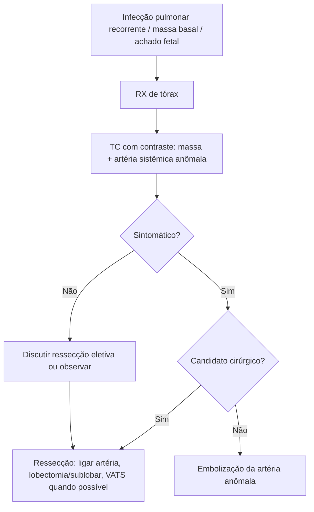

# Sequestro Pulmonar

> Resumo em palavras próprias do Whitebook (Condutas Cirúrgicas > Cirurgia Pediátrica), sem fisiopatologia detalhada, autoria e referências. Confira detalhes e doses na fonte: https://whitebook.pebmed.com.br/conteudo/?id=44930&categoryId=207&subcategoryId=826

**Definição:** malformação congênita com massa de tecido pulmonar não funcionante, desconectada da árvore traqueobrônquica normal e suprida por artéria sistêmica anômala. Sinônimos: sequestro broncopulmonar, sequestro pulmonar congênito.

## Epidemiologia
- 0,5–6% das malformações pulmonares; mais comum à esquerda e nas bases (associado à síndrome de cimitarra, mais à direita).
- Suprimento arterial da aorta torácica em 74%; também da aorta abdominal, tronco celíaco, intercostais, subclávia, esplênica/gástrica esquerda ou coronárias.
- Embriologia desconhecida: provável falha na separação das circulações pulmonar e sistêmica (broto pulmonar supranumérico ou deficiência vascular primária). Risco aumentado de infecção (bactérias colonizam pelos poros de Kohn).
- **Anatomopatológico:** massa cística ou sólida com elementos pulmonares normais; inflamação linfocítica e fibrose; sem estrutura brônquica funcional; em geral sem comunicação com o pulmão vizinho.

## Subtipos
**Intralobar:** segmento posterior do lobo inferior esquerdo; drenagem por veias pulmonares (95%); forma mais comum (75–86%); artéria da aorta torácica descendente (75%); assintomáticos ou com infecções recorrentes; diagnóstico tardio (metade após os 20 anos).
**Extralobar:** seio costofrênico ou bilateral (mais à esquerda), infradiafragmático; predomina em neonatos masculinos; anomalias associadas (hidropsia, hérnia diafragmática, pectus excavatum, MAC, fístula traqueoesofágica, duplicações); ~50% formam lesões híbridas com malformação adenomatoide; artéria geralmente da aorta abdominal; drenagem sistêmica (ázigos/hemiázigos, VCI, átrio direito); em geral assintomático; pode causar shunt esquerda-direita neonatal; raro no mediastino ou retroperitônio.

| Característica | Intralobar | Extralobar |
|---|---|---|
| Prevalência relativa | 6:1 | 1:6 |
| Idade | adultos e crianças | neonatos |
| Sexo | 1:1 | 80% masculino |
| Localização | 60% base esquerda, 40% direita | 90% à esquerda |
| Pleura | visceral comum | própria |
| Drenagem venosa | veias pulmonares (95%) | sistêmica (75%) |
| Anomalias associadas | raras (6–12%) | comuns (65%) |

## Clínica
- **Fetos:** polidrâmnio, hidropsia, derrame pleural, massa pulmonar.
- **Crianças/adultos:** infecções respiratórias recorrentes, dor torácica e broncospasmo nas infecções, broncossupuração, disfunção diafragmática/disfagia, dispneia, hemotórax espontâneo (aneurisma do vaso), abscesso, atelectasia, bronquiectasia, hemoptise maciça (rara), atraso do crescimento, insuficiência cardíaca; fluxo alto pode simular valvopatia. Pode ser achado incidental, sobretudo em idosos.

## Diagnóstico
Objetivo: afastar outras doenças e mostrar a artéria anômala.
- **RX de tórax:** inespecífico; opacidade homogênea no segmento basal posterior esquerdo ou massa entre o lobo inferior e o diafragma; nível hidroaéreo se houver comunicação; simula pneumonia.
- **TC com contraste:** em geral diagnóstica; massa entre lobo inferior e diafragma, consolidação ± cistos, bronquiectasia, cavitação; origem e trajeto dos vasos; hiperlucência (aprisionamento aéreo) nos intralobares.
- **Doppler/RM:** origem da artéria aberrante.
- **Angiografia:** padrão-ouro para demonstrar irrigação sistêmica, mas pouco realizada; artéria em ramo da aorta visível em 30% (patognomônico).
- **Diferencial:** abscesso, pneumonia necrosante, tuberculose, bronquiectasia, micetoma; MAC, hérnia diafragmática, cisto broncogênico/pericárdico, rim intratorácico; hematopoiese extramedular, meningocele lateral; tumor neurogênico, neoplasia pulmonar, tumores retroperitoneais.

## Tratamento
**Ressecção cirúrgica** é a escolha, sobretudo se sintomático (riscos: infecção recorrente, *Aspergillus*, malignização, hemoptise maciça); momento controverso no assintomático. Identificar antes a artéria anômala.
- Controle do suprimento arterial (no ligamento pulmonar nos intralobares), depois lobectomia ou ressecção sublobar; intralobar: ressecção anatômica; extralobar: ligadura vascular e ressecção isolada; videotoracoscopia com bons resultados; infecções prévias destroem o plano intersegmentar.
- **Riscos:** sangramento, infarto pulmonar, hemoptise, empiema, quilotórax, dor crônica, pneumonia, fístula aérea prolongada.
- **Embolização endovascular** (poucos relatos, mais no extralobar): molas, poliacetato de vinila, Gelfoam®, N-butilcianocrilato, plugues Amplatzer®; indicada em contraindicação cirúrgica, hemoptise, preparo pré-operatório e sangramento pós-operatório. Riscos: migração do material, dor, infecção da punção, oclusão incompleta, colaterais, shunts.

## Complicações e prognóstico
Infecções recorrentes, fístula com via aérea/trato digestivo, hemoptise, hemotórax, fungos, abscesso, malignização (carcinoma, mesotelioma), torção com infarto (extralobar). Mau prognóstico com hidropsia fetal, hipoplasia pulmonar ou derrame pleural volumoso.

## Fluxograma (refeito, a partir do texto; o original não traz algoritmo)

