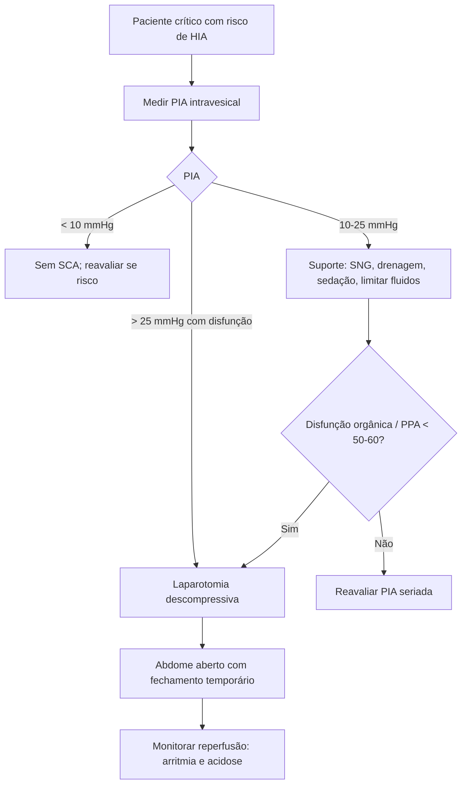

# Síndrome Compartimental Abdominal

> Resumo em palavras próprias do Whitebook (Condutas Cirúrgicas > Cirurgia Geral e do Aparelho Digestivo), sem fisiopatologia, autoria e referências. Confira detalhes e doses na fonte: https://whitebook.pebmed.com.br/conteudo/?id=23720&categoryId=207&subcategoryId=211

**Definição:** disfunção orgânica causada por hipertensão intra-abdominal (HIA), exigindo reconhecimento e intervenção imediatos; associada a pacientes críticos, com ou sem trauma. Pressão intra-abdominal (PIA) normal no crítico: **5–7 mmHg**; obesidade mórbida e gravidez podem manter 10–15 mmHg sem consequências.

## Repercussões por sistema
- **Cardiovascular:** menor débito por compressão cardíaca (ascensão do diafragma, a partir de ~10 mmHg) e menor retorno venoso (compressão da cava); hipovolemia e PEEP alta pioram.
- **Respiratório:** menor volume corrente, maior resistência vascular pulmonar, barotrauma, hipoxemia, hipercapnia, mais infecção pulmonar.
- **Renal:** menor fluxo e filtração (compressão da veia renal, vasoconstrição da artéria renal por SNS e SRAA); oligúria a ~15 mmHg, anúria a ~30 mmHg; risco maior de IRA.
- **Gastrintestinal:** o intestino é muito sensível (fluxo mesentérico cai desde ~10 mmHg; perfusão da mucosa a partir de 20 mmHg), isquemia, acidose láctica, translocação bacteriana e sepse; o fígado perde a capacidade de depurar lactato a ~10 mmHg.
- **SNC:** pressão intracraniana elevada e menor perfusão cerebral.

## Quadro clínico e classificação
- Ocorre em pacientes clínicos e cirúrgicos (inclusive cirurgias não abdominais). Em geral o paciente é crítico e não se comunica. Achados: abdome tenso, oligúria progressiva, piora dos parâmetros ventilatórios, hipotensão, taquicardia, turgência jugular, edema, taquipneia, hipoperfusão (pele fria, obnubilação, acidose láctica). Difícil em crianças.
- **Primária:** lesão ou doença abdominopélvica (trauma, hemoperitônio, pancreatite). **Secundária:** causas extra-abdominais (reanimação volêmica, sepse, queimaduras). **Recorrente:** recidiva após episódio prévio.
- Situações: trauma com reanimação, queimaduras > 30% SC, transplante hepático (PIA > 25 mmHg em 32%), ascite maciça, distensão de alças, megacólon tóxico, volvo, tumores, sangramento intraperitoneal, causas retroperitoneais (AAA roto, fratura pélvica, pancreatite), pós-operatório com grandes volumes de cristaloide.

## Diagnóstico
- Laboratório (lactato, creatinina, função hepática) mostra disfunção, mas nenhum exame é suficientemente sensível/específico. RX de tórax: atelectasia, hemicúpulas elevadas. **TC:** distensão maciça, espessamento de parede, compressão da cava, hérnia inguinal bilateral, compressão renal, infiltração retroperitoneal; identifica causas (ascite, hematoma, massa). **USG:** não mede PIA, mas avalia SNG, distensão gástrica, atividade intestinal, líquido livre, bexiga.
- **Medida da PIA (necessária):** intravesical é o método padrão (também intragástrico, intracolônico, cateter de cava). Técnica: esvaziar a bexiga, instilar soro fisiológico estéril incluindo o cateter, conectar ao transdutor (três vias para evitar punções), zerar na linha axilar média, medir no fim da expiração em decúbito dorsal sem contração abdominal. Imprecisa com aderências, hematoma ou fratura pélvica, bolsas abdominais, bexiga neurogênica.
- **Graus de HIA** (adulto): I 12–15 mmHg; II 16–20; III 21–25; IV > 25. (A fonte traz uma segunda escala — I 10–12, II 13–15, III 16–19, IV ≥ 20 — provavelmente para crianças; confira na fonte.)
- PIA < 10 mmHg em geral não há SCA; > 25 mmHg normalmente há; 10–25: duvidoso. Crianças têm PIA basal menor e podem desenvolver SCA com 10 mmHg. Complacência parietal crônica aumentada (gravidez, cirrose com ascite, obesidade) protege.
- **Diferenciais:** isquemia mesentérica, AAA roto, megacólon tóxico, causas inflamatórias (apendicite, diverticulite).

## Tratamento
Suporte, tratar a causa e, quando necessário, descomprimir. Cinco componentes: evacuar conteúdo intraluminal; remover líquido ou massas intra-abdominais; melhorar a complacência da parede; otimizar fluidos e perfusão; considerar laparotomia descompressiva. Descompressão cirúrgica é o tratamento definitivo (exceções: escarotomia em queimados e drenagem de ascite tensa).
- **Suporte:** SNG e sonda retal; drenar ascite, hemoperitônio, abscesso e hematoma por via percutânea quando possível; retirar curativos constritivos; analgesia, sedação, bloqueio neuromuscular, toxina botulínica; cabeceira > 20° reduz pneumonia associada à ventilação, mas aumenta a PIA; ventilação com menor volume corrente, pressão controlada, hipercapnia permissiva. Em HIA, limitar fluidos reduz o risco de SCA; em SCA, volume melhora transitoriamente o débito mas não trata a síndrome.
- **Cirurgia:** consenso de que a descompressão é indicada, sem limiar exato — em geral **PIA > 25 mmHg**; algumas fontes aceitam 15–25 mmHg para melhorar a perfusão. **Pressão de perfusão abdominal (PPA = PAM − PIA) > 60 mmHg** é o ideal; PPA < 50 mmHg prediz mortalidade melhor que outros indicadores.
- **Técnica:** laparotomia mediana pela linha alba, na sala ou à beira do leito na UTI; manter o abdome aberto com fechamento temporário (curativo de pressão negativa, silo/patch, peritoneostomia; troca a cada 48 h) e aproximar as bordas.
- **Atenção:** a descompressão melhora súbito a função respiratória e cardiovascular, mas a reperfusão libera conteúdo intracelular (arritmia, acidose); risco de assistolia/parada de até 25% na descompressão.
- **Prognóstico:** pior com atraso no reconhecimento (preditor independente de mortalidade); protocolos de monitorização melhoram.

## Fluxograma (refeito, a partir do texto; o texto original não traz uma figura)

