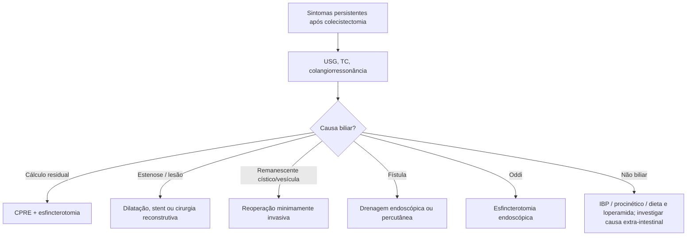

# Síndrome Pós-colecistectomia

> Resumo em palavras próprias do Whitebook (Condutas Cirúrgicas > Cirurgia Geral e do Aparelho Digestivo), sem fisiopatologia, autoria e referências. Confira detalhes e doses na fonte: https://whitebook.pebmed.com.br/conteudo/?id=45410&categoryId=207&subcategoryId=211

**Definição:** conjunto de sintomas persistentes ou recorrentes após colecistectomia, de causa biliar ou não biliar.

## Quadro clínico
Dor abdominal, sintomas dispépticos, icterícia, diarreia e outros sintomas gastrointestinais.

## Diagnóstico
USG das vias biliares, TC de abdome, colangiografia e colangiorressonância.

## Classificação
- **Precoce** (pós-operatório): lesão biliar, ducto cístico retido, cálculos no colédoco.
- **Tardia** (meses a anos): cálculos recorrentes no colédoco, estenose de via biliar, ducto cístico inflamado ou vesícula remanescente, estenose papilar, discinesia biliar (disfunção do esfíncter de Oddi).
- **Causas gastrointestinais:** SII, pancreatite, tumores pancreáticos, pâncreas divisum, hepatite, úlcera péptica, isquemia mesentérica, diverticulite, doenças esofágicas.
- **Causas extra-intestinais:** neurite intercostal, neuroma cicatricial, doença coronariana, distúrbios psicossomáticos.

## Tratamento (conforme a causa)
- Coledocolitíase residual: CPRE com esfincterotomia.
- Lesão ou estenose de via biliar: dilatação endoscópica, stents, ou cirurgia reconstrutiva nos casos complexos.
- Vesícula ou cístico remanescente: reoperação (de preferência minimamente invasiva).
- Fístula biliar: drenagem endoscópica ou percutânea.
- Disfunção do esfíncter de Oddi: esfincterotomia endoscópica.
- Refluxo duodenogástrico e dispepsia funcional: IBP, procinéticos.
- Diarreia: dieta com menos gordura e refeições fracionadas; loperamida se intensa.

## Fluxograma (refeito, a partir do texto; o texto original não traz uma figura)

