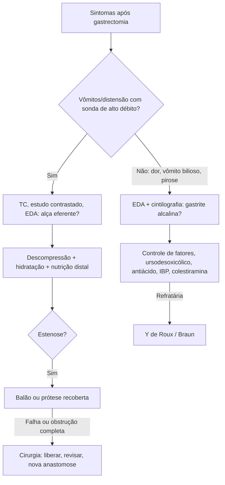

# Síndrome de Alças Pós-gastrectomias

> Resumo em palavras próprias do Whitebook (Condutas Cirúrgicas > Cirurgia Geral e do Aparelho Digestivo), sem fisiopatologia, autoria e referências. Confira detalhes e doses na fonte: https://whitebook.pebmed.com.br/conteudo/?id=64474&categoryId=207&subcategoryId=211

**Definições:** a síndrome das alças é o conjunto de complicações mecânicas por obstrução parcial ou completa da alça aferente (retém secreção biliopancreática) ou eferente (impede a progressão do alimento) após reconstruções digestivas. A gastrite alcalina é a inflamação da mucosa gástrica por refluxo de bile, suco pancreático e conteúdo duodenal, em geral por perda da barreira pilórica ou alteração anatômica.

## Síndrome da alça eferente
- Rara, menos descrita que a da alça aferente. Após gastrectomia com Billroth II, Y de Roux ou pancreatoduodenectomia.
- **Clínica:** dor, distensão gástrica/abdominal, náusea, vômitos alimentares ou biliosos, intolerância à dieta, drenagem nasogástrica alta ou persistente. Obstrução completa impede a progressão alimentar e exige tratamento oportuno.
- **Diagnóstico:** TC (dilatação, ponto de transição, complicações); estudo contrastado (contraste não progride para a alça eferente); EDA (avalia a anastomose, diferencia os óstios aferente e eferente, vê edema, estenose, angulação, exclui lesões mucosas e testa se é possível transpor a obstrução); enterografia contrastada (localiza e delimita a estenose, inclusive durante a intervenção).
- **Tratamento:** descompressão por sonda nasogástrica ou gastrojejunal, hidratação, reposição de eletrólitos e nutrição enteral distal à obstrução. Endoscópico: dilatação pneumática com balão (no pós-operatório recente, risco de perfuração e de comprometer a anastomose); prótese metálica totalmente recoberta após falha do conservador ou da dilatação (dilatação progressiva; migração é a complicação relevante, e se for distal pode obstruir ou perfurar). **Cirurgia:** obstrução completa, estenose persistente, falha do conservador/endoscópico ou impossibilidade técnica — corrigir a causa mecânica e restabelecer o trânsito (liberar aderências, revisar a reconstrução, nova anastomose).
- **Complicações/prognóstico:** desidratação, distúrbios eletrolíticos, comprometimento nutricional; as da prótese são migração, nova estenose, obstrução e perfuração. Prognóstico bom com diagnóstico e tratamento precoces.

## Gastrite de refluxo alcalino (biliar)
- **Primária** (sem cirurgia gástrica) ou **secundária** (alteração anatômica ou perda do piloro). Após gastrectomia distal, Billroth I e II têm mais refluxo biliar e gastrite do coto que o Y de Roux.
- **Clínica:** inespecífica e sem relação direta com o volume do refluxo — dor epigástrica, dispepsia, distensão, náusea, vômito bilioso, gosto amargo, anorexia, pirose, perda de peso; alguns são assintomáticos. Pequenos refluxos duodenogástricos são fisiológicos (após refeição, jejum, náusea/esforço, endoscopia).
- **Diagnóstico:** correlação clínica + evidência objetiva de refluxo + achados endoscópicos e histológicos; bile isolada no estômago não confirma. EDA (bile, hiperemia, edema, erosões, pregas espessadas; baixa especificidade, o exame pode induzir refluxo; permite aspirar e biopsiar); cintilografia hepatobiliar (sensível, não invasiva; limitada por custo, radiação, baixa resolução anatômica, sem quantificar volume e composição); fibra óptica para bilirrubina (pouco tolerada, pouco consolidada); impedanciopHmetria (não identifica bile); monitoramento biliar de 24 h (episódios prolongados ≥ 5 min); aspirado gástrico (pode dar falso-negativo pela natureza intermitente).
- **Tratamento clínico:** parar tabagismo e álcool, controlar glicemia, alimentação regular, tratar dismotilidade, erradicar *H. pylori* se presente. Ácido ursodesoxicólico 250 mg VO 1×/dia (à noite) por 4–8 semanas; hidróxido de alumínio 5–10 mL VO 4×/dia, 15 min antes das refeições e ao deitar; IBP em dose única pela manhã (omeprazol 40 mg, lansoprazol 30 mg, pantoprazol 40 mg, rabeprazol 20 mg, esomeprazol 40 mg, dexlansoprazol 30–60 mg); colestiramina 4–8 g/dia VO pela manhã.
- **Cirurgia:** sintomas persistentes sem resposta clínica e anatomia corrigível, para desviar a bile do estômago. Reconstrução em Y de Roux reduz a exposição; anastomose de Braun sobre Billroth II também desvia, mas a eficácia é controversa.
- **Complicações/prognóstico:** atrofia da mucosa, metaplasia intestinal, displasia, adenocarcinoma gástrico (relacionados à intensidade e duração do refluxo); resposta variável e recidiva elevada com monoterapia; certeza da evidência do ursodesoxicólico baixa ou muito baixa; Y de Roux pode causar hérnia interna, úlcera jejunal perto da gastrojejunostomia e síndrome de estase da alça de Roux.

## Fluxograma (refeito, a partir do texto; o original não traz algoritmo)

