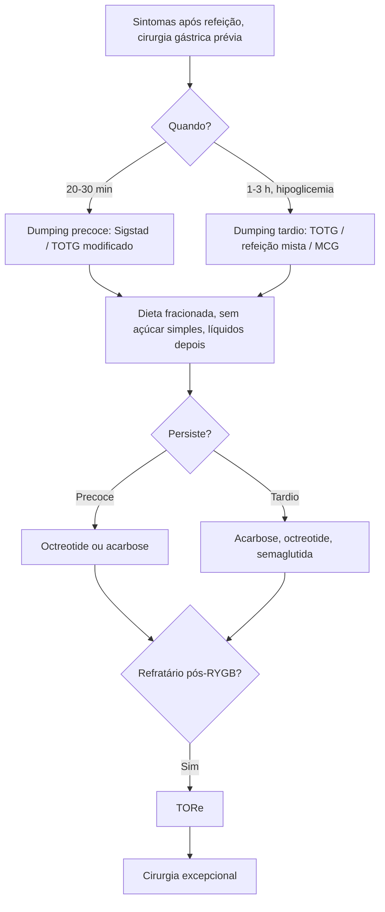

# Síndrome de Dumping Pós-cirurgias Gástricas

> Resumo em palavras próprias do Whitebook (Condutas Cirúrgicas > Cirurgia Geral e do Aparelho Digestivo), sem fisiopatologia, autoria e referências. Confira detalhes e doses na fonte: https://whitebook.pebmed.com.br/conteudo/?id=22599&categoryId=207&subcategoryId=211

**Definição:** complicação funcional do esvaziamento gástrico acelerado após cirurgias gástricas ou esofagogástricas, com sintomas digestivos e sistêmicos após as refeições.

| | Dumping precoce | Dumping tardio |
|---|---|---|
| Início | 20–30 min | 1–3 h |
| Mecanismo | Hiperosmolaridade | Hipoglicemia |
| Hormônios | Neurotensina, GLP-1, PYY | GLP-1, GIP |
| Sintomas | Gastrointestinais + vasomotores | Neuroglicopenia |

## Dumping precoce
- **Contexto:** mais comum que o tardio; perda ou disfunção do piloro. Após Billroth I ou II, gastrectomia total, vagotomia com drenagem, bypass em Y de Roux (RYGB) e bypass de anastomose única (OAGB).
- **Frequência:** 25–50% após gastrectomia; até 70% após bariátrica; OAGB 9–42,9% pelo escore de Sigstad (0,5–27,8% por autorrelato); Billroth II 50–60%.
- **Clínica (20–30 min após a refeição):** náusea, vômito, plenitude, eructações, distensão, cólica e diarreia explosiva; palpitações, taquicardia, sudorese, tontura, rubor, visão turva, síncope ou pré-síncope.
- **Diagnóstico:** relação temporal com a refeição. **Sigstad:** pré-choque/choque +5; perda de consciência +4; vontade de deitar/sentar +4; dispneia +3; exaustão +3; sono/apatia/visão turva +3; palpitação +3; inquietação +2; tontura +2; cefaleia +1; calor/palidez/pele pegajosa +1; náusea +1; distensão/meteorismo +1; borborigmos +1; eructação −1; vômitos −4. **> 7:** dumping precoce; 5–7 indeterminado; ≤ 4 exclui. O consenso internacional prefere o **TOTG modificado** (glicose, hematócrito, FC e PA a cada 30 min por 3 h): positivo se Ht aumenta > 3% **ou** FC > 10 bpm aos 30 min. Questionários (Sigstad, Arts, escala de sintomas) para triagem; EDA e estudos contrastados para excluir outras causas.
- **Tratamento:** dieta primeiro — refeições pequenas e frequentes, evitar açúcares simples, mais fibras, separar líquidos de sólidos e adiar líquidos ≥ 30 min, mais proteína e gordura (em menor quantidade). Fármacos se persistir:
  - *Octreotide* de ação curta 25–50 µg SC 30 min antes das refeições (até 50–100 µg); ou LAR 20 mg IM a cada 30 dias.
  - *Acarbose* 25 mg VO 3×/dia no início das refeições, titulando até 50–100 mg 3×/dia.
  - Pós-RYGB refratário: **TORe** (redução endoscópica da anastomose gastrojejunal, por cauterização ou sutura) — melhora do Sigstad, poucos eventos adversos e reintervenções, nenhuma morte nos estudos; pode ser repetida; poucos precisam de revisão cirúrgica.
  - **Cirurgia:** < 1% (refratários ou graves desde o início) para melhorar o reservatório e retardar o esvaziamento: segmentos jejunais isoperistálticos ou antiperistálticos (maior sucesso) ou Y de Roux com alça longa.

## Dumping tardio (hipoglicemia pós-bariátrica)
- Hipoglicemia reativa pós-prandial 1–3 h (2–3 h) após a refeição; menos comum, isolado ou associado ao precoce. Após RYGB, cerca de 80% dos afetados podem ficar assintomáticos; com semaglutida, dumping e hipoglicemia reativa em ~20–40% pós-RYGB (metanálises). Após OAGB, o manejo é sobretudo nutricional.
- **Clínica:** sudorese, tremores, tontura, taquicardia, confusão; palpitações, irritabilidade.
- **Diagnóstico:** suspeita após refeição rica em carboidratos; questionário validado; TOTG modificado (positivo se glicemia < 50 mg/dL entre 60 e 180 min) ou teste de refeição mista; monitoramento contínuo de glicose se testes negativos com alta suspeita (ainda não validado pelo consenso Delphi); excluir estenoses, aderências e insulinoma. O questionário de Arts diferencia precoce de tardio.
- **Tratamento:** pequenas refeições frequentes, menos carboidratos, separar líquidos e sólidos, adiar líquidos. Pectina (isolada ou com acarbose) retarda a absorção de carboidratos; diazóxido sem valor estabelecido (retenção hídrica, hipotensão, hirsutismo); análogos de somatostatina como no precoce; **semaglutida 2,4 mg semanal** (paradoxalmente reduz episódios, melhora escores e variabilidade glicêmica; efeito atribuído a esvaziamento mais lento, modulação da insulina e dessensibilização do receptor de GLP-1); TORe como opção; cirurgia excepcional.

| Tratamento | Precoce | Tardio |
|---|---|---|
| Dieta | + | + |
| Acarbose | +/- | +++ |
| Octreotide | +++ | ++ |
| Semaglutida | - | evidência emergente |
| TORe | + | + |
| Cirurgia | excepcional | excepcional |

## Fluxograma (refeito, a partir do texto; o original é a tabela comparativa acima)

