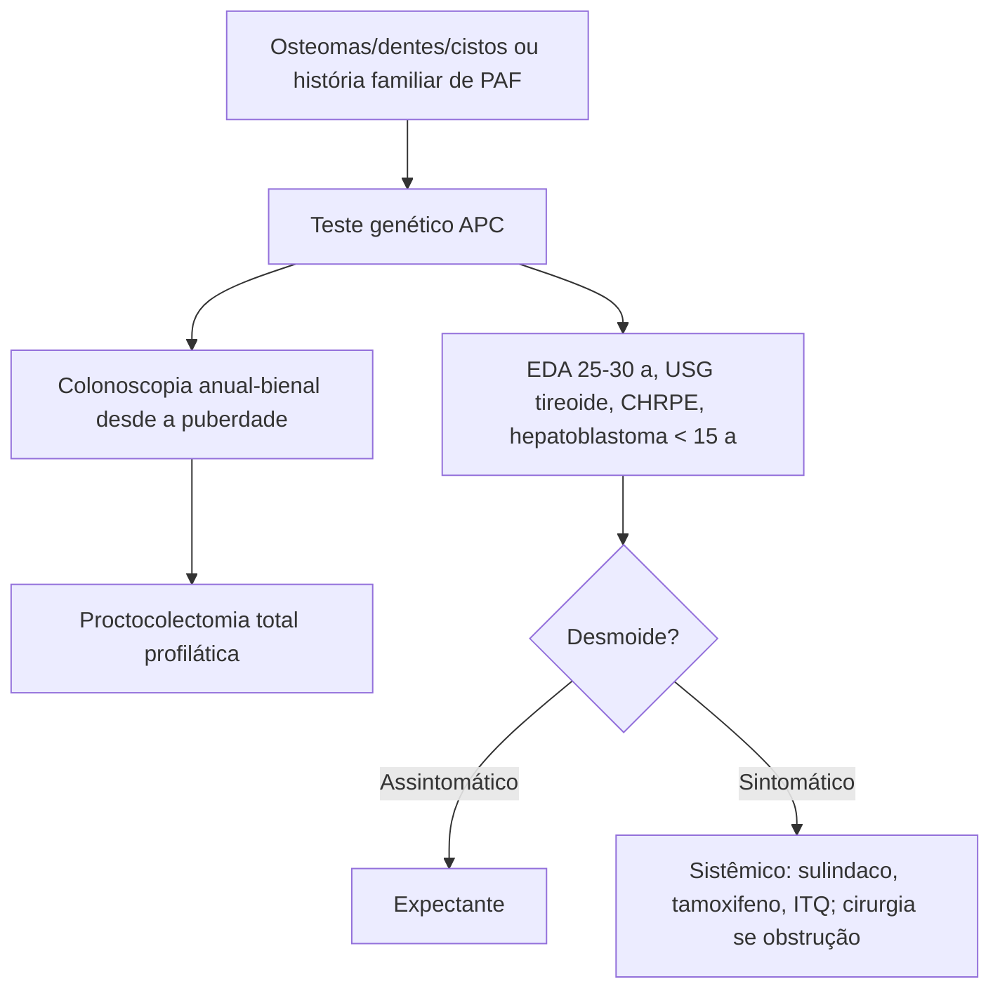

# Síndrome de Gardner

> Resumo em palavras próprias do Whitebook (Condutas Cirúrgicas > Cirurgia em Coloproctologia), sem fisiopatologia, autoria e referências. Confira detalhes e doses na fonte: https://whitebook.pebmed.com.br/conteudo/?id=44554&categoryId=207&subcategoryId=213

**Definição:** variante da polipose adenomatosa familiar (PAF) com manifestações extraintestinais — osteomas de mandíbula/crânio, dentes supranumerários, cistos epidermoides. Rara, autossômica dominante, penetrância ~100%; mutação do gene APC.

## Manifestações extraintestinais benignas
- **Osteomas:** crânio/mandíbula (qualquer osso), sem malignização, problema estético; podem preceder a polipose; 60–80% dos PAF.
- **Dentárias:** dentes supranumerários, cistos dentígeros, odontomas, agenesia, inclusos; 30–75% dos PAF; podem preceder a polipose.
- **Cutâneas:** cistos epidermoides, fibromas, lipomas, pilomatricomas.
- **Tumores desmoides:** 5–25%; mais abdominais, mas em qualquer estrutura musculoaponeurótica; benignos (sem metástase), mas com alta morbimortalidade (infiltram, comprimem vasos, causam obstrução ou fístulas); cirurgia estimula o crescimento; pico aos 30–40 anos; histologia igual aos esporádicos.
- **CHRPE** (hipertrofia congênita do epitélio pigmentar da retina): comum, sem repercussão clínica (um caso de transformação maligna).
- **Adenomas de adrenal:** achados incidentais, até 15%, malignização rara. **Angiofibromas nasais:** benignos, comportamento agressivo.

## Lesões malignas extracolônicas
Duodenal e periampular; tireoide (2,6% dos PAF, ~8× a população, média 33 anos, papilífero); pâncreas (adenocarcinoma 4×); gástrico; SNC (meduloblastoma — síndrome de Turcot); hepatoblastoma (meninos até 5 anos); delgado distal ao duodeno (raro); vesícula/vias biliares; adrenal.

## Rastreamento (todo paciente com Gardner)
- **Colonoscopia:** iniciar na puberdade (mutação identificada, ou parentes de 1º grau sem teste/inconclusivo), a cada 1–2 anos até a proctocolectomia total.
- **EDA** a partir dos 25–30 anos (frequência pelo estágio dos pólipos); a cada 1–3 anos com visão lateral para duodeno e papila.
- Exame físico e **USG de tireoide** anuais a partir dos 10–12 anos. **CHRPE:** lâmpada de fenda/oftalmoscopia indireta. Anamnese neurológica; RM de crânio se neoplasia cerebral familiar.
- **Hepatoblastoma:** nos primeiros 5 anos (e de 5 a 15 anos pelo trecho do texto) — palpação do fígado, função hepática, USG abdominal e AFP; pode suspender aos 10–15 anos.
- Outras neoplasias extracolônicas (pâncreas) só se sintomas ou história familiar. **Desmoides:** sem triagem; anamnese e exame físico; razoável TC de abdome com contraste oral a cada 3 anos dos 20 aos 25 anos.

## Tratamento
- **Proctocolectomia total profilática** após a puberdade (PAF clássica: risco de CCR ~100%).
- **Desmoides:** conduta expectante se assintomático/pouco sintomático; sintomáticos — terapia sistêmica (tamoxifeno, ITQs sorafenibe/pazopanibe/sunitinibe, quimioterapia, radioterapia, sulindaco) como alternativa à cirurgia quando esta é mórbida; cirurgia só se houver sintomas (dor, obstrução).
- Lesões malignas: caso a caso.

## Fluxograma (refeito, a partir do texto; o original não traz algoritmo)

