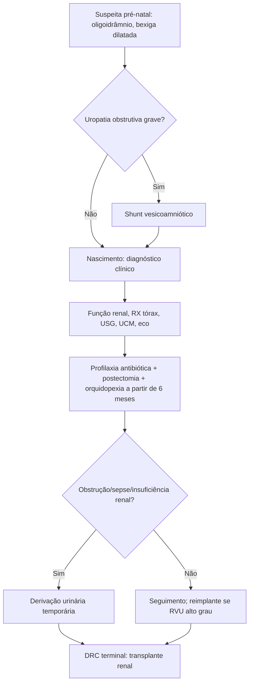

# Síndrome de Prune Belly

> Resumo em palavras próprias do Whitebook (Condutas Cirúrgicas > Cirurgia Pediátrica), sem fisiopatologia detalhada, autoria e referências. Confira detalhes e doses na fonte: https://whitebook.pebmed.com.br/conteudo/?id=44926&categoryId=207&subcategoryId=826

**Definição:** síndrome de Eagle-Barrett; doença congênita rara definida pela tríade **deficiência da musculatura abdominal, anomalias do trato urinário e distopia testicular**. "Barriga de ameixa" = parede abdominal enrugada pela ausência parcial ou total dos músculos.

## Epidemiologia
- Incidência de 3,8 por 100.000 nascidos vivos; maioria esporádica, cariótipo normal; quase só em meninos (< 5% em meninas, sem alteração gonadal).
- ~70% têm doença multissistêmica (cardiopulmonar, digestiva, musculoesquelética). ~75% têm refluxo vesicoureteral, em geral bilateral.
- Espectro vai de incompatível com a vida a envelhecimento normal; prognóstico depende da **displasia renal**. Mortalidade perinatal 10–25%, ligada à hipoplasia pulmonar por oligoidrâmnio (sequência de Potter).

## Clínica
Gravidade da displasia renal, das anomalias urinárias e da hipoplasia pulmonar definem a evolução (ITU, sepse urinária, insuficiência renal e respiratória). Achados: parede abdominal de ameixa (aplasia/hipoplasia muscular, uni ou assimétrica); **criptorquidia bilateral**; constipação crônica (Valsalva deficiente); intolerância ao exercício (movimento paradoxal do abdome); retardo de crescimento em até 1/3; malformações anorretais; torção esplênica; ceco móvel, cólon alongado e volvo; anomalias musculoesqueléticas e cardíacas.

## Diagnóstico
- **Pré-natal:** oligoidrâmnio, uretero-hidronefrose, bexiga distendida, rins policísticos/displásicos, ascite fetal, parede abdominal deficiente, pulmões hipoplásicos; difícil distinguir de **válvula de uretra posterior** (bexiga dilatada e hidronefrose bilateral em ambas).
- **Pós-natal:** clínico. Displasia grave costuma coexistir com hipoplasia pulmonar (natimorto ou óbito neonatal precoce; se sobreviver, ventilação agressiva e baixa sobrevida). Pode ser reconhecida tardiamente, até em adultos como causa rara de IRC terminal.
- **Exames:** ureia, creatinina, eletrólitos e gasometria; RX de tórax (pulmões pequenos); USG de abdome e vias urinárias; **uretrocistografia miccional** (refluxo, uretra, esvaziamento); urodinâmica (baixa contratilidade do detrusor); ecocardiograma.

## Seguimento
Cerca de metade dos que sobrevivem aos primeiros anos desenvolve DRC. Predizem DRC: rins bilateralmente anormais na USG, **creatinina > 0,7 mg/dL** e pielonefrite. Imagem do trato urinário pode destoar da função renal (nem sempre confiável para obstrução). Hipoplasia pulmonar é a complicação mais importante; deformidade torácica e movimentos paradoxais predispõem a tosse ineficaz, bronquite de repetição e depressão respiratória na anestesia. Pacientes com intervenção intrauterina têm melhor prognóstico que na VUP.

## Tratamento
- **Pré-natal:** casos graves de uropatia obstrutiva → *shunt* vesicoamniótico (previne evolução neonatal fatal por hipoplasia pulmonar).
- **Pós-natal — metas:** preservar função renal e trato superior, esvaziamento vesical adequado, imagem corporal/qualidade de vida, fertilidade e função sexual.
- **Profilaxia antibiótica** (RVU, estase ureteral, esvaziamento deficiente).
- **Postectomia** (alto risco de ITU).
- **Orquidopexia:** o mais cedo possível, a partir de **6 meses** (momento individualizado conforme a reconstrução urinária).
- **Derivação urinária temporária** (vesicostomia ou ureterostomia) para prevenir insuficiência renal aguda/sepse; frequente atresia/obstrução uretral com úraco patente.
- **Reimplante ureteral** para RVU de alto grau ou refratário.
- **Cistoplastia redutora:** não de rotina (a bexiga volta a aumentar e perder tônus); pode ser adjuvante da reconstrução ureteral.
- **Transplante renal** é a terapia de escolha na doença renal terminal (preventivo ou após diálise), com preparo para reduzir o volume pós-miccional; hemodiálise e diálise peritoneal têm eficácia semelhante.
- **Parede abdominal:** reconstrução por motivos estéticos e psicossociais (retirar pele redundante poupando o umbigo; pode melhorar bexiga e intestino; abdominoplastia extraperitoneal se não houver procedimento intra-abdominal; transposição de músculos da coxa para estabilidade axial e prevenção de cifoescoliose); correção precoce simultânea é aconselhável mas discutida. Cirurgia ortopédica para escoliose rara.

## Prognóstico
De incompatível com a vida a vida normal; mortalidade perinatal 10–25% (prematuridade, hipoplasia pulmonar; cardiopatia também pesa). Antes se julgava infertilidade (criptorquidia, colo incompetente com ejaculação retrógrada, hipoplasia prostática), mas com os avanços e a reprodução assistida muitos têm filhos.

## Fluxograma (refeito, a partir do texto; o original não traz algoritmo)

