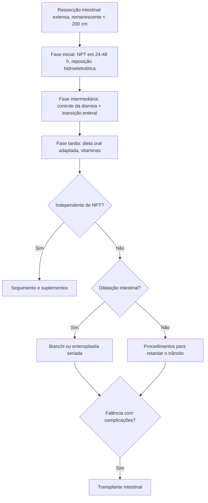

# Síndrome do Intestino Curto

> Resumo em palavras próprias do Whitebook (Condutas Cirúrgicas > Cirurgia Geral e do Aparelho Digestivo), sem fisiopatologia, autoria e referências. Confira detalhes e doses na fonte: https://whitebook.pebmed.com.br/conteudo/?id=39186&categoryId=207&subcategoryId=211

**Definição:** má absorção global por ressecção intestinal extensa, com intestino remanescente **< 200 cm**. Sinônimos: falência intestinal por ressecção extensa, intestino curto funcional.

## Etiologia
- **Congênita:** atresia, gastrósquise, volvo do intestino médio por má rotação. **Recém-nascidos:** enterocolite necrosante. **Crianças:** complicações pós-cirúrgicas, tumores, trauma.
- **Adultos:** doença vascular mesentérica (trombose é a mais comum), hérnias, oclusão mesentérica, volvo, trauma dos vasos mesentéricos superiores, cirurgia de câncer colorretal e suas complicações, Crohn, pseudo-obstrução, enterite actínica.

## Fatores que determinam a gravidade
- A adaptação começa em 12–24 h e progride, mas é sobrecarregada quando a perda passa de 75%. Dependem: comprimento remanescente, local da ressecção, **válvula ileocecal**, estado do tubo digestivo remanescente, capacidade adaptativa e doença residual (intestino, pâncreas, fígado).
- Ressecção ≤ 70% costuma ser tolerada se íleo terminal e válvula ileocecal são preservados; perder os 2/3 distais do íleo com a válvula compromete sais biliares e vitamina B12 mesmo com 75% preservado. A ressecção proximal é mais bem tolerada que a distal (o íleo se adapta melhor que o jejuno). Ressecção colônica associada agrava perda hídrica e nutricional.
- Diarreia por aumento de secreções e motilidade, efeito osmótico, hipergastrinemia/hipersecreção gástrica e sais biliares no cólon. Sepse por translocação bacteriana; a válvula ileocecal protege contra o supercrescimento.

## Classificação
Pequena ressecção: remanescente 100–150 cm; grande: ~40 cm; ultracurto: < 20–30 cm.

## Clínica e complicações
Diarreia crônica, desidratação, desnutrição (macro e micronutrientes), distúrbios hidroeletrolíticos, perda de peso; colelitíase (estase biliar, quebra da circulação êntero-hepática); nefro/urolitíase (hiperoxalúria); desmineralização óssea. Complicações: sepse, desnutrição proteico-calórica, hipovitaminoses, deficiência de oligoelementos, hipersecreção gástrica, falência hepática, osteoporose.

## Tratamento
**Controle da diarreia:** 6–8 refeições/dia, mastigar bem, evitar alimentos flatulentos, bebidas gaseificadas ou alcoólicas e lactose, mais fibra solúvel (pectina, gomas), ≥ 1.500 mL de água/dia. Fármacos: loperamida, codeína, difenoxilato (30–60 min antes das refeições e ao deitar); antissecretores (anti-H2/IBP) nos primeiros 6–12 meses de ressecção maciça, às vezes mais; colestiramina se diarreia por sais biliares; octreotida (análogo de somatostatina de longa duração).

**Nutrição (3 fases):**
- *Inicial (≈ 4 semanas):* distúrbios hidroeletrolíticos e diarreia intensa; NPT em 24–48 h se estável hemodinamicamente e sem acidose (atenção à hiperglicemia); reposição volêmica, cálcio 800–1.200 mg/dia, balanço hídrico rigoroso, cuidados com cateter.
- *Intermediária (1–2 anos):* adaptação; transição de parenteral para enteral; metas proteico-calóricas; atenção à hidratação (jejunostomizados); fibra solúvel; lipídios com TCM em estáveis sem esteatorreia; reintroduzir via enteral gradualmente e diluída.
- *Tardia (3–24 meses desde a ressecção):* adaptação máxima; manter ou recuperar peso; dieta hiperproteica, hipercalórica e pobre em gordura, sem lactose e sacarose; define a dependência de NPT; na falência intestinal a NPT prolongada por equipe capacitada é a primeira opção; hormônios tróficos (neurotensina, bombesina, GLP-2) em investigação.

**Vitaminas** (déficit mais comum das lipossolúveis): A — cegueira noturna, 5.000–50.000 UI/dia; D — osteoporose, osteomalacia, hiperparatireoidismo secundário: < 12 ng/mL → 50.000 UI/semana por 6–8 semanas e depois manutenção; 12–20 → 800–1.000 UI/dia; 20–30 → 600–800 UI/dia; E — 400 UI até 3×/dia; K — 10 mg em dose única, repetível em 48–72 h; B12 — 300–1.000 µg/mês sublingual, SC ou IM.

**Cirurgia** (pouco aplicada; após plateau com todas as medidas clínicas):
- Se há dilatação: alongamento longitudinal (Bianchi), enteroplastia transversa seriada.
- Sem dilatação, para retardar o trânsito: segmentos antiperistálticos (10–12 cm, ~10 cm do estoma terminal ou da junção delgado-cólon), interposição isoperistáltica de cólon, válvulas/esfíncteres (constrição externa, denervação segmentar, intussuscepção).
- **Transplante intestinal:** opção na falência com complicação grave da doença ou da NPT; ultracurto ou pseudo-obstrução são candidatos mesmo com boa evolução em NPT; comprovar irreversibilidade; marcadores: perda fecal de energia, dependência de NPT, citrulina; melhora com tacrolimo; sobrevida 1 e 5 anos: intestino isolado 75% e 48%; fígado-intestino ~66% e 54%.

**Prevenção:** no Crohn, ressecar só o segmento doente; na isquemia, ressecar o mínimo e programar *second look* para o intestino demarcado.

## Fluxograma (refeito, a partir do texto; o texto original não traz uma figura)

