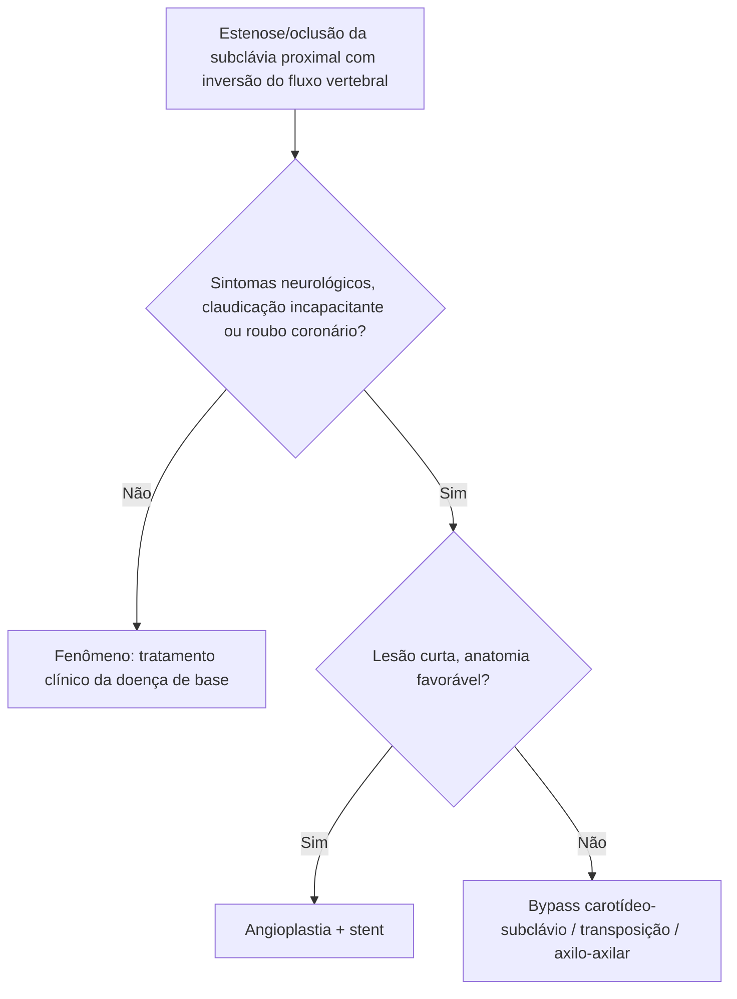

# Síndrome do Roubo da Subclávia

> Resumo em palavras próprias do Whitebook (Condutas Cirúrgicas > Cirurgia Vascular), sem fisiopatologia detalhada, autoria e referências. Confira detalhes e doses na fonte: https://whitebook.pebmed.com.br/conteudo/?id=64215&categoryId=207&subcategoryId=238

**Definição:** inversão do fluxo da artéria vertebral, em geral por lesão obstrutiva/estenosante da subclávia ipsilateral (antes da origem da vertebral, como na subclávia esquerda proximal ou no tronco braquiocefálico), com sintomas neurológicos e claudicação do membro superior. A vertebral passa a abastecer o braço retrogradamente, "roubando" fluxo da circulação posterior via polígono de Willis. Causa mais comum: aterosclerose; também Takayasu e outras arterites, trauma, radioterapia. Lesão na origem da subclávia pode causar **roubo coronário** em quem tem enxerto de mamária interna.
**Fenômeno × síndrome:** estenose/oclusão proximal com fluxo vertebral invertido **sem** sintomas neurológicos é *fenômeno* do roubo, não síndrome.

## Clínica
- Muitos são assintomáticos. Sintomas (posterior): **vertigem (o mais comum)**, síncope, disartria, diplopia/turvação, ataxia, *drop attacks*; podem piorar com exercício do braço.
- Exame: diferença de PAS entre braços > 15–20 mmHg, pulsos reduzidos ou ausentes (axilar, braquial, ulnar, radial) do lado afetado, sopro supraclavicular, sintomas provocados pelo esforço do membro.

## Diagnóstico
- **Doppler:** exame inicial (inversão do fluxo vertebral: reverso total, bidirecional ou alternante; a subclávia proximal é difícil de ver).
- **Angio-TC/RM:** caracteriza a lesão e as associadas, para planejamento.
- **Arteriografia:** padrão-ouro, reservada ao planejamento/execução da terapia endovascular.

## Tratamento
- **Indicações:** sintomas neurológicos, claudicação incapacitante do braço, roubo coronário com enxerto mamário. Assintomáticos (fenômeno): tratamento clínico otimizado da doença de base.
- **Endovascular (o mais usado):** angioplastia com balão + stent; menos invasivo, alto sucesso; ideal para lesões curtas e alto risco cirúrgico.
- **Aberto (cada vez menos):** falha do endovascular, lesões longas ou anatomia desfavorável; bypass carotídeo-subclávio, transposição da subclávia para a carótida comum ou bypass axilo-axilar; maior risco e internação.

## Fluxograma (refeito, a partir do texto; o original não traz algoritmo)

