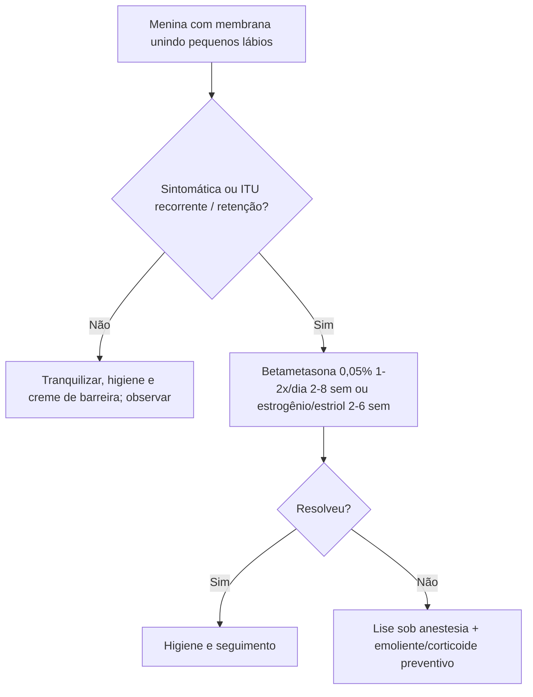

# Sinéquia de Pequenos Lábios em Pediatria

> Resumo em palavras próprias do Whitebook (Condutas Cirúrgicas > Cirurgia Pediátrica), sem fisiopatologia detalhada, autoria e referências. Confira detalhes e doses na fonte: https://whitebook.pebmed.com.br/conteudo/?id=64346&categoryId=207&subcategoryId=826

**Definição:** fusão parcial ou completa dos pequenos lábios na linha média, em geral na parte posterior da vulva (aderência ou fusão labial). O epitélio vulvar pré-puberal é fino e pobre em estrogênio; microtraumas e irritação persistente levam à cicatrização com fusão, que progride de trás para frente.

## Epidemiologia
- 0,6–5% na infância; benigna; meninas de 3 meses a 6 anos, pico aos **12–24 meses**; menos comum em adolescentes.
- Resolução espontânea em até **80%**.

## Clínica
- Em geral assintomática; achado incidental no exame ou na troca de fraldas. Sintomas possíveis: gotejamento pós-miccional, disúria/polaciúria, desvio do jato, pequena retenção de urina na vagina.
- Fatores associados: trauma local, fraldas, dermatite irritativa por urina/fezes, atopia, ITU recorrente, diarreia crônica, higiene inadequada ou excessiva, vulvovaginites, manipulação.
- **Exame:** membrana fina, translúcida ou esbranquiçada unindo os pequenos lábios, com pequeno orifício anterior para a urina.
- **Complicações:** vulvovaginites recorrentes, dermatite perineal, ITU recorrente, irritação; retenção urinária significativa é rara.

## Diagnóstico
Clínico, com exame atento "de fora para dentro" (o introito fica atrás da membrana; é frequente o erro diagnóstico de "agenesia vaginal").
**Diferencial:** hímen imperfurado, genitália ambígua, agenesia vaginal, líquen escleroso, abuso sexual.

## Conduta
Tranquilizar a família (benigna, sem risco para sexualidade ou fertilidade; costuma regredir na puberdade com o estrogênio). **Assintomática: observação**, sem ITU recorrente nem retenção importante.
- **Medidas gerais:** higiene suave sem sabonetes irritantes, troca frequente de fraldas, creme de barreira, banho de assento morno.
- **Estrogênio conjugado ou estriol:** camada fina com leve pressão na membrana, 1–2×/dia por **2–6 semanas**; sucesso 50–90%; tradicionalmente 1ª linha, hoje menos usado (pigmentação vulvar transitória, telarca discreta, irritação, sensibilidade mamária; regridem ao suspender).
- **Betametasona 0,05%** (mais usada): 1–2×/dia por **2–8 semanas**; eficácia semelhante, sem os efeitos do estrogênio, boa nas recidivas e na falha do estrogênio; cada vez mais 1ª opção.
- **Lise cirúrgica:** sintomática, com complicações ou falha do tratamento clínico; sob anestesia tópica, sedação ou geral conforme idade e extensão; **evitar lise traumática sem anestesia** (dor, trauma psicológico, recidiva, cicatriz). Depois: higiene, emoliente, corticoide tópico preventivo.
- **Prognóstico:** excelente; recidivas frequentes, porém autolimitadas.

## Fluxograma (refeito, a partir do texto; o original traz figuras)

