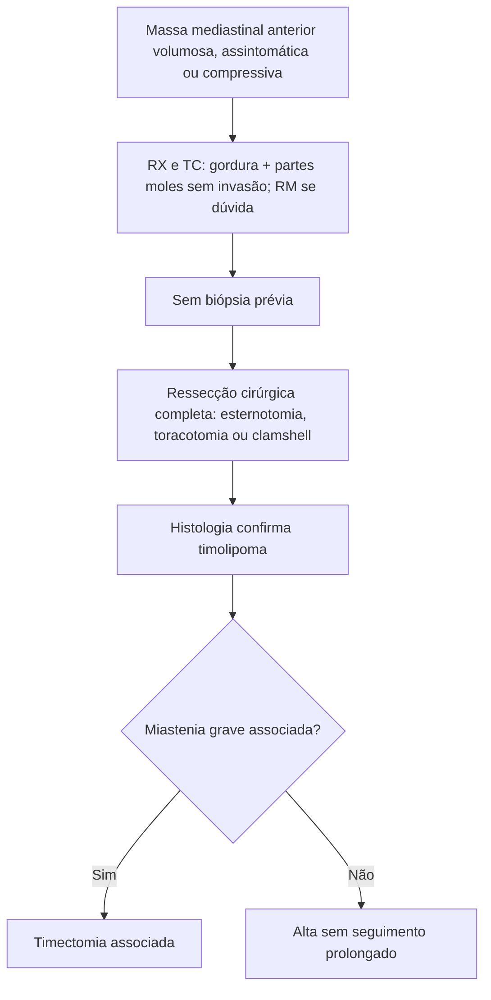

# Timolipoma

> Resumo em palavras próprias do Whitebook (Condutas Cirúrgicas > Cirurgia Torácica), sem autoria e referências. Confira detalhes e doses na fonte: https://whitebook.pebmed.com.br/conteudo/?id=39187&categoryId=207&subcategoryId=215

## Etiologia
Mal definida. Hipóteses: **substituição adiposa do timo** (a mais aceita), neoplasia verdadeira do timo, variante do timoma, hiperplasia da gordura mediastinal, neoplasia da gordura mediastinal que engloba tecido tímico, hamartoma tímico, desenvolvimento anômalo da terceira bolsa faríngea.

## Clínica
- Neoplasia rara (2–9% dos tumores mediastinais), de crescimento lento, em geral volumosa ao diagnóstico (> 1 kg). Adultos jovens (média 22 anos), sem predomínio de sexo; localiza-se nos seios cardiofrênicos e no mediastino anterior.
- **Associações:** anemia aplásica, hipogamaglobulinemia, líquen plano, doença de Graves, LES, linfoma de Hodgkin, leucemia linfocítica crônica; raramente miastenia grave (citada em 2,8–50%), timoma e linfoma tímico.
- 30–50% assintomáticos (achado incidental); ~50% têm sintomas compressivos inespecíficos (tosse, dispneia, dor torácica, cianose, disfonia).

## Diagnóstico
- Fortemente sugerido por imagem: gordura + partes moles sem invasão de estruturas vizinhas. **Diagnóstico definitivo só pela histologia da peça cirúrgica**; em geral não se biopsia antes da ressecção completa.
- **RX:** grande massa mediastinal anterior, pode ocupar os dois hemitórax e simular cardiomegalia ou elevação diafragmática. **TC:** densidade de gordura entremeada por partes moles. **RM:** hipersinal de gordura em T1, tecido tímico com sinal intermediário; supressão completa na STIR.
- **Diferenciais:** lipomatose mediastinal, lipossarcoma, timolipossarcoma, hipertrofia da gordura dos seios costofrênicos, hiperplasia tímica focal, cardiomegalia, sequestro pulmonar, atelectasia, tumor fibroso da pleura, hérnia diafragmática, teratoma.

## Tratamento
- **Ressecção cirúrgica completa** é curativa e de escolha. Vias: esternotomia mediana, toracotomia anterolateral, *clamshell* ou *hemiclamshell*. Adere, mas não invade estruturas vizinhas.
- Sem recorrência, metástases ou mortalidade relatadas após ressecção; não exige seguimento prolongado.
- Com miastenia associada: associar timectomia (pode melhorar/remitir a doença).

## Fluxograma (refeito, a partir do texto; o original não traz algoritmo)

