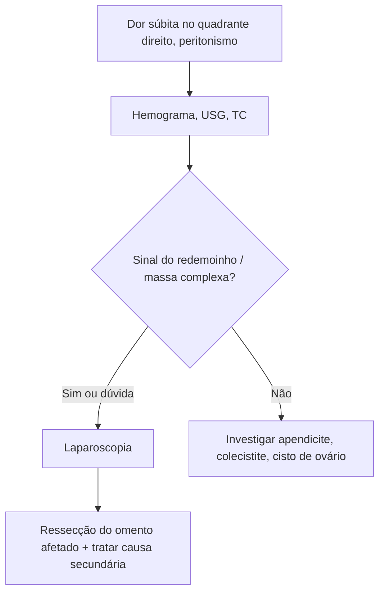

# Torção de Omento

> Resumo em palavras próprias do Whitebook (Condutas Cirúrgicas > Cirurgia Geral e do Aparelho Digestivo), sem fisiopatologia, autoria e referências. Confira detalhes e doses na fonte: https://whitebook.pebmed.com.br/conteudo/?id=704&categoryId=207&subcategoryId=211

**Definição:** o grande omento gira sobre o próprio eixo, com perfusão prejudicada, isquemia e necrose. Raramente é diagnosticada antes da cirurgia, pois simula causas comuns de abdome agudo. Sinônimos: torção omental, torsão do epíplon.

## Quadro clínico
Dor abdominal súbita à direita com irritação peritoneal; náusea, vômito e febre baixa. Metade dos pacientes tem massa dolorosa palpável. A clínica é confundida com apendicite ou diverticulite. Hemograma: leucocitose moderada em até 2/3.

## Diagnóstico
- **TC:** fibrose e gordura intraperitoneal convergindo radialmente para o ponto de torção (“sinal do redemoinho”); atenção à hérnia de Petersen.
- **USG:** massa complexa, mistura de sólido e áreas hipoecoicas.
- **Laparoscopia:** diagnóstica e terapêutica; permite ver a torção e ressecar o tecido necrótico.
- Pensar em torção de omento quando, em laparotomia por abdome agudo, houver líquido serossanguinolento sem outro foco.
- **Diferenciais:** apendicite, colecistite, torção de cisto de ovário.

## Tratamento
O diagnóstico costuma ser intraoperatório. Tratamento: **ressecção da porção afetada** e correção da patologia que causou a torção secundária.

## Fluxograma (refeito, a partir do texto; o texto original não traz uma figura)

