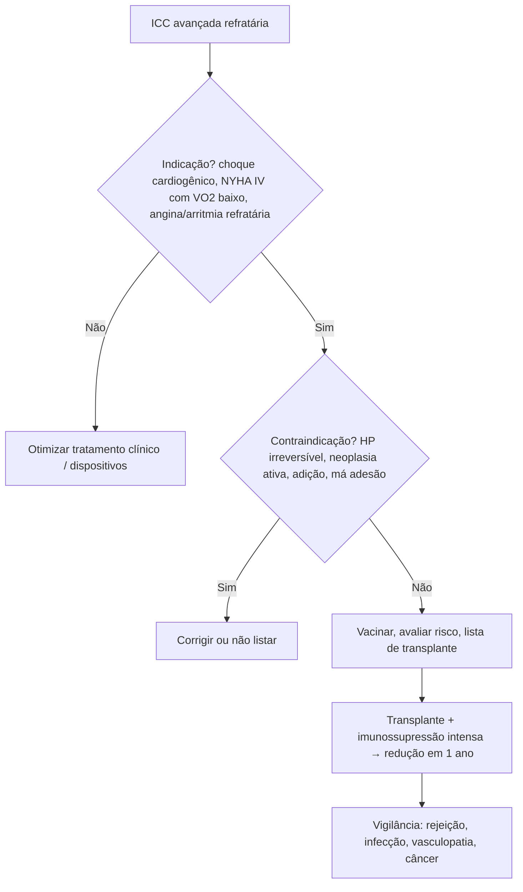

# Transplante Cardíaco

> Resumo em palavras próprias do Whitebook (Condutas Cirúrgicas > Cirurgia Cardiovascular), sem autoria e referências. Confira detalhes e doses na fonte: https://whitebook.pebmed.com.br/conteudo/?id=45401&categoryId=207&subcategoryId=305

**Definição:** tratamento de escolha em muitos pacientes com ICC avançada que seguem sintomáticos apesar da terapia clínica; a estratificação de risco é fundamental. Sinônimos: cardiotransplante, ortotópico, heterotópico.

## Indicações absolutas
- Choque cardiogênico com inotrópico EV contínuo ou suporte circulatório (balão intra-aórtico, assistência mecânica).
- ICC classe IV da NYHA refratária ao tratamento clínico e cirúrgico (inclusive dispositivos), com: **VO₂ pico ≤ 14 mL/kg/min** se intolerante a betabloqueador, **≤ 12 mL/kg/min** em uso de betabloqueador; alternativa em < 50 anos ou mulheres: VO₂ pico < 50% do previsto; Seattle Heart Failure Model com sobrevida em 1 ano < 80%; Heart Failure Survival Score de risco alto/médio.
- Angina grave intratável sem revascularização possível.
- Arritmias ameaçadoras refratárias a drogas, ablação, cirurgia e CDI.
- Cardiomiopatias restritiva e hipertrófica selecionadas com ICC NYHA III–IV.

## Indicações relativas
ICC limitante apesar de betabloqueador com VO₂ pico 13–14 mL/kg/min (ou < 55% do previsto); angina instável refratária sem outra opção; instabilidade recorrente do balanço hídrico/função renal apesar de adesão.

## Combinado
Em doença grave irreversível do coração e de outro órgão, não fazer transplante cardíaco isolado; múltiplos órgãos pode ser opção.

## Contraindicações
- **Absolutas/maiores:** doença sistêmica com expectativa < 2 anos, hipertensão pulmonar irreversível (varia entre centros), doença cerebrovascular grave sintomática, uso ativo de drogas, tabaco ou álcool, incapacidade de cumprir a terapia, doença multissistêmica com disfunção grave de órgãos-alvo.
- **Relativas:** idade > 70 anos; obesidade; diabetes com HbA1c > 7,5% e lesão de órgão-alvo (exceto retinopatia não proliferativa); IRC irreversível (TFG < 30; possível transplante combinado com rim); neoplasia ou infecção (individualizar); embolia pulmonar aguda (6–8 semanas); tabagismo (6 meses); abuso de substâncias (6 meses); suporte social inadequado; outras condições de risco perioperatório; fragilidade (dados limitados).

## Vacinação
Completar o calendário antes do transplante; vacinas de vírus vivo (varicela, zóster, caxumba, sarampo, rubéola, febre amarela) devem ser dadas antes, com intervalo > 4 semanas.

## Imunossupressão
Reatividade e rejeição são maiores nos primeiros 3–6 meses; a maioria dos serviços usa imunossupressão mais intensa no início e reduz no primeiro ano, mantendo o mínimo eficaz para limitar toxicidade. Preferir doses baixas de vários fármacos com toxicidades não sobrepostas a poucos em dose alta; evitar excesso (infecção e neoplasia).

## Complicações e causas de morte
Falha primária do enxerto (maioria das mortes nos primeiros 30 dias; pode aparecer na sala ou em 24 h); após a 1ª semana, rejeição aguda ou vasculopatia do aloenxerto; **infecções** (principal causa entre 6 meses e 1 ano; comuns e oportunistas); rejeição aguda (~10% das mortes nos primeiros 3 anos); **vasculopatia do aloenxerto** (aumenta com o tempo, entre as principais causas após o 1º ano); **neoplasia** (causa mais frequente de morte após 5 anos).

## Fluxograma (refeito, a partir do texto; o original não traz algoritmo)

