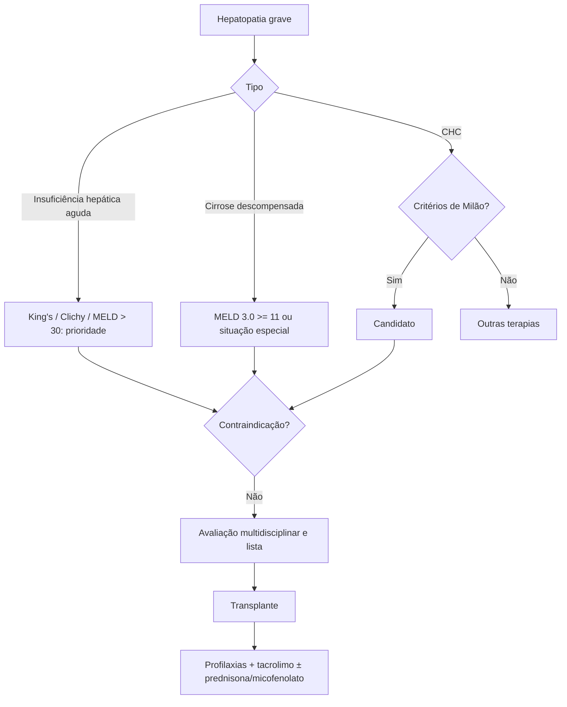

# Transplante Hepático

> Resumo em palavras próprias do Whitebook (Condutas Cirúrgicas > Cirurgia Geral e do Aparelho Digestivo), sem fisiopatologia, autoria e referências. Confira detalhes e doses na fonte: https://whitebook.pebmed.com.br/conteudo/?id=45402&categoryId=207&subcategoryId=211

**Conceito:** substituição do fígado do receptor por fígado de doador falecido ou por parte de fígado de doador vivo; terapia padrão para doença hepática descompensada, CHC inicial, insuficiência hepática aguda e indicações em expansão.

## Epidemiologia
Brasil é o 2º país em número de transplantes (2.365 hepáticos em 2023, > 90% pelo SUS), mas abaixo da demanda. Cirrose é a principal indicação (70–90%: álcool, hepatites B e C, doença esteatótica associada ao metabolismo); CHC é indicação emergente. Idade média 50–60 anos; sobrevida global ~80% em 3 anos.

## Indicações
- **Insuficiência hepática aguda** (INR > 1,5 + encefalopatia sem hepatopatia prévia): prioridade; no Brasil, hepatites virais agudas, lesão por drogas, hepatite autoimune, muitos sem causa definida. Encaminhar hepatite aguda grave a centro com transplante. Prognóstico: critérios de King’s College, Clichy e MELD > 30 (mau prognóstico).
- **Cirrose descompensada:** hemorragia varicosa, ascite, encefalopatia; síndrome hepatorrenal exige avaliação imediata. **MELD 3.0** (mortalidade em 3 meses; critério principal de alocação no Brasil desde 2025; mínimo de 11 pontos para inscrição). **Situações especiais** (fora do MELD): ascite refratária, síndrome hepatopulmonar, encefalopatia recorrente, ACLF grau II–III, prurido intratável, colangite de repetição.
- **Tumores:** CHC pelos **critérios de Milão** (uma lesão ≤ 5 cm ou até três < 3 cm, sem invasão vascular nem doença extra-hepática); também hemangioendotelioma epitelioide, adenomatose, hepatoblastoma, hemangioma gigante/hemangiomatose ou doença policística com síndrome compartimental, carcinoma fibrolamelar, tumor neuroendócrino metastático.
- **Metabólicas:** polineuropatia amiloide familiar I–III (transplante dominó, inclusive > 60 anos), hiperoxalúria primária, fibrose cística, glicogenoses I e IV, tirosinemia, Crigler-Najjar.

## Contraindicações
Doença cardiopulmonar intratável de risco proibitivo; neoplasia extra-hepática sem critérios de cura; tumor hepático fora dos critérios; anatomia inviável (trombose extensa da porta); infecção não controlada/sepse; IHA com PIC > 50 mmHg sustentada ou PPC < 40; hipertensão pulmonar com PAPm > 45; ACLF com > 3 falências ou CLIF-C ACLF > 64; falta de suporte psicossocial ou má adesão. **Álcool:** abstinência mínima de 3 meses com relatórios favoráveis da saúde mental (Portaria GM/MS 8.041/2025; antes 6 meses); hepatite alcoólica aguda grave pode ser considerada em protocolos de transplante precoce (primeiro episódio, alta probabilidade de adesão). Idade > 70 anos é contraindicação relativa.

## Avaliação pré-transplante (multidisciplinar)
- Tipagem ABO/Rh, função e lesão hepática, hemograma, função renal, alfafetoproteína, cálcio e vitamina D, sorologias (CMV, EBV, varicela, HIV, hepatites A/B/C, sífilis, Chagas), sedimento urinário.
- **Cardiopulmonar:** oximetria, gasometria, ECG, ecocardiograma com microbolhas, angioTC de coronárias, cintilografia, cateterismo conforme o caso; prova de função pulmonar. Risco maior com DAC, hipoxemia grave e PAP média alta; hipertensão pulmonar leve a moderada (PSAP 40–59 mmHg) não piora o resultado.
- **Câncer:** TC ou RM de abdome (anatomia e CHC), exame de pele; colonoscopia se > 45 anos (menos com parente de 1º grau com câncer de cólon) ou CEP; rastreio de colo uterino, mama e próstata como de rotina.
- **Infecção:** tuberculose latente (PPD/IGRA, RX), colonização por multirresistentes (MRSA, VRE, CRE), vacinação completa (pneumococo, meningococo, varicela, SARS-CoV-2; vivas atenuadas preferencialmente 4 semanas antes), tratar infecções ativas.
- EDA para varizes; rastrear e tratar osteoporose (bisfosfonato oral com cautela em varizes; osteopenia: cálcio e vitamina D); avaliação psicossocial com sessão educativa sobre riscos e benefícios, capacidade de seguir regimes complexos, tratamento prévio de uso de substâncias.

## Pós-transplante
- Infecção é a complicação mais frequente nos primeiros 3 meses (sinais atenuados pela imunossupressão). **Profilaxias** (variam por protocolo): bacteriana — ampicilina + cefotaxima nas primeiras 24 h; *Pneumocystis* (universal) — SMX-TMP 400/80 mg 1×/dia por 6 meses–1 ano; *Strongyloides* (universal) — ivermectina 200 µg/kg/dia em 2 doses, repetida após 15 dias; *Toxoplasma* — SMX-TMP 800/160 mg 1×/dia por 6 meses–1 ano se receptor IgG− e doador IgG+ ou desconhecido; *T. cruzi* — benzonidazol 5–7 mg/kg/dia em 2 doses por 30–90 dias se receptor IgG+ (monitorar parasitemia); CMV — ganciclovir 5 mg/kg EV 1×/dia ou valganciclovir 900 mg VO 1×/dia por 3 meses (receptor IgG− ou uso de timoglobulina), se receptor IgG+ monitorar PCR e tratar se > 2.000 U/mL (ajustar à função renal); hepatite B crônica — imunoglobulina anti-HBV nos primeiros dias + tenofovir ou entecavir contínuo; doador anti-HBc+/receptor HBsAg− — lamivudina 150 mg/dia ou outro antiviral contínuo.
- **Imunossupressão:** tacrolimo é a primeira linha, em geral com prednisona e micofenolato; rejeição aguda manejada com ajuste da imunossupressão (casos complexos, multidisciplinar); retirada gradual é objetivo teórico, com extrema cautela.

## Fluxograma (refeito, a partir do texto; o original não traz algoritmo)

