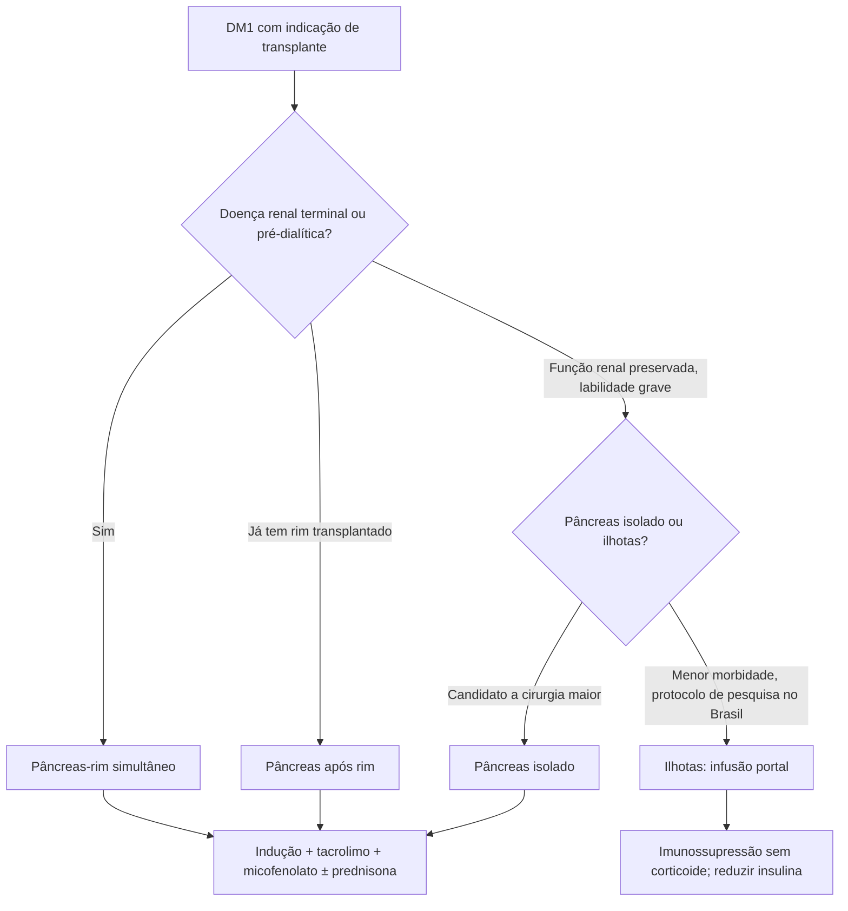

# Transplante Pancreático e de Ilhotas Pancreáticas

> Resumo em palavras próprias do Whitebook (Condutas Cirúrgicas > Cirurgia Geral e do Aparelho Digestivo), sem fisiopatologia, autoria e referências. Confira detalhes e doses na fonte: https://whitebook.pebmed.com.br/conteudo/?id=39190&categoryId=207&subcategoryId=211

# Transplante de pâncreas (órgão inteiro)

## Conceito
- Único tratamento que normaliza glicemia e HbA1c no DM1; leva a independência de insulina e euglicemia sustentada. Sucesso maior que o das ilhotas, porém com mais morbimortalidade.
- Benefícios: qualidade de vida, fim da insulina exógena, menos complicações secundárias (retinopatia, neuropatia, nefropatia, doença vascular), nefroproteção do rim transplantado, controle de cetoacidose e hipoglicemia, regressão parcial da neuropatia e estabilização da retinopatia.
- Sobrevida do enxerto: 97–98% em 1 ano e > 90% em 3 anos.

## Indicações
18–60 anos; DM1 ou insulinodependente; DM2 selecionado (peptídeo C > 0,8 ng/mL, dependência de insulina); DRC terminal por DM; DM instável apesar de insulinoterapia intensiva; DM por pancreatite crônica, fibrose cística ou pancreatectomia total por doença não maligna; capacidade de adesão e compreensão de riscos e benefícios.

## Contraindicações
ICC (FE < 40%); IAM < 6 meses; DAC não corrigível; doença arterial periférica extensa; abuso de substâncias; doença psiquiátrica ou deficiência intelectual que impeça a compreensão; neoplasia metastática ou incurável; obesidade. **Relativas:** HIV, prova cruzada (T-cell) positiva, retinopatia proliferativa ou hemorragia retiniana recente, doença vascular periférica com obstrução ilíaca ou amputação prévia, neuropatia autonômica sintomática.

## Modalidades
- **Simultâneo pâncreas-rim (SPK):** mais realizado e com melhores resultados. Ideal: DM1 com DRC terminal ou pré-dialítica (ClCr ≤ 20 mL/min/1,73 m²), reserva cardíaca adequada, sem doador renal vivo ou preferência pelos dois órgãos de doador falecido. Menos comum: pâncreas de falecido com rim de vivo.
- **Pâncreas após rim (PAK):** segundo mais realizado. Ideal: DM1 com rim transplantado prévio e função estável, boa reserva cardíaca, mau controle apesar de insulina intensiva.
- **Pâncreas isolado (PTA):** menos realizado e mais controverso. Segundo ADA e SBD: DM1, boa reserva cardíaca, ClCr ≥ 70 mL/min, sem contraindicações, com labilidade glicêmica e complicações agudas graves (cetoacidose de repetição, hipoglicemias graves, mesmo assintomáticas) apesar de manejo endocrinológico, sobretudo com situações de risco (acidentes de trabalho/trânsito, cuidado de crianças); ou problemas clínicos e emocionais graves e incapacitantes no automanejo da insulina. Alguns consideram DM2 em insulina com IMC ≤ 30.

## Doador e captação
- ABO compatível; crossmatch HLA negativo; 10–50 anos; IMC 15–40; sem DM pessoal ou em parentes de 1º grau; sem etilismo crônico; sem cirurgia pancreática/duodenal, esplenectomia ou tumor maligno; sorologias negativas (HIV, hepatites B e C, HTLV); sem hepatopatia crônica; sem pancreatite, edema extenso, hematoma, infiltração gordurosa, fibrose, nódulos ou infecção abdominal ao exame macroscópico.
- Morte encefálica segue a principal fonte; doação após morte circulatória controlada não é contraindicação com boa seleção e controle do tempo de isquemia.
- Captação em bloco com os demais órgãos abdominais (técnica modificada se junto com o fígado); preservar cotos da artéria esplênica, mesentérica superior e veia porta; solução de preservação (Wisconsin) a 4 °C; lavagem duodenal com iodopovidona e antibiótico/antifúngico por SNG antes do clampeamento aórtico; retirar o bloco pancreatoduodenal com baço e segmentos ilíacos para reconstrução vascular.
- **Back table:** esplenectomia; encurtar duodeno (10 cm), suturar/invaginar bordas; suturar raiz do mesentério; religadura de colédoco, gastroduodenal e mesentérica inferior; mobilizar a porta; enxerto arterial em “Y” (ilíacas + mesentérica superior e esplênica). Reconstruções aumentam risco de trombose.

## Implante
Em transplante simultâneo, o rim vai primeiro. Laparotomia mediana; fossa ilíaca direita; anastomose arterial término-lateral na ilíaca comum com enxerto em Y; drenagem venosa sistêmica ou portal; drenagem exócrina preferencialmente entérica (duodenojejunal com Y de Roux). A drenagem vesical associa-se a ITU, cistite crônica, pancreatite de refluxo, acidose metabólica e hematúria. Isquemia < 12 h dá melhores resultados (aceitável até 24 h).

## Seguimento
- **Indução:** globulina antitimócito (policlonal depletora de linfócitos T); alemtuzumabe (anti-CD52, depleção profunda); basiliximabe (anti-CD25, não depletor); daclizumabe (anti-CD25).
- **Manutenção:** tacrolimo + micofenolato ± prednisona. Evitar inibidor de calcineurina (pior desfecho imunológico sem menor toxicidade comprovada, conforme o texto).
- Profilaxia de CMV e oportunistas até 6 meses.
- Monitorar glicemia, amilase e, no SPK, creatinina; USG com Doppler, TC com contraste, anticorpos anti-doador, autoanticorpos; biópsia conforme a clínica, não de rotina.

## Complicações
Relaparotomia 10–20%; urológicas (drenagem vesical); fístula entérica 5–8%; trombose vascular 10–35%; pancreatite de refluxo; abscesso/sepse; deiscência de parede; hemorragia 5%; lesão de isquemia-reperfusão; infecções (CMV, *Cryptococcus*, *Aspergillus*); doença linfoproliferativa 1–2,5%; rejeição 5–25% (hiperaguda, aguda, crônica).

# Transplante de ilhotas

## Conceito
- Ilhotas são ~2% da massa pancreática. Aprovado no Canadá, **experimental no Brasil** (apenas em estudos controlados). Não garante independência de insulina (só parte permanece livre após 5 anos), mas melhora o controle e reduz a labilidade. Muitas vezes são necessários 2 ou mais doadores. Implante portal de células endócrinas; morbidade 20× menor que a do transplante de pâncreas.

## Indicações e elegibilidade
- **Indicações:** DM1 lábil (grandes oscilações, tipicamente > 200 mg/dL, ou hipoglicemias graves sem sintomas de alerta); transplante renal prévio com instabilidade; autotransplante após pancreatectomia total (pancreatite crônica ou aguda recorrente); prevenção de DM iatrogênico após pancreatectomia.
- **Elegibilidade:** 18–65 anos; DM1 > 5 anos com peptídeo C indetectável; hipoglicemias graves recorrentes; progressão das complicações crônicas.
- **Excluir:** DAC não tratada; IMC > 26; insulina > 0,7 U/kg; HbA1c > 12%; creatinina > 1,5 mg/dL e/ou albuminúria > 300 mg/24 h; infecção ativa ou doença psiquiátrica.
- **Modalidades:** isolado; após rim; simultâneo ao rim; rim após ilhotas (raríssimo); autotransplante.

## Procedimento
Limpeza e canulação dos ductos; perfusão, distensão e digestão com colagenase intraductal; separação mecânica (método de Ricordi); diluição, purificação e cultura (36–72 h). Infusão única de ~300.000 IEQ em meio com heparina, por 20–40 min, pela veia porta, por cateterismo transcutâneo trans-hepático guiado por USG/fluoroscopia; monitorar a pressão portal e interromper se > 20 mmH₂O ou o dobro do basal.

## Eventos adversos
Alteração de provas hepáticas, punção de órgãos adjacentes, sangramento intra-abdominal, trombose de ramos portais (1%), dor, anemia, hipertensão portal aguda na infusão, hipoglicemia grave por excesso de insulina (rara). No autotransplante: trombose portal, sangramento pela heparina, contaminação do preparado.

## Seguimento
- Manter insulina (cerca de 2/3 da dose prévia) e reduzir gradualmente até suspender em 2–11 meses se houver independência. Melhor parâmetro: peptídeo C (indetectável antes). Testes funcionais (estímulo com arginina, TOTG/IV); controle de glicemias, HbA1c, hipoglicemias e necessidade de insulina.
- **Imunossupressão** indefinida, sem corticoide. Protocolo de Edmonton: daclizumabe + sirolimo + tacrolimo (daclizumabe IV na indução e nas primeiras 8 semanas, espaçado). **Autotransplante não exige imunossupressão.**

## Resultados
- **Alotransplante:** controle glicêmico melhor, menor variabilidade, proteção contra hipoglicemia grave. 40–60% ficam sem insulina no 1º ano, ~25% em 5 anos; maioria mantém peptídeo C detectável; > 90% protegidos de hipoglicemia grave; > 80% com HbA1c < 7% sem hipoglicemia grave no 1º ano e mantido em 2 anos; no estudo CIT07, > 90% livres de hipoglicemia grave em 2 anos.
- **Autotransplante:** 30–40% sem insulina (até 70% com > 250.000–300.000 IEQ); 80–90% com peptídeo C detectável; menos dor, melhor nutrição, ganho de peso e menos internações; melhores resultados em não diabéticos prévios e jovens.

## Fluxograma (refeito, a partir do texto; o original não traz figura)

