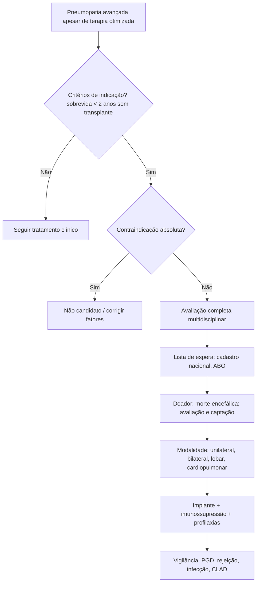

# Transplante Pulmonar

> Resumo em palavras próprias do Whitebook (Condutas Cirúrgicas > Cirurgia Torácica), sem autoria e referências. Confira detalhes e doses na fonte: https://whitebook.pebmed.com.br/conteudo/?id=45404&categoryId=207&subcategoryId=215

**Definição:** considerado em doença pulmonar avançada com declínio progressivo apesar de terapia clínica/cirúrgica otimizada; candidatos sintomáticos nas atividades diárias, com expectativa de vida limitada (~2 anos). ~85% dos transplantes no mundo são por DPOC, fibrose pulmonar idiopática (FPI), fibrose cística (FC), enfisema por deficiência de alfa-1-antitripsina e hipertensão arterial pulmonar (HAP).

## Doenças com possível indicação
- **Obstrutivas:** DPOC, alfa-1-antitripsina, disfunção crônica do aloenxerto (CLAD, bronquiolite obliterante), bronquiolite obliterante pós-infecciosa.
- **Intersticiais:** FPI, pneumonite de hipersensibilidade, pneumoconioses, DPI associada a colagenose ou a drogas, sarcoidose.
- **Supurativas:** FC, bronquiectasias não-FC.
- **Vasculares:** hipertensão pulmonar idiopática/secundária, doença veno-oclusiva, Osler-Rendu-Weber.
- **Outras:** LAM, doença enxerto-versus-hospedeiro, adenocarcinoma minimamente invasivo/*in situ* difuso, microlitíase, histiocitose de Langerhans.

## Seleção do receptor (critérios gerais)
Doença grave sem resposta à terapia; risco de morte sem transplante > 50% em 2 anos; probabilidade de sobreviver ≥ 90 dias após o transplante > 80%; sem comorbidade extrapulmonar que limite a sobrevida nos primeiros 5 anos; perfil psicossocial e apoio adequados.
- **Doença intersticial:** UIP/NSIP, independentemente da função; CVF < 80% ou DLCO < 40%; dispneia/limitação; necessidade de O2 (mesmo ao esforço); falha de teste terapêutico em formas inflamatórias. **Progressão:** queda de CVF ≥ 10% em 6 meses (5% já pior prognóstico), queda de DLCO ≥ 15%, SpO2 < 88% ou TC6M < 250 m (ou queda > 50 m), hipertensão pulmonar, internação por piora/pneumotórax/exacerbação.
- **Fibrose cística:** VEF1 ≤ 30%, queda rápida de VEF1 apesar de terapia ótima (sobretudo mulheres), micobactéria não tuberculosa ou *B. cepacia*, diabetes, TC6M < 400 m, hipertensão pulmonar (PSAP > 35 mmHg ao eco ou PAPm > 25 mmHg), ↑ exacerbações com falência respiratória (VNI), resistência antibiótica, desnutrição, pneumotórax, hemoptise grave apesar de embolização; hipoxemia (PaO2 < 60 — < 55 na portaria brasileira) com hipercapnia (PaCO2 > 50), VNI prolongada, internações frequentes por multirresistentes, classe funcional OMS IV.
- **Bronquiectasia não-FC:** NYHA III, VEF1 ≤ 30% ou declínio rápido, hipoxemia (PaO2 < 60), hipercapnia e perda de peso, infecções de repetição, hemoptise ou pneumotórax, hipertensão pulmonar.
- **DPOC:** progressão apesar de terapia otimizada (fármacos, reabilitação, O2), sem indicação de redução de volume; BODE > 5–6; PaCO2 > 50 e/ou PaO2 < 60; VEF1 < 25% (< 500 mL); alfa-1. **Listagem mais urgente:** BODE ≥ 7, VEF1 < 15–20%, ≥ 3 exacerbações graves/ano, 1 exacerbação com falência hipercápnica, hipertensão pulmonar moderada a grave.
- **Vasculares:** NYHA III/IV durante o escalonamento, doença rapidamente progressiva, uso de terapia parenteral, suspeita de doença veno-oclusiva/capilarite. **Listagem:** NYHA III/IV após ≥ 3 meses de prostanoide combinado, índice cardíaco < 2 L/min/m², TC6M < 350 m, pressão atrial direita média ≥ 15 mmHg, PAPm ≥ 55 mmHg (portaria brasileira), hemoptise, derrame pericárdico, sinais de falência de VD (renal, bilirrubina, BNP, ascite).
- **Adenocarcinoma *in situ*/minimamente invasivo:** doença difusa bilateral com restrição e comprometimento respiratório importante, queda de qualidade de vida, falha terapêutica, tumor restrito ao pulmão.

## Contraindicações
- **Absolutas:** infecção instável/intratável (pulmonar ou extrapulmonar), patógenos virulentos/resistentes crônicos, TB ativa, neoplasia nos últimos 5 anos (2 se pele não melanoma), disfunção grave de outros órgãos (coração, fígado, rim, cérebro), instabilidade aguda (sepse, IAM, falência hepática), coronariopatia importante não revascularizável, diátese hemorrágica não corrigível, deformidade torácica/espinhal que cause restrição grave, IMC ≥ 35, tabagismo ativo, dependência de drogas/álcool, problemas psicossociais ou má adesão.
- **Relativas:** idade > 65 anos com baixa reserva, IMC 30–34,9, desnutrição grave, osteoporose grave sintomática, cirurgia torácica extensa prévia, colonização por germes muito resistentes/virulentos, outras micobacterioses, HIV, hepatite B/C, falta de apoio social.
- **Observações:** ventilação mecânica e suporte extracorpóreo são contraindicações relativas, mas usados como ponte (VM invasiva segue fator de risco); VNI é preferível. Corticoide sistêmico não contraindica (prednisona 0,2–0,3 mg/kg/dia geralmente segura). Diabetes não contraindica (a maioria exige HbA1c ≤ 7).

## Avaliação do receptor
- **Cardiopulmonar:** ECG; eco (função, pressões da artéria pulmonar, TAPSE etc.); cateterismo direito (pressões); esquerdo se idoso (alguns protocolos > 40 anos) ou vasculopatia; RX, gasometria em ar ambiente, prova de função completa com pletismografia (CPT), TC6M, oximetria; TC de tórax (viabilidade e planejamento); cintilografia de perfusão; densitometria óssea (corticoide).
- **Laboratório:** sorologias (toxoplasmose, hepatites A/B/C, Chagas, sífilis, CMV, HIV, HTLV I/II, EBV); hemograma, função renal e hepática, coagulograma, glicemia, lipidograma, ácido úrico, eletrólitos, EAS, clearance de creatinina de 24 h, urocultura; PRA (HLA) a cada 6 meses; escarro (bacterioscopia, cultura, BAAR e fungos), PPD.
- **Broncoscopia** (anatomia; lavado para cultura, sobretudo em doença supurativa). **Vacinas:** hepatite B, influenza, pneumococo.
- **Multidisciplinar:** serviço social, fisioterapia, nutrição, enfermagem, psicologia.

## Alocação
- No Brasil: cadastro nacional por macrorregiões; fila cronológica por data de inscrição + compatibilidade ABO; priorização por agravamento via câmara técnica (30 dias, prorrogável). EUA: *Lung Allocation Score* (0–100; mortalidade em fila + benefício em 1 ano + geografia + ABO).

## Modalidades
- **Unilateral:** 15–20% dos adultos; menor complexidade; mais pacientes beneficiados.
- **Bilateral sequencial:** 97% dos pediátricos e ~80% dos adultos; indicada em doenças supurativas e HAP; melhor resultado a longo prazo.
- **Lobar:** cadavérico (pacientes pediátricos/pequenos, fibrose ou FC, graves em lista) ou **intervivos** (lobos inferiores de dois doadores compatíveis em ABO e HLA; para quem não sobreviveria à espera).
- **Cardiopulmonar:** cardiopatia terminal refratária + pneumopatia terminal (ex.: cardiopatia congênita complexa/Eisenmenger).

## Captação
**Doador em morte encefálica:** avaliar clínica, gasometria, RX (idealmente TC), broncoscopia e inspeção intraoperatória.
- **Ideal:** idade < 55 anos; PaO2/FiO2 > 400 (PEEP 5–8, FiO2 1); broncoscopia normal; RX normal; escarro sem germes; tabagismo < 20 anos; compatibilidade ABO e HLA; óbito não por asma.
- **Limítrofe/marginal:** > 55 anos; PaO2/FiO2 < 300; tabagismo > 20 anos; infiltrado no RX; trauma torácico; broncoscopia alterada; VM > 48 h.
- **Compatibilidade:** ABO, HLA I/II (*crossmatch* virtual), etiologia do receptor, tamanho (razão CPT prevista receptor/doador — fórmulas de Ouwens e Mason).
- **Broncoscopia do doador:** anomalias (brônquio traqueal), lesões, infecção, lavado bilateral.
- **Cirurgia de captação:** metilprednisolona ou hidrocortisona 500 mg–1 g; ventilação protetora (PEEP 5–8, FiO2 50–60%, Vt 6–8 mL/kg, Pplatô < 35); limitar cristaloides; decúbito dorsal, esternotomia, pericardiotomia em T invertido; avaliação macroscópica (lacerações, massas, aderências, edema/peso, complacência, tamanho); heparina 400 U/kg; canulação da artéria pulmonar; **prostaglandina E1** 500 µg; clampeamento aórtico, descompressão (VCI, átrio esquerdo); perfusão anterógrada com **Perfadex Plus** 50–70 mL/kg mantendo ventilação (FiO2 50–60%); cardiectomia e perfusão retrógrada com 1.000 mL (250 mL por veia); explante em bloco ou separado, insuflado após grampeamento; tripla embalagem e resfriamento; fragmento linfoide para *crossmatch* real.
- **Doador de coração parado (DCP):** crescente no mundo, **ainda não permitido no Brasil** (ética, biologia, lei). Categorias: I (encontrado morto) e II (parada irreversível inesperada) não controladas, III (retirada planejada de suporte; a mais usada, controlada), IV (parada em morte encefálica), V (eutanásia; Países Baixos/Bélgica). Resultados similares ao doador em morte encefálica. Na categoria III: retirada do suporte, espera da parada, constatação (2–5 min), perfusão fria em 30–90 min (alguns até 180; "isquemia morna").

## Preparo do enxerto
- ***Back table*:** retirar excessos; dividir artérias pulmonares e limpar adventícia; preparar o *cuff* atrial (duas veias ipsolaterais); coto brônquico mantendo o pulmão inflado (limite: dois anéis acima da carina secundária); pericárdio posterior pode proteger a anastomose brônquica.
- **Perfusão pulmonar *ex vivo* (EVLP):** recondiciona enxertos limítrofes — circuito de perfusão tipo ECMO com solução Steen, normotermia, ventilação protetora por 6–8 h, monitorando pressões, gasometria e RX.

## Implante
- **Unilateral:** decúbito lateral, toracotomia posterolateral; liberar aderências; isolar artéria e veias pulmonares; teste de clampeamento da artéria pulmonar (arritmia, instabilidade, hipertensão pulmonar → suporte extracorpóreo); pneumonectomia do nativo com cotos longos; anastomoses na ordem **brônquica** (prolene/PDS; retalho opcional), **artéria pulmonar** (prolene contínuo) e **átrio** (cuff com sutura evertida contínua); ventilar e reperfundir lentamente (10 min) com de-aeração; hemostasia; drenos anterior e posterior; troca do tubo duplo lúmen por simples e broncoscopia.
- **Bilateral sequencial:** decúbito dorsal; esternotomia, bitoracotomia ou *clamshell* (mais comum); começa pelo lado pior pela cintilografia; mesmos passos sequenciais; dois drenos por lado.
- **Lobar:** incompatibilidade de tamanho ou intervivos. **Cardiopulmonar:** anastomoses em aorta, átrio direito e brônquios principais; sempre com circulação extracorpórea.
- **Assistência circulatória:** instabilidade, hipertensão pulmonar aguda, falha de troca gasosa, dificuldade técnica; rotina em pediátrico e HAP primária; sempre no cardiopulmonar. CEC (circuito aberto, intraoperatória) × ECMO (circuito fechado; estende ao pós, menos inflamação/hemólise/anticoagulação).

## Pós-operatório
- Ventilação protetora, Vt ≤ 6 mL/kg do doador; óxido nítrico inalatório não rotineiro; hipoxemia → pensar em disfunção primária do enxerto (a mais comum), sobrecarga, ICC, atelectasia, pneumonia, derrame, TEV, broncoespasmo, pneumotórax, problemas anastomóticos, tamponamento. Manter broncodilatador prévio nos unilaterais. Extubar cedo se PaO2/FiO2 estável > 200 (em hipertensão pulmonar, aguardar ≥ 24 h).
- Edema pulmonar quase universal; cateter de artéria pulmonar por 72 h; PCP baixa (5–15 mmHg) compatível com diurese e PA; transfusão com hemoglobina-alvo ~10 (o texto traz "mg/dL" — conferir na fonte), hemácias irradiadas. Drenos até fim da fuga e débito < 200 mL/dia (maioria sai em 7–10 dias).
- **Imunossupressão:** indução com metilprednisolona 500–1.000 mg intraoperatória e basiliximabe 20 mg EV na indução e no 4º dia. Manutenção com três drogas — corticoide, inibidor de calcineurina (ciclosporina/tacrolimo) e antimetabólito (azatioprina/micofenolato); inibidores de mTOR (sirolimo/everolimo) só após o 3º mês (risco de deiscência brônquica). Rejeição aguda: pulsoterapia de corticoide; falha → timoglobulina.
- **Profilaxias:** antibacteriana até o 14º dia PO (ajustar por culturas); CMV conforme D/R — D−/R− aciclovir 3 meses; D+/R+ ganciclovir/valganciclovir 3 meses; D+/R− 6 meses; EBV não; fungos — nistatina 3 meses, anfotericina inalatória + itraconazol 400 mg VO 3 meses, SMX-TMP 400/80 mg/dia (pneumocistose) indefinidamente.
- **Broncoscopias** seriadas se alteração ventilatória ou para vigilância de rejeição; alguns centros fazem lavado e biópsia seriados no 1º ano.

## Complicações
- **Precoces:** **disfunção primária do enxerto (PGD)** — edema inflamatório não cardiogênico nas primeiras 72 h (isquemia-reperfusão), causa importante de óbito; avaliar em T0–6 h, 24, 48, 72 h; fatores: CEC, FPI, HAP, carga tabágica do doador, IMC; profilaxia: baixa pressão de reperfusão, evitar CEC, Perfadex Plus (NO não protege); tratamento: suporte, sedação ± bloqueio, balanço hídrico restrito, ventilação protetora, ONi 10–20 ppm (até 40) na hipoxemia grave/hipertensão pulmonar, surfactante, ECMO. **Graus:** PGD 0 (PaO2/FiO2 > 300, RX normal); 1 (> 300, infiltrado); 2 (200–300, infiltrado); 3 (< 200, infiltrado).
  Outras: deiscência/necrose de anastomose brônquica, estenose vascular, acotovelamento da artéria pulmonar, trombose atrial, derrame/empiema, distúrbios GI (gastroparesia, Ogilvie), pseudoartrose esternal/osteomielite, paralisia frênica.
- **Rejeição hiperaguda:** por anticorpos pré-formados; hoje rara com PRA e *crossmatch*; óbito em até 48 h; prevenção com plasmaférese e timoglobulina no *mismatch*.
- **Rejeição celular aguda:** linfocitária; causa importante de óbito no 1º ano e de CLAD; dispneia, dessaturação, derrame, febre, infiltrado ou assintomática; diagnóstico histológico (perivascular/intersticial = A; bronquiolar = B); risco de disfunção crônica maior com ≥ A2; tratamento: ajuste da imunossupressão, pulsos de metilprednisolona, ATG ou OKT3. **A0** nenhuma; **A1** mínima; **A2** leve; **A3** moderada; **A4** grave; **B0** sem inflamação bronquiolar; **B1R** baixo grau; **B2R** alto grau; Ax/Bx não graduáveis.
- **Infecção:** principal causa de óbito após o 1º ano.
- **Tardias:** estenose de anastomose brônquica, granuloma, traqueomalácia, fístulas, osteomielite crônica, hiperinsuflação do pulmão nativo (unilateral), **CLAD** (restritiva, obstrutiva ou mista), rejeição por anticorpos, recidiva da doença de base (sarcoidose, LAM, proteinose, histiocitose, CA bronquioloalveolar, alfa-1, entre outras), doença linfoproliferativa pós-transplante, progressão da doença do pulmão nativo, outras neoplasias (pulmão, pele).
- **Retransplante:** ~4% dos transplantes; causas: PGD, complicações respiratórias intratáveis, CLAD; resultados piores que o primeiro.

## Fluxograma (refeito, a partir do texto; o original traz um algoritmo em figura de outra entidade e ilustrações)

