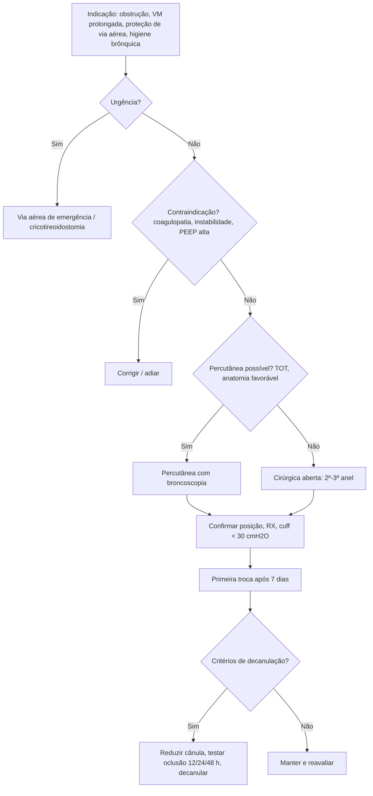

# Traqueostomia

> Resumo em palavras próprias do Whitebook (Condutas Cirúrgicas > Cirurgia Torácica), sem autoria e referências. Confira detalhes e doses na fonte: https://whitebook.pebmed.com.br/conteudo/?id=38910&categoryId=207&subcategoryId=215

**Definição:** abertura da parede anterior da traqueia, abaixo da laringe, com comunicação ao meio externo por meio de uma cânula (estoma traqueal). Uma das cirurgias mais antigas da medicina. (As figuras ilustrativas do original não foram reproduzidas.)

## Indicações
- **Urgência/obstrução:** trauma grave de face ou laringe, edema de glote (anafilaxia, angioedema), estenose subglótica, grandes tumores de orofaringe/laringe ou corpos estranhos não removíveis.
- **Ventilação mecânica prolongada:** alternativa à IOT prolongada (previne estenose subglótica, facilita o desmame).
- **Proteção de via aérea deficiente:** coma, disfunção neurológica (AVC, TCE) ou neuromuscular, tosse ineficaz, disfagia, alto risco de aspiração.
- **Higiene brônquica:** grande volume de secreção (fibrose cística, DPOC).
- **Cirurgias complexas** de cabeça e pescoço/laringectomias no pós-operatório imediato.

## Contraindicações (poucas absolutas; decisão individual)
- Obstrução laringotraqueal distal ao estoma; infecção/celulite local; anatomia desfavorável (pescoço curto/obeso, bócio grande, vasos anômalos — USG pode ajudar —, cirurgia cervical extensa prévia).
- **Coagulopatia:** anticoagulação terapêutica, uremia, INR > 1,5, TTPa > 1,8 ou plaquetas < 50.000 — corrigir antes de traqueostomia eletiva/semieletiva.
- Emergência extrema (preferir cricotireoidostomia); instabilidade hemodinâmica grave; grande instabilidade ventilatória (PEEP > 10 cmH2O, FiO2 > 0,6).

## Momento ideal
- Idealmente entre 5 e 14 dias de IOT em ventilação prolongada presumida ou falha de desmame inicial; (o original também cita realização após 14–21 dias em cenário distinto, não detalhado — conferir na fonte).
- Benefícios: menor espaço morto e resistência (desmame mais fácil), menos sedação, menos lesão laringotraqueal (sinéquias, paralisia de pregas, estenose, malácia), melhor comunicação e alimentação, possível menor PAVM (ainda debatido), mais conforto e mobilidade, menor risco de extubação acidental e menor internação em UTI. Decisão individualizada conforme prognóstico e família.
- **Vantagens sobre a IOT translaríngea:** via estável e acessível, melhor higiene brônquica, desmame de sedação, melhor cuidado oral, deambulação precoce, menor lesão laríngea, alimentação oral possível com balonete desinsuflado, fala com válvulas.

## Preparo
- Em centro cirúrgico ou UTI. **Antibioticoprofilaxia não é recomendada.**
- Verificar TCLE, drogas que aumentam sangramento, indicação, exames de coagulação/plaquetas/ureia. Pré-oxigenar com O2 100%; hiperextensão cervical com coxim interescapular (considerar Trendelenburg reverso a 30°; atenção a trauma raquimedular); suspender dieta enteral; material completo (luz, EPI, broncoscópio e USG se percutânea); auxílio de enfermagem/fisioterapia; sedação, analgesia e bloqueio neuromuscular.
- **Material:** campos e capotes, bandeja de pequenas cirurgias, lidocaína 1–2% 10–20 mL, lidocaína gel, cânula (número conforme o TOT), bisturi lâmina 11 (15 em pediatria), sonda nasogástrica 18 ou 20, seringas, agulhas, náilon 3-0 ou 4-0, gazes.

## Técnica cirúrgica (aberta)
1. Anestesia local; incisão cervical anterior (preferencialmente transversa), entre a cricoide e a fúrcula esternal (ou uma polpa digital acima dela).
2. Diérese por planos na rafe mediana; afastar os músculos pré-tireoidianos; istmectomia ou afastamento cranial da tireoide (opcional); ancoramento traqueal com pontos (opcional).
3. Auxiliar desinsufla o balonete do TOT, traciona o tubo (evitar perfurar o balonete) e desconecta a VM.
4. Abertura da parede anterior entre o 2º–3º (ou 3º–4º) anel: incisão longitudinal, transversa, janela, em T, flap de Björk (U invertido) ou T invertido (preferida).
5. Mobilizar o TOT cranialmente sob visão/palpação até a ponta ficar logo acima da abertura (não extubar!).
6. Introduzir a cânula (sonda nasogástrica como guia, se preciso); insuflar o balonete, conectar ao ventilador e confirmar: ventilação bilateral, SpO2, curvas e volume corrente, capnografia, ausência de resistência ou enfisema progressivo.
7. Ráfia parcial das extremidades (opcional), fixação com velcro/cadarço (± sutura à pele), retirar o TOT, curativo oclusivo.
- **Alertas:** não usar bisturi elétrico em contato com ar rico em O2 (risco de combustão); não retirar o TOT antes de confirmar a cânula; ter segunda cânula e material de IOT à mão.

## Técnica percutânea
- Essencialmente eletiva, idealmente com broncoscopia flexível (às cegas ou com USG há mais risco); à beira do leito. **Vantagens:** menor tempo, pouca perda sanguínea, menos infecção. **Riscos:** laceração traqueal, lesão vascular grave, perfuração esofágica.
- **Contraindicações absolutas:** acesso de emergência/urgência, ausência de TOT, ausência de traqueia cervical (ressecção prévia), artéria inominada ou ramos no sítio.
- **Relativas:** idade < 16 anos, coagulopatia incontrolável, PEEP ≥ 20 cmH2O, marcos anatômicos alterados (bócio, cricoide difícil de palpar), instabilidade cervical, via aérea difícil, crianças, anatomia distorcida (hematoma, tumor, cicatriz), traqueomalácia grave, obesidade mórbida, instabilidade hemodinâmica/hipoxemia/disfunção respiratória grave, dupla antiagregação (dados limitados).
- **Passos (Ciaglia, Griggs, balão; Fantoni é retrógrado):** a partir do TOT (> 7 mm para o broncoscópio padrão) ou máscara laríngea; assepsia e campos; lidocaína com vasoconstritor; incisão de 1–2 cm; balonete desinsuflado e TOT tracionado até a subglote; broncoscopia define o ponto entre o 2º–3º anel; punção a 45° caudal (bolhas na seringa; risco de perfurar o broncoscópio ou a parede posterior); cateter plástico e fio-guia sob visão; dilatação progressiva (múltiplos dilatadores, um só ou pinça de Griggs); cânula sobre o guia e confirmação com broncoscopia; extubação com visualização supraestomal e laríngea; fixação e curativos.

## Cuidados pós-procedimento
- Descarte de perfurocortantes; monitorar SpO2 e curvas; retirar coxim; cabeceira 30–45°; RX de tórax (posição da cânula, complicações); balonete com manômetro abaixo da pressão de perfusão capilar traqueal (**30 cmH2O ou 22 mmHg**); ajustar a VM; retomar anticoagulação profilática/terapêutica após 12 h.

## Tipos de cânulas
- **Com balonete:** ventilação mecânica ou proteção de via aérea; impede a fala; há modelos de comprimento ajustável (obesos, estenoses) e com/sem endocânula (Portex, Shiley, Blueline).
- **Sem balonete:** quem protege a via aérea e não precisa de pressão positiva; decanulação ou uso crônico (paralisia de pregas, disfunção laríngea, estenose supraestomal); permite fala ocluída ou com válvula; ex. metálica, Biesalski, Shiley sem balonete.
- **Fenestradas:** em cânulas com ou sem balonete; permitem fluxo aéreo superior e vocalização.
- **Medidas:** C (comprimento), ID (diâmetro interno — define o número, ex.: nº 8 = 8 mm), OD (diâmetro externo).

## Complicações
- **Do procedimento:** hemorragia (vaso, tireoide), extubação acidental com perda da via aérea, falso trajeto (laceração traqueal/esofágica), lesão do laríngeo recorrente, pneumomediastino, pneumotórax, enfisema subcutâneo, insuficiência respiratória, PCR por hipóxia, fratura de anel traqueal, combustão (bisturi elétrico).
- **Precoces (16–20%):** sangramento/hematoma, fuga aérea, enfisema subcutâneo, infecção do estoma (*S. aureus*, *Pseudomonas*), obstrução ou desposicionamento da cânula, edema pulmonar por pressão negativa.
- **Tardias (6–8%):** distúrbios de deglutição e fala, granulação, estenose, traqueomalácia, pneumonia, broncoaspiração, fístula traqueoesofágica (maior com sonda nasogástrica + cânula), fístula traqueoinominada, fístula traqueocutânea/orifício persistente (3–6 meses após retirar a cânula), cicatrização anômala.

## Cuidados com o traqueostomizado
- Limpeza diária (aspiração, endocânula — alguns usam peróxido de hidrogênio diluído por 10–15 min, lavando com salina estéril); estoma limpo, trocar gaze e fixador sujos.
- Balonete 20–25 mmHg (até 30 cmH2O); evitar hiperinsuflação; vazamento pode exigir troca.
- Umidificação e aquecimento do ar (nebulização ou circuitos umidificadores).
- **Aspiração** conforme necessidade (excesso de secreção, dessaturação, desconforto, roncos, sibilos), evitando aspiração profunda e vigorosa; riscos: hipoxemia, broncoespasmo, ↑ PIC e PA, dor, sangramento, agitação, atelectasia, arritmias, traqueíte.
- Evitar angulação da cânula em relação ao estoma (granulomas, estenose, fístulas).
- **Decanulação acidental:** mais comum em obesos e anatomia difícil (transporte, ventilação com bolsa-válvula); hipoxemia, rebaixamento, insuficiência respiratória, enfisema, pressão alta. Precoce (< 7 dias): reintubar por via translaríngea, reposicionar a cânula eletivamente com guia e, de preferência, broncoscopia. Tardia (> 7 dias): se estável, ventilar pelo estoma e reintroduzir; se instável, IOT ou ocluir o estoma, ventilar e, depois, trocar a cânula.

## Troca de cânula
- **Motivos:** balonete danificado, vazamento por traqueomalácia, obstrução, conversão de tipo, decanulação gradual, dano, necessidade de broncoscopia (cânula pequena), comprimento inadequado, desconforto. Idealmente a partir de 7 dias; sem troca rotineira — conforme a demanda.
- **Procedimento:** explicar ao paciente; avaliar tamanhos (tabelas de equivalência se mudar de tipo); monitorizar; ter cânulas menores e material de via aérea de emergência; testar o balonete e lubrificar; posição semirrecumbente com leve extensão cervical; pré-oxigenar ≥ 3 min com O2 100% e aspirar. Passar guia (ex.: sonda nasogástrica) pela cânula antiga, desinsuflar o cuff e retirá-la, inserir a nova pelo guia (ou usar TOT fino de 5–5,5 mm sem balonete como guia, que também permite ventilar). Confirmar com ausculta, SpO2, status ventilatório e capnografia.
- **Complicações:** hemorragia, falso trajeto, obstrução, hipoxemia, broncoaspiração, enfisema, falha.

## Decanulação
- Só com via aérea pérvia garantida; avaliação multidisciplinar (médico — de preferência cirurgião torácico ou de cabeça e pescoço —, fonoaudiologia, fisioterapia). A ferida cicatriza em cerca de 10 dias (até 6 meses).
- **Critérios:** gasometria estável, sem desconforto ventilatório, sem febre/infecção ativa, estabilidade hemodinâmica, via aérea pérvia, PaCO2 < 60 mmHg, sem delirium ou transtorno psiquiátrico, deglutição e proteção de via aérea adequadas (fonoaudiologia), tosse efetiva e menor secreção; endoscopia normal ou estenose < 30% (opcional). Preferencialmente TC de traqueia (cortes axial, sagital e coronal) e broncoscopia, embora não uniforme na prática.
- **Desmame:** reduzir progressivamente o calibre; testar oclusão (12 h, 24 h, 48 h) com botão ou válvula de fala; revisões sobretudo se dispneia, estridor ou sibilância.
- **Falha:** persistência da causa, deslocamento da parede anterior obstruindo o lúmen, edema de mucosa, intolerância ao aumento de resistência (crianças, idosos), estenoses laringotraqueais, traqueomalácia, distúrbios laríngeos.

## Pediatria
- O prazo para indicar é maior que em adultos e depende mais da doença de base que do tempo de VM. Cânula individualizada conforme o TOT. Mais lesões de pele no local (prolongam a internação); fixadores de velcro e curativos específicos periestomais são preferíveis.

## Fluxograma (refeito, a partir do texto; o original traz figuras ilustrativas)

