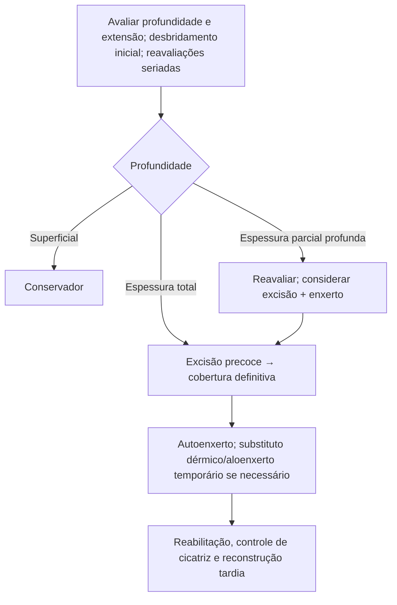

# Tratamento Cirúrgico de Queimaduras

> Resumo em palavras próprias do Whitebook (Condutas Cirúrgicas > Cirurgia Plástica), sem autoria e referências. Confira detalhes e doses na fonte: https://whitebook.pebmed.com.br/conteudo/?id=62986&categoryId=207&subcategoryId=947

**Introdução:** remoção do tecido desvitalizado (desbridamento/excisão) e cobertura definitiva por enxerto ou técnicas reconstrutivas; integra o manejo das queimaduras profundas com pouco potencial de cicatrização espontânea.
**Objetivos:** remover necrose, reduzir o tempo de escara, limitar perda de amplitude de movimento, edema e contraturas (posicionamento e imobilização), preparar o leito, fechar cedo, favorecer a integração do enxerto, preservar tecido viável, reduzir infecção e sequelas. Antes da alta, metas funcionais: ficar em pé, deambular, alimentar-se, ir ao banheiro.

## Desbridamento e excisão
- **Desbridamento:** retirada mecânica de tecido necrótico, secreções e contaminantes (restos de roupa, medicamentos caseiros); pode exigir curativos seriados.
- **Excisão:** remove a escara e o tecido inviável até o tecido viável, no centro cirúrgico sob anestesia, em queimaduras profundas de 2º grau e de 3º grau. **Tangencial:** remoção progressiva das camadas queimadas, preserva a derme residual e melhora a cicatriz. **Precoce:** um pilar do tratamento moderno — menor internação, menos sepse, fechamento mais precoce; descrita entre o **2º e o 12º dia**.

| Profundidade | Cicatrização espontânea | Cirurgia |
|---|---|---|
| Superficial (1º grau) | alta | não |
| Espessura parcial superficial | alta | geralmente não |
| Espessura parcial profunda | limitada | frequente |
| Espessura total | muito limitada | habitual |
| 4º grau | ausente | necessária, com reconstrução complexa |

## Enxerto × retalho
Enxerto é totalmente separado da doadora e depende do leito; retalho mantém o pedículo e é para defeitos complexos.
- **Origem:** autoenxerto (definitivo), aloenxerto e xenoenxerto (temporários).
- **Espessura:** parcial (mais usado em queimados, epiderme + parte da derme, mais áreas doadoras, principal após excisão; maior contração secundária) × total (toda a derme, menor contração secundária, preferido em áreas funcionais/estéticas; maior contração primária).
- **Integração:** embebição plasmática (24–48 h), inosculação, neovascularização (4–7 dias). **Reinervação:** 2–4 semanas, maior nos enxertos totais. Folículos pilosos vão com o enxerto total; o parcial tende a ficar sem pelos.
- **Ácido tranexâmico (adjuvante):** menos perda sanguínea e analgésico nas primeiras 24 h, sem aumento de infecção ou de falha do enxerto.

## Substitutos cutâneos
Ideal: atóxico, pouco antigênico, compatível, sem transmitir doenças, que reduza bactérias e perda hídrica e proteja estruturas nobres.
- Aloenxerto (cadáver; revasculariza, rejeitado em ~10 dias); xenoenxerto (suíno; curativo biológico temporário).
- Matrizes dérmicas acelulares (AlloDerm®, Strattice®, SurgiMend®, GraftJacket®, NeoForm®, DermaMatrix®); **Integra®** (colágeno bovino + condroitina-6-sulfato com silicone; precisa enxerto depois); **Biobrane®** (silicone, colágeno suíno e náilon; espessura parcial, temporário); TransCyte®; Dermagraft®; Apligraf®; Orcel®; Epicel®/Laserskin® (queratinócitos autólogos); StrataGraft® (queimaduras térmicas profundas com elementos dérmicos preservados).
- Desbridamento enzimático (bromelina): menos tempo para remover escara, menos excisão e autoenxertia.

| Método | Papel | Limitação |
|---|---|---|
| Autoenxerto | definitivo | área doadora |
| Aloenxerto / xenoenxerto | temporário | rejeição |
| Integra® | substituto dérmico | exige enxerto subsequente |
| Biobrane® | temporário | não é definitivo |
| StrataGraft® | celular | indicações específicas |

## Acompanhamento e reconstrução
Vigiar cicatrização, integração, infecção, contraturas (mais frequentes se o fechamento atrasa) e função; exercícios passivos, posicionamento antideformidade, talas, mobilização precoce; fisioterapia, terapia ocupacional, controle do edema, manejo da cicatriz. Reconstruções podem ser necessárias por anos, planejadas com paciente e família. Reconstrução: expansão tecidual, retalhos (Z-plastia para retrações, retalhos em cabeça e pescoço, exposição de estruturas nobres, lesões elétricas). **Centro de queimados:** equipe multiprofissional (cirurgião, enfermagem, fisioterapia, terapia ocupacional, psicologia, nutrição, serviço social), com menos cicatriz e dor e melhor função e reintegração.

## Fluxograma (refeito, a partir do texto; o original não traz algoritmo)

