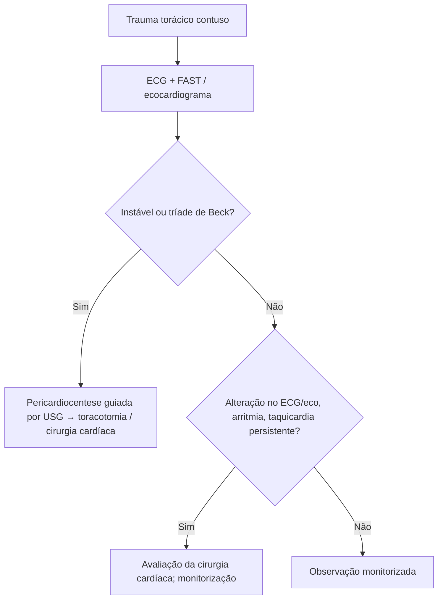

# Trauma Cardíaco Contuso

> Resumo em palavras próprias do Whitebook (Condutas Cirúrgicas > Cirurgia Cardiovascular), sem fisiopatologia detalhada, autoria e referências. Confira detalhes e doses na fonte: https://whitebook.pebmed.com.br/conteudo/?id=49227&categoryId=207&subcategoryId=305

**Definição:** o trauma torácico contuso pode lesar o coração por transmissão de energia cinética, comprimindo-o contra esterno, vértebras ou gradil costal.

## Mecanismos e causas
Desaceleração rápida, impacto direto, mudança brusca da pressão intratorácica, compressão entre esterno e coluna, perfuração por fragmento ósseo. Mais comuns: acidentes automobilísticos, colisões e quedas. **Commotio cordis:** impacto preciso no tórax em período vulnerável do ciclo cardíaco desencadeia arritmia letal (rara, potencialmente fatal).

## Clínica
- Muito variável; outras lesões torácicas confundem. A pior forma é a ruptura de câmara (pode ser fatal no local).
- **Tríade de Beck** (hipotensão, turgência jugular, bulhas abafadas) = tamponamento. O **ventrículo direito** é o mais acometido (anterior); átrios menos (menor pressão e massa). Lesão inicial pode ser assintomática com ruptura tardia (laceração dinâmica pela contração).
- Lesão valvar aguda ou do septo interventricular → ICC aguda, congestão, dispneia, insuficiência respiratória; sopro é pista.
- Taquicardia isolada deve ser atribuída a inflamação ou perda sanguínea; se persistir após correção, ou surgirem arritmias/novo bloqueio de ramo, buscar lesão cardíaca.

## Diagnóstico
**Ecocardiograma** é o exame de escolha (função, disfunção segmentar, comunicações, valvas, ruptura de parede); nem sempre disponível. **FAST** é alternativa (tamponamento e sangramento). **Enzimas cardíacas:** papel incerto (sobem em traumas leves), não pedir de rotina. **ECG** em todo paciente com dor torácica ou suspeita cardíaca. Diferencial: trauma torácico, fratura de costela, choque.

## Tratamento
- Lesões leves: observação com monitorização cardíaca.
- Lesões importantes (câmaras/estruturas): equipe de cirurgia cardíaca e cirurgia se indicada. **Evitar vasopressores e ventilação com pressão positiva** quando possível (aumento de pressão nas câmaras agrava ruptura).
- Hipotensão + bulhas abafadas + turgência jugular: **pericardiocentese**, de preferência guiada por USG. Derrame pericárdico (com ou sem tamponamento): preferencialmente **toracotomia** para avaliar lesões cardíacas associadas.

## Fluxograma (refeito, a partir do texto; o original não traz algoritmo)

