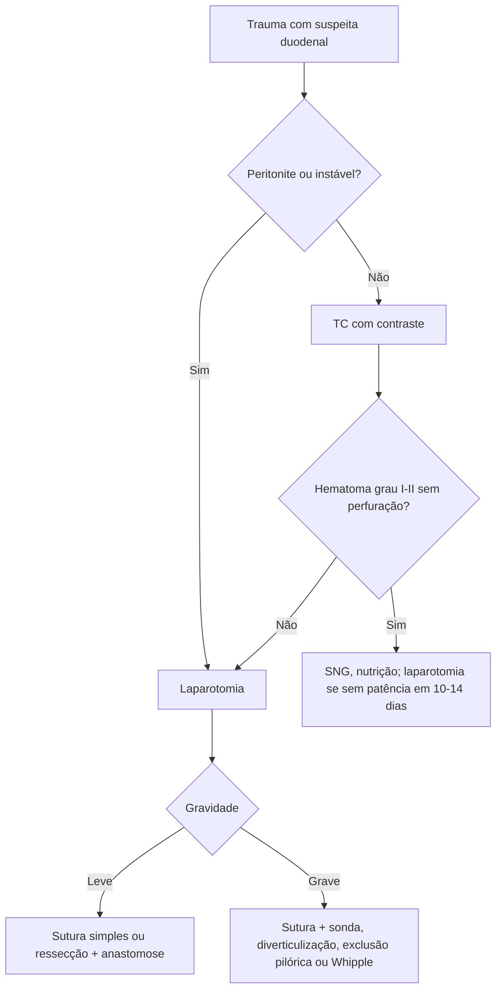

# Trauma Duodenal

> Resumo em palavras próprias do Whitebook (Condutas Cirúrgicas > Cirurgia Geral e do Aparelho Digestivo), sem fisiopatologia, autoria e referências. Confira detalhes e doses na fonte: https://whitebook.pebmed.com.br/conteudo/?id=45399&categoryId=207&subcategoryId=211

**Definição:** laceração ou hematoma de qualquer porção do duodeno por trauma abdominal fechado ou penetrante. O duodeno vai do piloro ao ângulo de Treitz e é em grande parte retroperitoneal.

## Epidemiologia e mecanismo
3–5% dos traumas abdominais; alta morbimortalidade; jovens do sexo masculino; trauma penetrante causa 61–88%. No contuso: compressão entre a coluna e volante, cinto ou guidão.

## Clínica
- Dor no abdome superior; equimose ou “sinal do cinto” em sedados; abdome tenso e peritonismo não específicos; palpar a coluna (fratura transversa vertebral → lesão abdominal em ~1/3).
- Evolução desfavorável: dor e tensão crescentes, vômitos persistentes com intolerância oral, hipotensão inexplicada, leucocitose crescente, obstrução alta, sepse.
- Perfuração retroperitoneal: taquicardia, dor em hipocôndrio direito, vômito, febre; peritonite se extravasa para a cavidade.

## Imagem (TC)
Espessamento parietal, líquido periduodenal ou no espaço perirrenal anterior direito, menor captação de contraste na parede, “sinal do coágulo sentinela”, ar ou contraste extraluminal (perfuração).

## Classificação
I — hematoma de uma porção ou laceração parcial sem perfuração; II — hematoma de mais de uma porção, laceração < 50% da circunferência, ou maior sem lesão ductal/perda tecidual; III — laceração de 50–75% da 2ª porção ou 50–100% da 1ª, 3ª ou 4ª; IV — laceração > 75% da 2ª porção, ou envolvendo ampola/colédoco distal; V — laceração maciça do complexo duodenopancreático ou desvascularização.

## Tratamento
**Conservador** (trauma contuso grau I–II, hematoma): SNG, suporte nutricional; nutrição enteral precoce (sonda posicionada) é preferível; se obstrução alta por hematoma, nutrição parenteral; se sem patência após **10–14 dias**, laparotomia. Jejunostomia alimentar pode ser necessária (graus III–IV).

**Cirúrgico:** penetrante (transecções); contuso com transecção parcial/total ou baixo grau com falha clínica após 2 semanas.
- Avaliar o duodeno em toda laparotomia; inspecionar o retroperitônio (bile, bolhas, hematoma). **Hematoma duodenal achado na laparotomia deve ser preservado** (não abrir, para não transformá-lo em lesão de espessura total); só descomprimir se falhar o conservador.
- **Controle de danos:** controlar sangramento e contaminação, tamponamento e fechamento temporário, depois UTI (volume, aquecimento, coagulação).
- Maioria: desbridamento e sutura simples ou ressecção e anastomose. Lesão grave: sutura primária com sonda descompressiva; diverticulização duodenal; **exclusão pilórica** (Vaughan: sutura da lesão, fechamento do piloro por gastrotomia, gastrojejunostomia nesse local); duodenopancreatectomia (Whipple).

## Complicações
Abscesso intra-abdominal, pancreatite pós-traumática, fístula duodenal. Maior risco: trauma de alta energia, lesão > 75% da circunferência, 1ª ou 2ª porção, reparo atrasado > 24 h, lesão do colédoco.

## Fluxograma (refeito, a partir do texto; o texto original não traz uma figura)

