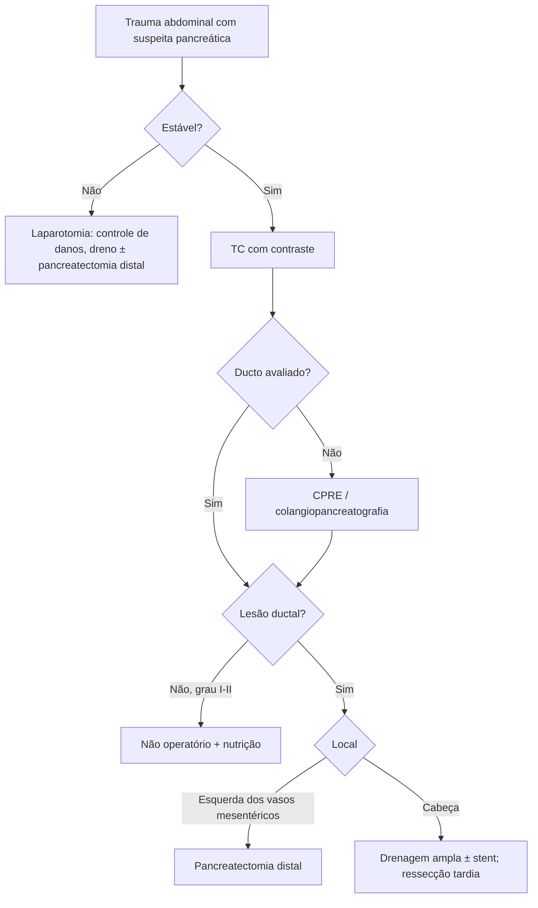

# Trauma Pancreático

> Resumo em palavras próprias do Whitebook (Condutas Cirúrgicas > Cirurgia Geral e do Aparelho Digestivo), sem fisiopatologia, autoria e referências. Confira detalhes e doses na fonte: https://whitebook.pebmed.com.br/conteudo/?id=45400&categoryId=207&subcategoryId=211

**Definição:** lesão do pâncreas por trauma abdominal fechado (compressão contra a coluna: volante, cinto, guidão; quedas, agressões) ou penetrante (arma branca e, sobretudo, de fogo). A integridade do **ducto pancreático** é o principal preditor de morbimortalidade.

## Epidemiologia
3–5% dos traumas abdominais fechados do adulto; < 1% em crianças; graus I–II = 70%. Série do National Trauma Data Bank (2019; 8.386 casos): 61% contusos, 39% penetrantes.

## Clínica
- Dor no abdome superior (lúcidos); equimose de parede ou “sinal do cinto” em sedados ou com lesão neurológica; abdome tenso e peritonismo indicam lesão intra-abdominal, mas não específica.
- Palpar coluna torácica e lombar: fratura transversa do corpo vertebral acompanha lesão intra-abdominal em ~1/3.

## Diagnóstico
- Mecanismo compressivo sugere a lesão; confirmação por **TC** ou na laparotomia. **Amilase e lipase não devem ser usadas** para diagnóstico.
- **TC:** laceração/hematoma, extravasamento ativo de contraste, edema/aumento heterogêneo, baixa atenuação, líquido peripancreático; avalia parênquima e ducto.
- Se a TC não define o ducto: **colangiopancreatografia** (método mais acurado para lesão ductal; o fator mais importante na decisão entre conservador, cirurgia imediata ou minimamente invasiva). Indicada em estáveis com TC inconclusiva ou quando não houve estudo contrastado no intraoperatório; a CPRE pode tratar (stent biliar ou pancreático) por via endoscópica ou percutânea.

## Classificação (AAST)
I — hematoma/contusão menor ou laceração superficial, sem lesão ductal; II — contusão/laceração maior sem lesão ductal ou perda tecidual; III — transecção distal ou lesão ductal/parenquimatosa; IV — transecção proximal (à direita da veia mesentérica superior) ou lesão envolvendo a ampola; V — disrupção massiva da cabeça.

## Tratamento
**Não operatório:** crescente para graus I e muitos II, e até III sem lesão ductal confirmada e sem outra lesão que exija laparotomia. Depende de estabilidade hemodinâmica e exclusão de lesão ductal (lesão ductal e trauma penetrante são fatores contrários). Descompressão GI e suporte nutricional; enteral precoce > parenteral.

**Cirúrgico:**
- Avaliar o pâncreas em toda laparotomia; checar duodeno e ducto; após controle de hemorragia e contaminação, inspecionar o retroperitônio (bile, bolhas de ar, hematoma peripancreático). Colangiografia intraoperatória por lesão duodenal ou duodenotomia anterior.
- **Sinais de lesão ductal:** lesão ductal visível, transecção completa, laceração > 50%, perfuração central, maceração grave.
- Evitar drenagem simples isolada. Lesão à esquerda dos vasos mesentéricos (grau III): **pancreatectomia distal** (menos complicações que dreno); **esplenopancreatectomia** estendida à direita é a opção de emergência mais rápida.
- **Controle de danos:** tamponamento, fechamento temporário, UTI (volume, aquecimento, coagulação); pancreatectomia distal rápida possível; lesões ductais: drenagem ampla; sangramento da cauda: compressas; cabeça (frequentemente com duodeno) pode exigir ressecção sem reconstrução.
- **Graus IV–V (cabeça):** entre duodenopancreatectomia e conservador; drenagem ampla de contato é rápida e deixa opções (reoperação precoce por equipe experiente, stent endoscópico, drenagem pancreaticocutânea dirigida). A maioria das fístulas puras cura sozinha ou evolui para pseudocisto/abscesso.
- Grau > III: pelo menos **dois drenos de sucção** (um acima e um abaixo do pâncreas).

## Complicações
Fístula pancreática, pseudocisto, abscesso intra-abdominal. Maior risco: trauma de alta energia, reparo atrasado > 24 h, lesão da via biliar comum.

## Fluxograma (refeito, a partir do texto; o texto original não traz uma figura)

