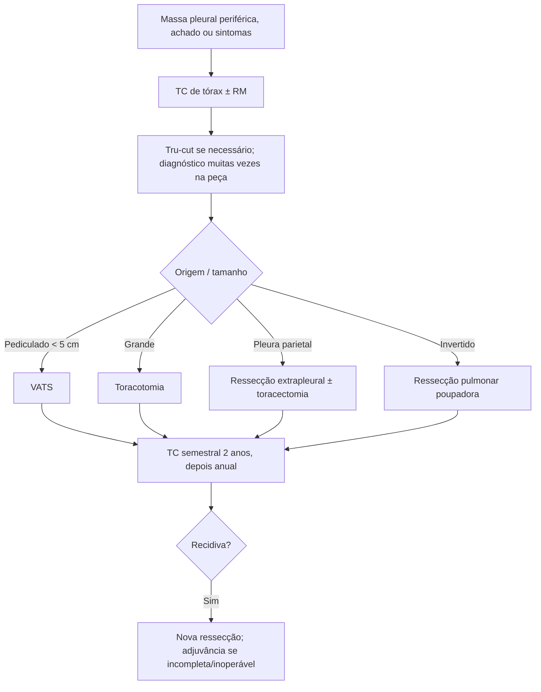

# Tumor Fibroso de Pleura

> Resumo em palavras próprias do Whitebook (Condutas Cirúrgicas > Cirurgia Oncológica), sem fisiopatologia, autoria e referências. Confira detalhes e doses na fonte: https://whitebook.pebmed.com.br/conteudo/?id=39193&categoryId=207&subcategoryId=212

**Definição:** neoplasia pleural rara, mesenquimal, em geral benigna (tumor fibroso solitário da pleura). Não se associa a asbesto nem a tabagismo; sem predisposição genética conhecida.

## Patologia
- Sem os dados de fisiopatologia: o texto traz achados anatomopatológicos úteis ao diagnóstico — tumor branco, fibroso, encapsulado, de 1 a 36 cm (mediana 7–9 cm); histologia “sem padrão” (células fusiformes com colágeno), pouco celular, baixo índice mitótico. IHQ: vimentina, CD34 e bcl-2 positivos; CEA e citoqueratina negativos.
- **Padrão de malignidade (England):** alta celularidade, núcleos sobrepostos, > 4 mitoses por campo maior, pleomorfismo significativo. Preditores de malignização (≈20%): > 10 cm, hemorragia/necrose, séssil, derrame ipsilateral, crianças/adolescentes.

## Clínica
- 5% dos tumores pleurais; sem predileção por sexo; 6ª–7ª décadas; 80–90% benignos; tende a recidivar mesmo após ressecção completa e pode malignizar.
- Geralmente assintomático (> 50% incidentalomas, curso indolente). 40–60% sintomáticos: tosse, dispneia, dor torácica, hemoptise, pneumonia obstrutiva, síndrome de veia cava, baixo débito por compressão cardíaca; inespecíficos: perda de peso, fadiga, febre (mais nos malignos). Derrame pleural em 0–12% (seroso ou sero-hemático; citologia raramente diagnóstica).
- **Osteoartropatia hipertrófica** (Bamberger-Marie) e baqueteamento em 10–20% (tumores > 7–10 cm; ácido hialurônico): edema de punhos/mãos, dor em ossos longos, sobretudo tíbia. **Síndrome de Doege-Potter:** hipoglicemia hipoinsulinêmica por IGF-II, mais em tumores malignos, grandes ou com muitas mitoses.

## Diagnóstico
- **Radiografia:** lesão arredondada/ovalada, bem delimitada, periférica, em campos médio/inferior, às vezes móvel com a posição (pedunculada), com ou sem derrame.
- **TC:** densidade de partes moles heterogênea, geralmente < 10 cm, contato com a pleura, compressão de estruturas; avalia plano de clivagem; contraste mostra vascularização, hemorragia ou necrose; ~80% têm pedículo vascular; raramente origem parenquimatosa (“tumor invertido”) ou múltiplos; grandes lesões da pleura mediastinal podem simular massa mediastinal.
- **RM:** melhor para extensão e invasão de diafragma/parede; captação heterogênea; não distingue benigno de maligno. **Angiografia:** mostra o suprimento pelo pedículo. **PET-CT:** não diferencia; pouca captação ajuda a afastar outras malignidades.
- **Biópsia:** citologia em geral não diagnóstica; risco de sangramento (um caso de implante no trajeto); preferir agulha Tru-cut à fina; o diagnóstico definitivo costuma vir só com a ressecção.
- **Diferenciais:** mesotelioma, sarcoma, tumores germinativos, neurogênicos, timoma, linfoma, neoplasia pulmonar, metástase.

## Tratamento
- Cirurgia se factível e paciente elegível. VATS para lesões pediculadas < 5 cm; toracotomia para grandes. Origem na pleura parietal → ressecção extrapleural; invasão do gradil → toracectomia associada; tumor invertido → ressecção pulmonar poupadora (sublobar, lobectomia ou pneumectomia).
- Adjuvância (QT ou RT) com resultados inconclusivos; usada em recidiva, ressecção incompleta ou inoperável.

## Seguimento e prognóstico
- TC de tórax semestral por 2 anos e depois anual, por mais de 15 anos. Recidiva local → suspeitar de malignidade e reoperar.
- Sobrevida global em 5 anos 79–100%; tamanho não se relaciona diretamente; menor recidiva em pedunculados não invasivos (geralmente no mesmo hemitórax em 24 meses); melhor fator prognóstico = ressecção completa. Metástases: fígado, SNC, baço, peritônio, adrenais, TGI, rins, ossos; recidivas podem ser mais agressivas.

## Fluxograma (refeito, a partir do texto; o original não traz algoritmo)

