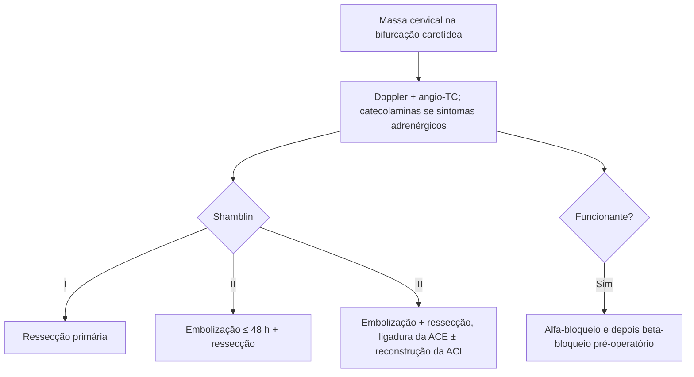

# Tumor de Glômus Carotídeo

> Resumo em palavras próprias do Whitebook (Condutas Cirúrgicas > Cirurgia Vascular), sem autoria e referências. Confira detalhes e doses na fonte: https://whitebook.pebmed.com.br/conteudo/?id=64217&categoryId=207&subcategoryId=238

**Definição:** neoplasia rara, em geral benigna, de células paraganglionares quimiorreceptoras (crista neural) no corpo carotídeo; crescimento lento, em contato íntimo com estruturas cervicais nobres.

## Epidemiologia
Subtipos esporádico (o mais comum), familiar (até 35% bilateral) e hiperplásico (altitude elevada). Funcionantes (secretam catecolaminas) × não funcionantes (a maioria). Incidência ~1–2/100.000.

## Clínica
Assintomático no início; massa cervical indolor, pulsátil ou não. Funcionantes: palpitação, sudorese, hipertensão. Compressivos: Horner, rouquidão, disfagia, disfonia, atrofia do trapézio. Perguntar história familiar e origem (altitude).
**Exame:** massa firme, elástica, indolor, anterolateral na bifurcação carotídea (anterior ao esternocleidomastóideo); **sinal de Fontaine** (move-se lateralmente, pouco na vertical); pulsatilidade em geral transmitida da carótida.

## Diagnóstico
- **Doppler:** 1ª linha, lesão hipervascularizada na bifurcação, mede o tamanho.
- **Angio-TC cervical:** planejamento, relação com estruturas, nutrição, ressecabilidade; define Shamblin.
- **Arteriografia seletiva:** padrão-ouro para a vascularização; **sinal da lira** (patognomônico: alargamento entre as carótidas interna e externa); usada para embolização pré-operatória.
- Catecolaminas séricas e metanefrinas urinárias se suspeita de funcionante.
- **Shamblin:** I pouca relação com a adventícia; II envolvimento parcial da bifurcação sem circunferência; III envolve 360° os ramos (inclusive a ACI). Define a estratégia e a ressecabilidade.
- **Diferencial:** aneurisma carotídeo, linfonodomegalia, cisto branquial, cisto tireoglosso, bócio/tumor de tireoide.

## Tratamento
Cirúrgico sempre que possível.
- Funcionante: **bloqueio alfa, depois beta** antes da cirurgia.
- Shamblin I: ressecção primária, sem grandes intercorrências.
- Shamblin II/III: **embolização pré-operatória** (até 48 h antes, microesferas, pelo ramo nutridor, em geral da carótida externa) para reduzir sangramento.
- Shamblin III: ligadura da carótida externa e, às vezes, ressecção e **reconstrução da interna** com safena ou PTFE.
- Casos complexos/volumosos: equipe multiprofissional (vascular + cabeça e pescoço); mandibulotomia/ressecção mandibular em selecionados.

## Fluxograma (refeito, a partir do texto; o original traz a classificação de Shamblin)

