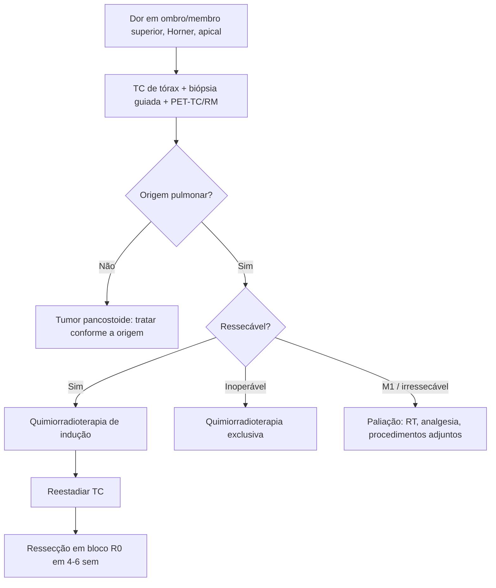

# Tumor de Pancoast

> Resumo em palavras próprias do Whitebook (Condutas Cirúrgicas > Cirurgia Oncológica), sem fisiopatologia, autoria e referências. Confira detalhes e doses na fonte: https://whitebook.pebmed.com.br/conteudo/?id=50380&categoryId=207&subcategoryId=212

**Definição:** tumor pulmonar do ápice que invade estruturas da abertura torácica superior (pleura parietal, 1º e 2º arcos costais, vasos subclávios, plexo braquial, corpos vertebrais, gânglio estrelado), com ou sem a síndrome de Tobias-Pancoast. Tumor **pancostoide (“Pancoast-like”)**: apical, primário ou metastático, de origem não pulmonar, com dor em ombro irradiada ao membro superior. “Sulco superior” é termo anatômico mal definido. Acomete sobretudo os compartimentos médio e posterior (2/3).

## Epidemiologia
Raro: 2,7–8,5% dos carcinomas pulmonares (< 5% em média). Tabagismo é o principal fator de risco; mais em homens na 6ª década. Biologicamente semelhante aos CPNPC; raramente é de pequenas células. Menos de 50% são ressecáveis ao diagnóstico; 10–20% têm N2.

## Clínica
- **Dor** contínua, progressiva, intensa, incapacitante, refratária a analgésicos comuns, na cintura escapular ipsilateral com irradiação para axila, escápula e membro superior; frequentemente confundida com doença ortopédica/reumatológica. Sintomas pulmonares clássicos (hemoptise, tosse, dispneia) são incomuns pela localização periférica.
- **Exame:** fraqueza e atrofia dos músculos intrínsecos da mão; edema do braço (trombose da subclávia); paralisia diafragmática (frênico); disautonomia facial (hipertermia, eritema, anidrose); exame neurológico essencial.
- **Síndromes:** dor + fraqueza + disestesia em C8–T1 + Claude-Bernard-Horner (enoftalmia, ptose, anidrose, miose ipsilaterais; gânglio estrelado) com destruição da 1ª costela ou vértebra — síndrome completa em ~10%; Horner em 25–40%.
- **Compartimentos:** *anterior* (esterno à borda anterior do escaleno anterior; veia subclávia, jugulares; dor na parede anterior, trombose venosa); *médio* (entre escalenos anterior e médio; artéria subclávia, troncos do plexo, frênico; dor/parestesia no ombro e braço, trombose arterial, paralisia diafragmática); *posterior* (atrás do escaleno posterior; vertebral, gânglio estrelado, cadeia simpática, forame neural, vértebras; dor axilar e face medial do braço, Horner).

## Diagnóstico
- Radiografia pouco sensível (opacidade apical com osteólise; incidência lordótica). **TC de tórax:** principal exame (parênquima, invasão, linfonodos, guia de biópsia). Estadiamento sistêmico com PET-TC; sem ele, cintilografia óssea e TC de abdome/pelve. (O texto cita ainda imagens de invasão local/vascular e ressonância; conferir na fonte.)
- **Histologia sempre** (se não for pulmonar, é pancostoide): punção transtorácica guiada por USG/TC (90% de diagnóstico), biópsia excisional de linfonodo supraclavicular/escaleno, minitoracotomia axilar ou pleuroscopia; broncoscopia tem baixo rendimento, em geral não indicada.
- **Diferenciais:** tumor primário da parede, mesotelioma, metástases, linfoma, tuberculose, aspergilose, actinomicose, equinococose, abscesso, tumor pseudoinflamatório, amiloidose, pseudoaneurisma de carótida, hemangioma.
- **Estadiamento AJCC 2018:** T3 = pleura parietal, parede, frênico, pericárdio parietal; T4 = corpo vertebral ou canal espinhal, vasos subclávios e/ou ramos superiores do plexo (C8 ou acima). Linfonodos escalênicos/supraclaviculares ipsilaterais (N3 formal) comportam-se como doença local, se sem N2. Grupos: T3N0 = IIB; T3N1–2 = IIIA; T4 qualquer N = IIIB; N3 = IIIB; M1 = IV.

## Tratamento
Ideal em centros experientes (≥ 2 casos/ano). Tratamento trimodal em pacientes selecionados dá os melhores resultados.
- **Curativo:** quimiorradioterapia de indução (concomitante, baseada em platina; protocolos SWOG 9416 e JCOG 9806), seguida de ressecção em bloco. Reestadiar com TC de tórax e abdome ao fim da indução. Cirurgia idealmente 4–6 semanas após o término (evitar o pico de fibrose actínica em 2–3 meses). Preparo: avaliação cardiopulmonar (DLCO), Doppler de vasos se ressecção arterial for planejada.
- **Irressecável:** metástases extratorácicas; N2/N3 (ver exceção escalênica/supraclavicular isolada); invasão vertebral > 50%; acometimento nervoso acima de T1; infiltração do plexo com perda motora; traqueia/esôfago/mediastino; baixa reserva cardiopulmonar.
- **Cirurgia:** ressecção em bloco R0 (± hemivertebrectomia/laminectomia, ligadura de veia subclávia, arterioplastia); primeiro a parede, depois lobectomia/ressecção anatômica com linfadenectomia mediastinal; reconstrução com prótese se necessário (defeitos cobertos pela escápula geralmente dispensam); equipe multidisciplinar (torácica, ortopedia, neurocirurgia). **Vias:** posterior — Shaw-Paulson (toracotomia posterolateral); anterior (melhor para plexo e subclávios) — Dartevelle (transclavicular), Grunenwald/Spaggiari (transmanubrial), hemi-clamshell, Masaoka (alçapão); combinações, VATS e robótica.
- **Complicações:** hemotórax, quilotórax, fuga aérea, atelectasia, pneumonia, ISC, empiema, arritmia, IAM, discinesia da parede, trombose, fístula liquórica, pneumoencéfalo, Horner, ventilação prolongada, déficit nervoso, neuralgia pós-toracotomia, instabilidade da cintura escapular.
- **Potencialmente curativo (inoperável):** quimiorradioterapia exclusiva.
- **Paliativo:** foco na dor; radioterapia paliativa; cirurgias adjuntas — cordotomia, rizotomia posterior seletiva, mielotomia comissural, talamotomia estereotáxica.

## Prognóstico
Falha principalmente por metástase a distância (SNC 40–80%, ossos); recidiva locorregional < 30% com terapia trimodal. Pior: Horner, N2/N3, subclávios/vértebras/costelas, R1/R2, ressecção não anatômica. Sobrevida em 5 anos: 46–61% com trimodal; 0–6,25% só paliação.

## Fluxograma (refeito, a partir do texto; o original não traz algoritmo)

