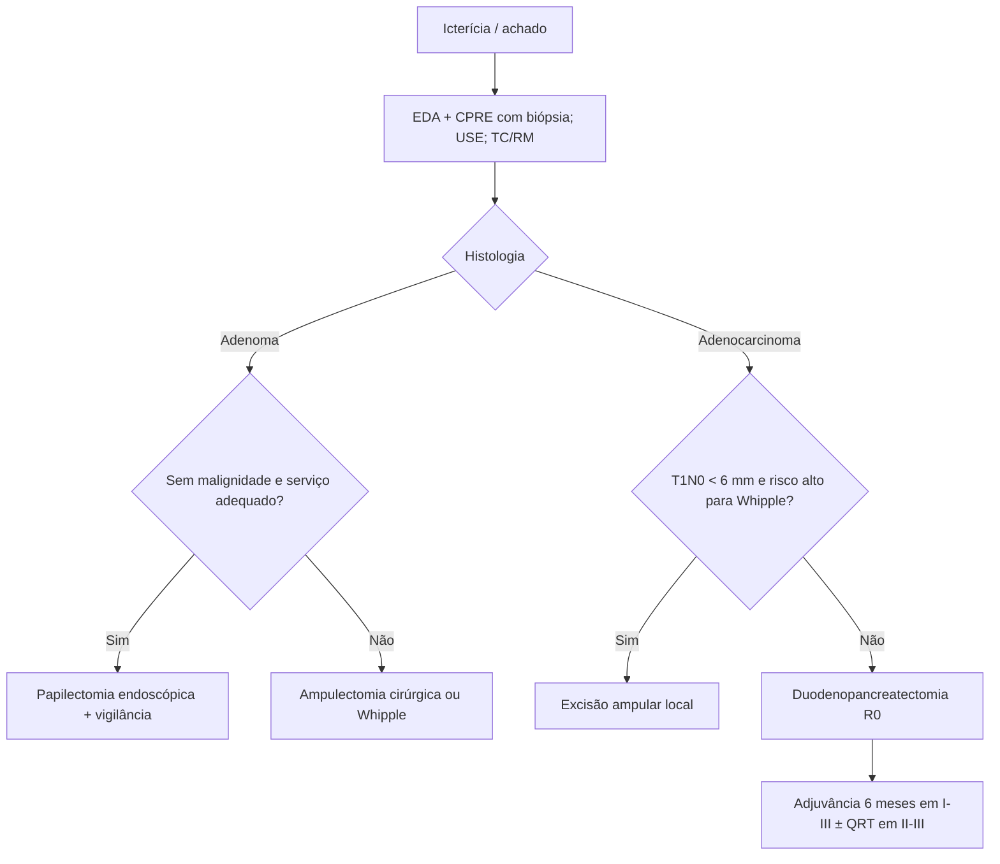

# Tumor de Papila Duodenal

> Resumo em palavras próprias do Whitebook (Condutas Cirúrgicas > Cirurgia Oncológica), sem fisiopatologia, autoria e referências. Confira detalhes e doses na fonte: https://whitebook.pebmed.com.br/conteudo/?id=63099&categoryId=207&subcategoryId=212

**Definição:** tumores da papila duodenal ou ampola de Vater (ampulares), benignos ou malignos. Adenoma é a lesão benigna mais comum e adenocarcinoma, a maligna principal.

## Adenoma de papila
- Lesão pré-maligna: 15–60% têm foco de adenocarcinoma. Origina-se da mucosa da papila maior, esporádico ou associado a polipose adenomatosa familiar.
- **Clínica:** icterícia em 50–75%, em geral indolor ou com desconforto epigástrico vago; menos comuns: prurido, cólica biliar, náuseas/vômitos, colangite, pancreatite aguda. Imagem (icterícia obstrutiva): dilatação do ducto biliar ou cálculos. EDA e CPRE identificam e permitem biópsia.
- **Tratamento** (sem estudos randomizados): papilectomia endoscópica é bem indicada sem evidência de malignidade, em serviço com endoscopia intervencionista; duodenopancreatectomia ressecaria curativamente e elimina recidiva local (adenomas não esporádicos), mas com grande morbimortalidade; ampulectomia cirúrgica (remoção da ampola) tem menor morbimortalidade, porém margens inadequadas e recidiva. Decidir pelas características do adenoma e do paciente, polipose duodenal associada, experiência endoscópica e aceitação de vigilância endoscópica prolongada.

## Adenocarcinoma de papila
- Raro: 4–10 casos por milhão; 6% dos tumores periampulares (pâncreas, ampola, vias biliares, duodeno). Esporádico ou em síndromes de polipose (risco 200–300× maior, e mais precoce); pico aos 60–70 anos nos esporádicos. Prognóstico melhor que o dos periampulares pancreáticos e biliares; histologia e sequência adenoma-carcinoma lembram o intestino.
- **Clínica:** icterícia (~80%), dor, febre, náusea leve, dispepsia, esteatorreia, perda de peso, fadiga, sangramento nas fezes.
- **Diagnóstico:** USG (inicial, raramente vê o tumor); TC e RM (tumor, metástases, ressecabilidade); CPRE (identifica, biopsia e descomprime); ecoendoscopia (extensão, linfonodos, biópsia; sensibilidade semelhante à CPRE para tumores pequenos).
- **TNM (8ª ed.):** T1a limitado à ampola/esfíncter de Oddi; T1b além do esfíncter e/ou submucosa duodenal; T2 muscular própria; T3a até 0,5 cm do pâncreas; T3b > 0,5 cm ou tecido peripancreático/serosa duodenal sem tronco celíaco/AMS; T4 AMS, celíaco ou hepática comum. N1 1–3; N2 ≥ 4. **Estágios:** 0 Tis; IA T1a N0; IB T1b–T2 N0; IIA T3a N0; IIB T3b N0; IIIA T1–3 N1; IIIB qualquer T N2 ou T4; IV M1.
- **Tratamento:** cirurgia é o único curativo, exigindo R0; padrão: duodenopancreatectomia (Whipple). Ressecção local tem menos morbidade, mas mais recidiva e menor sobrevida em doença invasiva; excisão ampular local pode ser considerada em T1N0 < 6 mm na USE, preferindo-se a cirurgia agressiva nos invasivos (inclusive T1 bem diferenciados) se o paciente tolera Whipple.
- **Adjuvância (NCCN 2026):** estágios I–III (observação pode ser considerada nos I–II), 6 meses, iniciando em até 12 semanas; opcionalmente QRT nos II–III. Esquemas: 5-FU/leucovorina ou gencitabina; também capecitabina, FOLFOX, CAPEOX, capecitabina/gencitabina, cisplatina/gencitabina e mFOLFIRINOX em alguns casos. RT para alto risco de recidiva, margens comprometidas e linfonodos positivos.

## Fluxograma (refeito, a partir do texto; o original não traz algoritmo)

