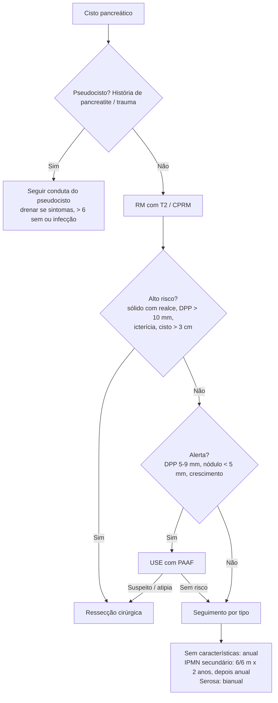

# Tumores Císticos do Pâncreas

> Resumo em palavras próprias do Whitebook (Condutas Cirúrgicas > Cirurgia Geral e do Aparelho Digestivo), sem fisiopatologia, autoria e referências. Confira detalhes e doses na fonte: https://whitebook.pebmed.com.br/conteudo/?id=22591&categoryId=207&subcategoryId=211

Relativamente raros, mas detectados em **40–50%** das RM de abdome feitas por outros motivos; geralmente benignos; prevalência cresce com a idade. O **pseudocisto** é a lesão cística mais comum. Em geral incidentalomas, mas podem causar dor e icterícia.

## Classificação
- Pseudocisto (não neoplásico).
- **Neoplásicos:** cística serosa, sólida pseudopapilar, cística mucinosa, intraductal mucinosa papilar (IPMN).
- **Não neoplásicos:** cisto verdadeiro/epitelial benigno, de retenção, mucinoso não neoplásico, linfoepitelioide.

## Diagnóstico por imagem e punção
- **TC** (protocolo pâncreas) para diagnóstico e seguimento. **RM** (T2) costuma ser o 1º passo: avalia o componente cístico e permite seguimento sem radiação. **Colangiorressonância:** avalia a comunicação com o ducto pancreático principal (DPP).
- **USE:** caracteriza a lesão e guia a punção (PAAF 19–22 G, transgástrica ou transduodenal na cabeça): viscosidade, CEA, mutações GNAS/KRAS, amilase, citologia.
  - **Indicações de PAAF:** > 1,5 cm; componente sólido; DPP > 5 mm; sintomas; história familiar de câncer de pâncreas.
  - **Complicações:** pancreatite aguda (mais na cabeça/uncinado, leve a moderada), infecção (profilaxia com quinolona ou cefalosporina de 2ª geração), sangramento.
- Excluído o pseudocisto, definir o tipo por epidemiologia, imagem e características do líquido.

## Conduta geral
Depende do quadro, do potencial de malignidade, do desejo do paciente e do risco operatório; referências: AGA e Fukuoka.
- Lesão sem características de risco: RM (T2) após **1 ano**; se estável, encerrar; se mudou, investigar.
- Se houver características a esclarecer: RM de pâncreas/colangiorressonância; sem características → seguimento anual; IPMN de ducto secundário → 6/6 meses por 2 anos, depois anual; neoplasia cística serosa → bianual; sem tempo máximo definido de seguimento.
- **Ressecção** se: cisto **> 3 cm**; icterícia obstrutiva com cisto na cabeça; componente sólido com realce; DPP **> 10 mm**. Considerar também: nódulo mural, achados suspeitos no DPP (espessamento, nódulo, mucina), citologia suspeita ou positiva. Nenhum consenso define com exatidão quem operar.

## Pseudocisto pancreático
- Coleção inflamatória com parede de fibrose/granulação (sem epitélio) após pancreatite aguda/crônica ou trauma; ocorre em **10–20%** das pancreatites agudas por cronificação (> 4 semanas) de coleção peripancreática aguda; geralmente estéril.
- **Clínica:** dor persistente após a pancreatite, saciedade precoce, perda de peso; complicações: hemorragia, ruptura (ascite), infecção.
- **Diagnóstico:** coleção peripancreática com cápsula fina que realça após 4 semanas de pancreatite não necrosante; sem sólidos/debris; 2–20 cm; comunica com o DPP; USE é a mais usada no diferencial (coleção hipoecoica com halo espesso). Líquido: amilase **> 250 U/mL** (< 250 praticamente exclui), opaco, baixa viscosidade, sem células epiteliais. Pancreatite necrosante com componentes não sólidos após 4 semanas = necrose encapsulada (WON).
- **Tratamento:** a maioria resolve sozinha. Drenar se volumoso persistente ou crescente em 6 semanas, sintomas (dor, obstrução pilórica, icterícia, perda de peso) ou infecção/abscesso. Momento ideal: após maturação (**6–8 semanas**, cápsula na USE). Vias: percutânea; endoscópica transmural (pigtail ou prótese metálica, guiada por USE); endoscópica transpapilar (menos sangramento e perfuração, limitada em lesões volumosas); cirúrgica apenas se as demais falharem.

## Neoplasia cística serosa
- Cisto verdadeiro com líquido seroso; 1–2% dos tumores exócrinos; mulheres > 60 anos ("tumor da avó"); benigna, malignização ~**0,1%**; corpo/cauda; associada à doença de von Hippel-Lindau (mutação VHL).
- Em geral assintomática; grandes podem comprimir órgãos e formar massa palpável.
- **TC:** microcistos com septos finos em "favo de mel"; calcificação/cicatriz central em até 20% (patognomônica). Células ricas em glicogênio (PAS+). Líquido: amilase **< 250 U/mL**, CEA **< 5**.
- Variantes: macrocística, sólida serosa, associada à VHL, neuroendócrina mista serosa.
- **Conduta:** seguimento por imagem (às vezes dispensável). Ressecar se sintomática com lesão **> 4 cm**, crescimento ou dúvida diagnóstica.

## Neoplasia cística mucinosa (NCM)
- Cistos verdadeiros mucinosos, pré-malignos ou malignos (cistoadenoma, borderline, carcinoma in situ, cistoadenocarcinoma).
- **70%** sintomáticos (dor vaga, pancreatite); invasivos: síndrome consumptiva; até **25%** já com metástase linfonodal/hepática ao diagnóstico.
- Epidemiologia: 2,5% dos tumores exócrinos e 16% dos cistos ressecados; **> 99% mulheres**, idade média 50 anos; ~1/3 dos ressecados com câncer invasivo; corpo/cauda; sobrevida em 5 anos nas formas invasivas **62%**.
- **Imagem:** cisto único, geralmente unilocular, encapsulado, septado, **6–11 cm**; calcificação periférica sugere malignização; não comunica com o DPP nem o dilata. Histologia: estroma ovariano, células colunares produtoras de mucina. Líquido: **CEA > 800 ng/mL**, mucina, amilase variável; mutações KRAS e RNF43.
- **Tratamento:** cirurgia em sintomáticos e com características malignas (sólido, atipia importante, adenocarcinoma); < 3 cm sem alarme: discutir ressecção vs seguimento (difícil distinguir de IPMN). Em geral pancreatectomia corpo-caudal; sem carcinoma invasivo, dispensa seguimento.

## Neoplasia sólida pseudopapilar (tumor de Frantz)
- Mista (sólida e cística hemorrágico-necrótica), baixo grau; **85% mulheres** jovens (25–30 anos), 20–25% em crianças; corpo/cauda; mutação CTNNB1 (Wnt/β-catenina).
- Hoje, achado incidental; sintomas por compressão (dor, náuseas, vômitos, massa).
- **TC:** lesão única, grande, encapsulada com cápsula espessa, cístico-sólida com realce; hemorragia/degeneração central; calcificação rara. Aspirado sanguinolento, celularizado, CEA baixo, epitélio não mucinoso. Carcinoma: invasão vascular/perineural/adjacente ou metástases (fígado).
- **Tratamento:** sempre cirúrgico e curativo, com baixa recidiva (maior risco com invasão linfovascular/capsular e metástases sincrônicas).

## IPMN
- Tumores mucinosos do pâncreas exócrino com alto potencial maligno. **Tipos:** do DPP (dilatação ≥ 5 mm), de ductos secundários, mista. **Subtipos histológicos:** intestinal (mais evolui para malignidade), pancreatobiliar, gástrica, oncocítica.
- Neoplasia cística mais comum; mais homens (algumas séries sem diferença), 6ª–7ª décadas (média 65); cabeça e uncinado; ducto secundário é o mais frequente e de menor risco; mista ≈ ducto principal; alta recorrência. Maioria assintomática; pode causar icterícia e pancreatite.
- **Diagnóstico:** todos comunicam com o DPP (CPRM ou USE avaliam); até **40%** têm múltiplos cistos; estigmas de displasia alta/adenocarcinoma: nódulo mural, DPP dilatado (> 9 mm), parede espessa com realce, obstrução ductal; "boca de peixe" (mucina na papila) sugere IPMN de DPP; pancreatoscopia na dúvida. Líquido: mucina, **CEA > 200 ng/mL**; mutações GNAS, KRAS, RNF43, CTNNB1.
- **Alto risco (cirurgia, se possível):** icterícia relacionada; nódulo mural com realce **≥ 5 mm**; DPP **> 10 mm**.
- **Sinais de alerta (indicar USE):** DPP 5–9 mm; mudança abrupta de calibre com atrofia distal; nódulo mural com realce < 5 mm; parede espessada/realçada; cisto **≥ 3 cm**; pancreatite aguda recente; linfonodomegalia; CA 19-9 elevado; crescimento ≥ 5 mm em 2 anos. Após USE, operar se nódulo ≥ 5 mm, DPP suspeito ou citologia com atipia importante/adenocarcinoma.
- **Seguimento:** < 1 cm: TC/RM 6/6 meses e depois bianual; 1–2 cm: 6/6 meses por 1 ano, anual após 2 anos, espaçando até 2/2 anos; 2–3 cm: USE em 3–6 meses, depois até 1 ano alternando RM e USE (cirurgia em jovens aptos); **> 3 cm:** RM/USE alternados a cada 3–6 meses, cirurgia fortemente considerada em jovens aptos. Acompanhar o remanescente após Whipple/pancreatectomia distal.
- Grau de displasia só é definido na histologia. Sem condições cirúrgicas: ablação endoscópica com injeção de paclitaxel após lavagem com etanol, ou radiofrequência.

## Fluxograma (refeito; o original está em imagens na fonte)

