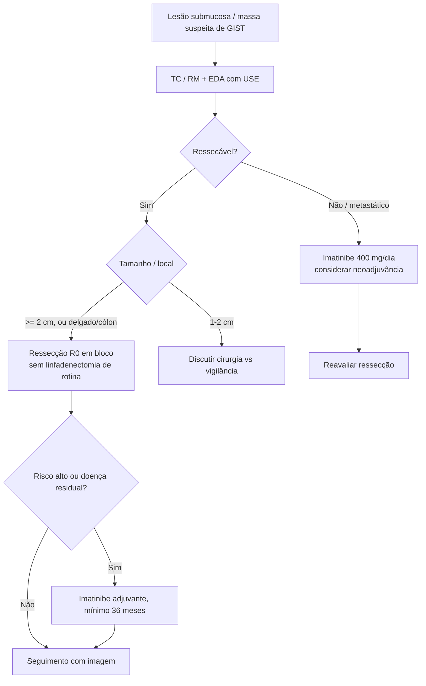

# Tumores Estromais do Tubo Digestivo (GISTs)

> Resumo em palavras próprias do Whitebook (Condutas Cirúrgicas > Cirurgia Geral e do Aparelho Digestivo), sem fisiopatologia, autoria e referências. Confira detalhes e doses na fonte: https://whitebook.pebmed.com.br/conteudo/?id=38912&categoryId=207&subcategoryId=211

**Definição:** tumores estromais do TGI, de origem mesenquimal (não epitelial); derivam das células intersticiais de Cajal.

## Conceitos gerais
- 1–2% das neoplasias primárias do TGI; os mesenquimais mais comuns; incidência 14,5/1.000.000/ano; 95% em adultos > 40 anos; igual entre os sexos. Casos pediátricos: tríade de Carney, Carney-Stratakis, neurofibromatose tipo 1.
- Comportamento variável; metástases linfonodais raras; hematogênicas: fígado (principal), peritônio, omento, pulmão, osso, subcutâneo, cérebro.
- Tamanho de milímetros a 40 cm. **Localização:** estômago 40–50% > delgado 30% > cólon 15% > duodeno 5% > esôfago, vesícula, apêndice 1%.
- Não costumam ser infiltrativos; moles, friáveis, vascularizados, podem ter degeneração cística.
- **Biologia:** 80–90% com mutação do **KIT** (éxons 11, 9, 13, 17), CD117+ e CD34+; ~5% com mutação do **PDGFRA**.
- Histologia: fusiforme 70%, epitelioide 20%, misto 10%. Prognóstico: tamanho, índice mitótico, sítio e mutação.

## Classificação de risco (Miettinen, adaptada)
| Grupo | Tamanho | Mitoses/50 CGA | Risco |
|---|---|---|---|
| 1 | ≤ 2 cm | ≤ 5 | Benigno |
| 2 | 2–5 | ≤ 5 | Baixo |
| 3A | 5–10 | ≤ 5 | Baixo |
| 3B | > 10 | ≤ 5 | Moderado |
| 4 | ≤ 2 | > 5 | Incerto/baixo |
| 5 | 2–5 | > 5 | Moderado |
| 6A | > 5 | > 5 | Alto |
| 6B | > 10 | > 5 | Alto |

O consenso de 2002 também estratifica em muito baixo, baixo, intermediário e alto risco por tamanho e mitoses (alto: > 5 cm com > 5 mitoses, > 10 cm com qualquer índice mitótico, qualquer tamanho com > 10 mitoses).

## Clínica
- Muitos < 2 cm, achados em endoscopia, imagem ou cirurgia. Sintomáticos: massa palpável, aumento do abdome, HDA, anorexia, perda de peso, obstrução, dor, náuseas/vômitos; ruptura (hemoperitônio, pneumoperitônio); raramente icterícia obstrutiva ou obstrução renal. Sintomas por compressão, não por invasão.

## Diagnóstico
- **EDA:** lesão submucosa ou massa intraluminal com ulceração apical; suspeitar quando biópsias mucosas são negativas.
- **TC/RM:** definição anatômica, planejamento e metástases hepáticas (que podem parecer cistos); lesões heterogêneas com líquido central e eventual calcificação. Angio-TC para avaliar compressão vascular em tumores centrais.
- **Biópsia** (percutânea ou endoscópica) não é rotina em tumores ressecáveis; indicada para neoadjuvância ou diferencial com linfoma (risco de implante peritoneal e sangramento). Biópsia endoscópica profunda (a mucosa costuma estar íntegra), ± USE.
- **Definitivo:** imuno-histoquímica: CD117 + (~90%), CD34 + (60–70%), actina de músculo liso (15–60%), desmina (< 2%), S100 (< 5%).
- **Diferenciais:** leiomioma, linfoma, metástases, schwannoma, melanoma metastático, tumores fibroblásticos (desmoide, miofibroblástico inflamatório, pólipo fibroide inflamatório).

## Cirurgia
Ressecção completa é o único tratamento curativo.
- **Indicações:** GIST **≥ 2 cm** em qualquer local; 1–2 cm: individualizar (observação difícil de recomendar); **cólon e delgado** independentemente do tamanho (mais agressivos); citorredução/resgate quando houver doença ressecável ou metastática (R0/R1 sempre que possível; todos recidivam depois); paliativa (obstrução, hemorragia).
- Em doença localizada, cirurgia é a 1ª etapa: ressecção completa em bloco, margem R0, congelação das margens. Margem ideal desconhecida (não precisa ser ampla como no adenocarcinoma).
- **Vias:** laparotomia (rotina); laparoscopia (< 2–3 cm, sobretudo gástricos); endoscópica (esôfago, estômago, reto, eventualmente).
- **Por sítio:** gástrico — ressecção em cunha, gastrectomia distal ou total (perto do piloro/cárdia); duodeno — ressecção econômica ou duodenopancreatectomia; delgado/cólon — ressecção segmentar com meso; reto distal — amputação abdominoperineal (radioterapia pode ajudar a poupar esfíncter). Linfadenectomia não é rotina em adultos, salvo linfonodos suspeitos adjacentes.

## Terapia-alvo
- **Imatinibe** (inibidor de tirosina quinase de KIT/PDGFRA): **400 mg/dia VO com alimentos**; na progressão, 600–800 mg/dia; em GIST extragástrico e éxon 9 pode-se subir a 800 mg/dia se não houver resposta em 3 semanas. Uso contínuo (mínimo **36 meses** em alto risco).
- **Indicações:** adjuvância (doença residual, avançado/metastático/recidivante); neoadjuvância ainda em estudo (simplificar cirurgia, converter via, reduzir estágio; ~6 meses antes, com resposta radiológica).
- Resposta em semanas, máxima em **6–9 meses**; depende do éxon: éxon 11 (72%), éxon 9 (32%), *wild type* (12%).
- **Resistência:** primária 5%, precoce 14%, tardia (a maioria; dose inadequada, granulócitos altos, lesões volumosas, extragástrico).
- **Efeitos colaterais:** cefaleia, náuseas/vômitos, retenção hídrica, câimbras, mialgia, diarreia, rash e bolhas, astenia, alteração de provas hepáticas, anemia, leucopenia, dor óssea, sangramento do TGI.
- **Sunitinibe** (multi-TKI; KIT, PDGFRA, VEGFR-1/2/3, RET, Flt3; antiangiogênico): 37,5 mg/dia contínuo ou 50 mg/dia por 4 semanas com 2 de pausa.

## Seguimento e prognóstico
- Exame clínico e imagem seriados: TC com contraste ou RM de abdome/pelve a cada 3–4 meses nos 2 primeiros anos; depois 4/4 ou 6/6 meses; após 5 anos, anual. PET-CT ideal, mas dispensável. Metastáticos sem tratamento: imagem se novos sintomas.
- **Recidiva:** 40–90% após cirurgia curativa; tempo médio nos avançados 18–24 meses; ligada a tamanho, local, manuseio e mitoses; peritônio e fígado (difusas, multifocais). Ressecção paliativa possível.
- Sobrevida média 17–50 meses; em 5 anos 20%; o imatinibe parece aumentar em 20% a sobrevida em 2 anos dos metastáticos vs ressecção isolada.

## Fluxograma (refeito, a partir do texto de conduta)

