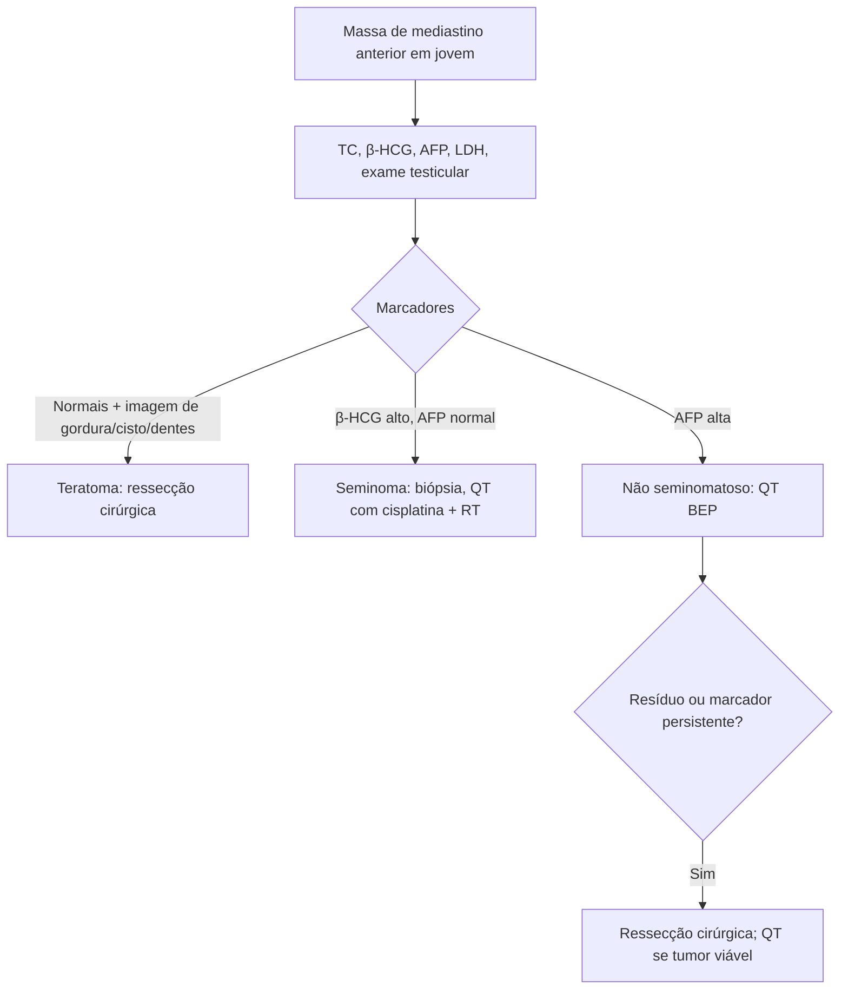

# Tumores Germinativos do Mediastino

> Resumo em palavras próprias do Whitebook (Condutas Cirúrgicas > Cirurgia Oncológica), sem fisiopatologia, autoria e referências. Confira detalhes e doses na fonte: https://whitebook.pebmed.com.br/conteudo/?id=44557&categoryId=207&subcategoryId=212

**Definição:** grupo heterogêneo de neoplasias benignas e malignas do mediastino. Mediastino anterossuperior é o sítio extragonadal mais comum (3–5% dos tumores germinativos; outros: retroperitônio, cervical, pineal, sacrococcígeo); 10–15% dos tumores mediastinais anteriores do adulto. Idade média 27 anos (20–50). Benignos são mais comuns (80%); malignos predominam em homens (seminomas).

**Comparação com os gonadais:** homens jovens, linha média, metástases em pulmão/fígado/ossos, subtipos seminomatoso e não seminomatoso, sensíveis a cisplatina, marcadores β-HCG e AFP. **Diferenças no mediastino:** efeito de massa, predomínio não seminomatoso, síndrome de Klinefelter em 8%, maior frequência de neoplasias hematológicas (leucemia não linfoide, mielodisplasia, histiocitose maligna). Sempre investigar tumor primário extratorácico/gonadal.

## Clínica
~2/3 dos teratomas benignos são assintomáticos; 80% dos malignos têm sintomas: dor torácica anterior, tosse, dispneia, febre, disfagia, perda de peso; síndrome de veia cava superior. O componente cístico pode infectar, romper para a pleura (empiema) ou brônquio (tricoptise — patognomônica — ou expectoração oleosa). Exame físico geralmente normal; examinar os testículos.

## Diagnóstico
- **Marcadores** (β-HCG, AFP, LDH em todos): teratoma benigno sem elevação; seminoma ↑ β-HCG com AFP normal; não seminomatoso ↑ AFP (80%) ± β-HCG; elevação de ambos permite tratar sem biópsia em muitos serviços. Tabela: seminoma (AFP −, β-HCG −/+); teratoma (−/−); teratoma com carcinoma embrionário (AFP +); carcinoma embrionário (AFP +); carcinoma embrionário com sinciciotrofoblasto (+/+); coriocarcinoma (β-HCG +); saco vitelínico (AFP + e β-HCG +, conforme tabela da fonte).
- **Imagem:** RX PA e perfil + TC de tórax com contraste (cístico × sólido, relações, invasão, necrose/hemorragia, derrames, linfonodos); RM não de rotina (vasos, parede torácica); PET-CT (extensão, massa residual pós-QT); USG gonadal discutível se exame testicular normal e sem outra doença metastática.
- **Biópsia:** punção transtorácica guiada por TC ou procedimento menor (Chamberlain, toracoscopia/VATS, mediastinoscopia), começando pelo menos invasivo; se houver linfonodo periférico suspeito, biópsia excisional antes.
- **Classificação:** teratoma maduro (sólido) e cisto dermoide; seminomatosos; não seminomatosos (saco vitelínico, embrionário, coriocarcinoma, teratoma maligno/teratocarcinoma, mistos).
- **Diferenciais:** bócio mergulhante, linfoma, aneurisma de aorta, tumores cervicais, hiperplasia tímica/timoma, carcinoma brônquico, timolipoma, cisto tímico, tuberculose, cisto pericárdico.
- **Estadiamento clínico:** I bem circunscrito, sem invasão microscópica; II confinado ao mediastino com infiltração de pleura/pericárdio/grandes vasos; III com metástases (IIIA intratorácicas; IIIB extratorácicas).

## Teratoma
- Mais comum (60–70%), 8–13% dos tumores mediastinais anteriores; benigno, crescimento lento, grande; cístico = dermoide. Maduro: ≥ 2 dos 3 folhetos (endoderma, mesoderma, ectoderma). Maligno/imaturo: elementos maduros + tecido fetal; todos têm propensão a malignizar; o fetal tem bom prognóstico, mas mais recidiva/metástase.
- Até 50% assintomáticos; ruptura: dor, febre, derrame, tamponamento, tricoptise (tecido pancreático produtor de amilase). RX anormal em 90%, calcificação 20–40%, dentes = patognomônico. TC: heterogeneidade, nível gordura-fluido (raro e específico), gordura intralesional (−40 a −129 UH) sugere maduro; imagem típica sem invasão dispensa biópsia. β-HCG e AFP normais.
- **Tratamento:** ressecção (esternotomia mediana, toracotomia ou VATS); aderências podem exigir ressecção de órgãos para R0. Sem RT/QT para os maduros; imaturo na peça → RT ± QT adjuvante; imaturo: QT neoadjuvante e cirurgia possível.

## Seminoma
- Quase só homens caucasianos; maligno mais comum (40–50%); até 20–30 cm, crescimento lento; 60–70% com metástase ao diagnóstico (pulmão, ossos, cérebro, medula, fígado, baço). Mau prognóstico: > 35 anos, grande volume, SVCS, linfadenopatia, AFP alta. Sobrevida em 5 anos 40–60%.
- Pode haver ginecomastia; visível no RX; calcificação/infiltração incomuns; indistinguível de linfoma/timoma — biópsia essencial; TC de abdome (grande adenopatia retroperitoneal sugere tumor testicular metastático); TC/RM de crânio e cintilografia se sintomas. β-HCG elevado em 10% do puro, LDH ↑, AFP baixa (se alta: componente não seminomatoso). Sem sistema de estadiamento confiável.
- **Tratamento:** quimioterapia com cisplatina em todos os estágios; doença localizada: RT de mediastino e supraclavicular; RT adjuvante para controle locorregional. Cirurgia é controversa, nunca isolada; útil se o diagnóstico vier só após a ressecção, em doença pequena sem infiltração, debulking de tumores muito grandes ou ressecção de resíduo > 3 cm após QT + RT (risco de tumor viável).

## Não seminomatoso
- Teratocarcinoma, coriocarcinoma, embrionário, saco vitelínico e mistos (manejo semelhante); agressivo, crescimento rápido, metástase precoce (85–95% ao diagnóstico; pulmão, pleura, linfonodos, fígado); coriocarcinoma é o pior; Klinefelter em 20% e neoplasias hematológicas.
- Sintomático (mal-estar, febre, perda de peso, compressão, SVCS); AFP muito alta (60–80%), β-HCG (30–50%), LDH; TC com massas heterogêneas, necrose e hemorragia; derrames comuns. Biópsia antes do tratamento sistêmico (alguns aceitam homem jovem + massa anterior + AFP alta).
- **Tratamento:** QT com cisplatina, etoposídeo e bleomicina (bons resultados); < 50% normalizam marcadores. Cirurgia para marcadores persistentemente elevados ou massa residual no mediastino após o sistêmico; tumor viável na peça → QT adicional.

## Fluxograma (refeito, a partir do texto; o original não traz algoritmo)

