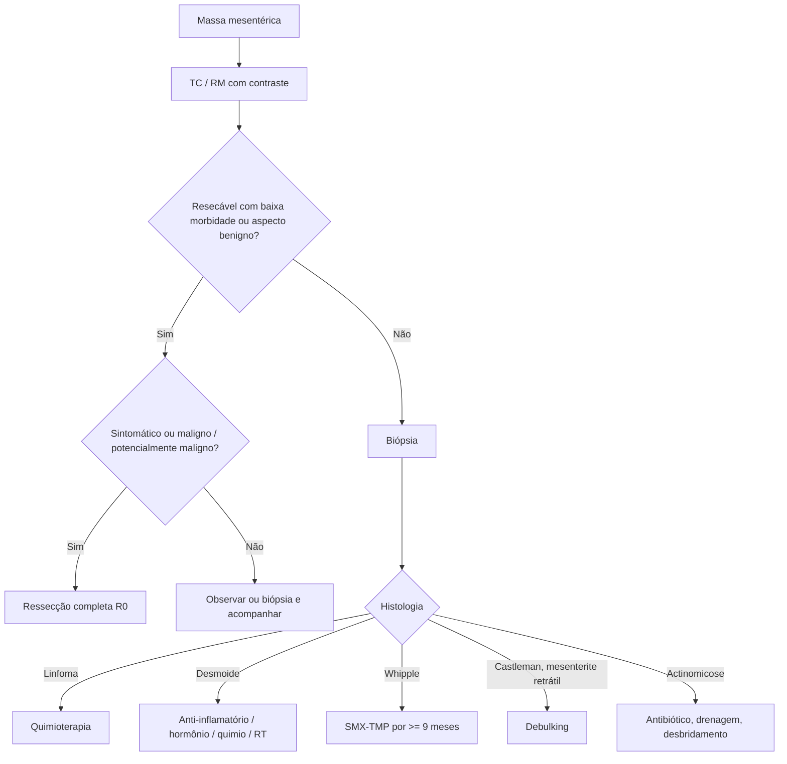

# Tumores Mesentéricos

> Resumo em palavras próprias do Whitebook (Condutas Cirúrgicas > Cirurgia Geral e do Aparelho Digestivo), sem fisiopatologia, autoria e referências. Confira detalhes e doses na fonte: https://whitebook.pebmed.com.br/conteudo/?id=454&categoryId=207&subcategoryId=211

**Definição:** lesões de vários grupos histológicos no mesentério, sólidas ou císticas; primárias, secundárias (metástases de TGI, pâncreas, vias biliares) ou de origem inflamatória/infecciosa.

## Etiologias
- **Linfáticos:** linfangioma cístico (cístico mais comum), linfoma (maligno mais comum, sobretudo não Hodgkin; também o sólido mais comum), doença de Castleman, linfadenopatia metastática de tumor neuroendócrino.
- **Primários:** cisto mesentérico simples (defeito congênito de fusão peritoneal), mesotelioma cístico benigno (cirurgia/inflamação prévia), mesotelioma peritoneal maligno (asbesto).
- **Tecido adiposo/conjuntivo:** tumor fibroso solitário, desmoide (associado a PAF/Gardner; benigno porém infiltrativo), fibroma, lipoma, lipossarcoma, GIST.
- **Inflamatórios/infecciosos:** pseudotumor inflamatório/miofibroblástico, mesenterite esclerosante (lipodistrofia, paniculite, mesenterite retrátil), actinomicose (*Actinomyces israelii*), doença de Whipple (*Tropheryma whipplei*).
- **Císticos extramesentéricos:** cistos mucinosos (ovarianos), pseudocisto não pancreático (abscesso/hematoma), cisto dermoide/teratoma cístico maduro.

## Quadro clínico
- Raros (~1/100.000 nos EUA); qualquer idade; achado durante investigação de dor inespecífica. Maioria de origem linfática, metade linfangiomas císticos.
- Sintomas por massa e compressão; obstrução é tardia (malignos e grandes benignos). Queixa principal: dor inespecífica e abaulamento em massas grandes; massas grandes podem ser palpáveis.
- **Pistas:** mesotelioma maligno — exposição a asbesto, placas pleurais calcificadas; pseudocisto — pancreatite, trauma, abscesso; linfoma — sintomas B, imunossupressão; desmoide — PAF/Gardner, cirurgia prévia; lipoma — obesos e diabéticos; mesenterite esclerosante — síndrome carcinoide em tumores carcinoides; actinomicose — grande invasão tecidual com bom estado geral e febre baixa, sobretudo mulheres com DIU.

## Diagnóstico
USG visualiza; **TC com contraste IV** (ou RM) é o principal exame e separa lesões císticas, sólidas e mistas.
- **Císticas:** linfangioma — parede fina, multilocular, conteúdo seroso/quiloso/hemorrágico, contato com a alça; cisto mesotelial — unilocular seroso; mesotelioma benigno — múltiplos cistos variados; mesotelioma maligno — massas sólido-císticas mal definidas ± calcificações, invasão, placas pleurais; cisto mucinoso — uni/multilocular mucinoso ± calcificações; pseudocisto — parede espessa, loculado, debris, níveis; dermoide — misto com gordura e calcificações.
- **Sólidas:** linfoma — densidade uniforme, vasos poupados (sinal do sanduíche), hepatoesplenomegalia, outras adenopatias; Castleman — bem delineado, nódulos satélites, realce arterial; tumor fibroso solitário — bem delimitado, realce portal, necrose ou cistos; desmoide — uniforme, realce fraco; fibroma; lipoma — densidade de gordura, septos; lipossarcoma — heterogêneo, infiltrante; GIST — heterogêneo, realce portal; carcinoide com mesenterite — calcificações, bandas de retração, aspecto radial; actinomicose — sólido-cística, mal delimitada, invasiva; Whipple — linfonodos de centro hipodenso, infiltração gordurosa; paniculite — gordura, pseudocápsula, sinal do anel gorduroso; pseudotumor inflamatório — partes moles, necrose central, bem delimitado.
- Muitas vezes o diagnóstico vem na laparoscopia/laparotomia. Laboratório inespecífico (PCR, leucograma, LDH, CA 125, CA 19-9).
- **Biópsia** (percutânea ou cirúrgica) em lesões irressecáveis, de aspecto maligno ou que exigiriam cirurgia muito mórbida. Lesões benignas ou facilmente ressecáveis: ressecção completa direta. Sintomático e ressecável: ressecar sem biópsia; assintomático: biópsia, ressecção ou acompanhamento.
- **Diferenciais:** neoplasias de cólon, GIST, linfomas, linfadenopatias.

## Tratamento
- **Não operatório:** linfoma — quimioterapia; linfangioma não ressecável — esclerosante intracístico repetido; mesenterite esclerosante precoce — resolução espontânea, ou imunossupressão nos graves; Whipple — sulfametoxazol-trimetoprima por **no mínimo 9 meses**; desmoide irressecável/rápido — anti-inflamatório, hormonioterapia, quimioterapia, radioterapia (± cirurgia subtotal).
- **Cirurgia:** linfangioma cístico; lesões císticas solitárias benignas sintomáticas (tumor fibroso solitário, cisto mucinoso, desmoide, Castleman); tumores malignos ou potencialmente malignos (fibroso maligno, GIST, lipossarcoma, mesotelioma maligno).
- **Observar:** pequenos lipomas e fibromas (até crescimento/sintomas); desmoides assintomáticos (10% regridem).
- **Princípios:** avaliar relação com vasos mesentéricos; objetivo R0 (R1 só com adjuvância; em sarcoma pode ser inútil ou prejudicial); TC ou PET-TC para avaliar. **Técnicas:** enucleação (bem circunscritos); ressecção intestinal maior (infiltrativos, atentando para a vascularização remanescente); *debulking* (Castleman, mesenterite retrátil em carcinoide); desbridamento, drenagem e estomas na actinomicose.

## Fluxograma (refeito, a partir do texto; o texto original não traz uma figura única)

