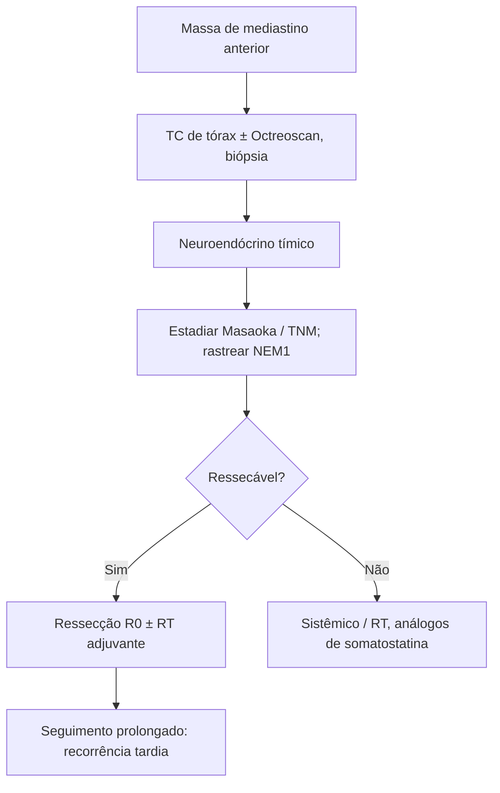

# Tumores Neuroendócrinos Primários do Timo

> Resumo em palavras próprias do Whitebook (Condutas Cirúrgicas > Cirurgia Oncológica), sem fisiopatologia, autoria e referências. Confira detalhes e doses na fonte: https://whitebook.pebmed.com.br/conteudo/?id=39151&categoryId=207&subcategoryId=212

## Epidemiologia e patologia
- Muito raros (2–5% das neoplasias tímicas; ~1:5 milhões); homens de 40–60 anos; maioria é carcinoide atípico; comportamento muito agressivo (82% malignos), diferente dos neuroendócrinos do TGI e do pulmão. Podem coexistir com timoma ou carcinoma tímico. Associação com NEM1: 25% dos casos (carcinoides típicos e atípicos).
- Mediastino anterior; histologicamente iguais a outros carcinoides; calcificação rara. Imuno-histoquímica: sinaptofisina+, cromogranina+, NSE+, Pax8+ (1/3), CD56+, TTF1−, queratinas+. Disseminação linfática e hematogênica mesmo em baixo grau (pulmão e ossos). Maior grau = mais alterações genéticas.
- **Classificação OMS:** baixo grau (carcinoide típico: sem necrose, < 2 mitoses/2 mm², 20%); grau intermediário (atípico: necrose focal e/ou 2–10 mitoses/2 mm², 40–50%); carcinoma de grandes células (> 10 mitoses, necrose extensa, 15–25%); carcinoma de pequenas células (> 10 mitoses, morfologia de pequenas células, 10%).

## Clínica e diagnóstico
- 1/3 assintomático (incidentaloma ou rastreio de NEM1). Sintomas compressivos (dor torácica, dispneia, tosse, síndrome de veia cava superior); rouquidão se invade o laríngeo recorrente; síndromes paraneoplásicas em 50% (Cushing, hipercalcemia, hipofosfatemia; mais raramente acromegalia, SIADH, Eaton-Lambert, osteoartropatia hipertrófica); metástases. Síndrome carcinoide: 0,6%.
- **TC de tórax** é o exame de escolha: massa mediastinal anterior grande (média 11 cm), lobulada, com hemorragia, necrose e calcificações pontuais; difícil distinguir de timoma, exceto pelo tamanho. **Octreoscan** localiza tumores secretores ocultos e metástases.
- **Biópsia** (punção transtorácica ou mediastinostomia anterior) em sintomas de doença localizada, massa de crescimento rápido sem suspeita de outra coisa, ou invasão local.

## Estadiamento
- **Masaoka:** I encapsulado sem invasão microscópica; II invasão macroscópica da gordura pleural mediastinal e microscópica da cápsula; III invasão macroscópica de órgãos adjacentes; IVa pleural/pericárdica; IVb linfo-hematogênica.
- **TNM (8ª ed.):** T1 encapsulado ou gordura mediastinal ± pleura (T1a sem pleura; T1b pleura mediastinal); T2 pericárdio; T3 pulmão, veia braquiocefálica, VCS, frênico, parede torácica, vasos pulmonares extrapericárdicos; T4 aorta, artéria pulmonar intrapericárdica, miocárdio, traqueia, esôfago, ramos do arco aórtico. N1 linfonodos peritímicos anteriores; N2 intratorácicos profundos ou cervicais. M1a nódulos pleurais/pericárdicos separados; M1b metástases a distância. Estágios: I T1N0; II T2N0; IIIA T3N0; IIIB T4N0; IVA qualquer T N1 ou M1a; IVB N2 ou M1b.
- **Diferenciais:** timoma (sobretudo tipo A), carcinoide pulmonar com extensão mediastinal, linfoma não Hodgkin, timolipoma, hiperplasia tímica, teratoma, cisto tímico, paragangliomas, sarcomas de pequenas células, carcinoma medular de tireoide.

## Tratamento
- > 50% têm grande invasão local, dificultando a cirurgia. Ressecável: **ressecção completa R0**. Radioterapia neoadjuvante/adjuvante defendida por alguns (invasão capsular); papel de QT e RT adjuvantes controverso; respostas isoladas a análogos de somatostatina e sunitinibe relatadas.
- NEM1: considerar exploração cervical no mesmo tempo; alguns defendem timectomia profilática em NEM1 submetido a paratireoidectomia, sobretudo homens.

## Prognóstico
Sobrevida em 5 anos: carcinoide típico 50–100%; atípico 30–80%; grandes células 30–66%; pequenas células 0% (mediana 13,75 meses). Fatores: histologia, estágio, tipo de ressecção, recorrência, endocrinopatia, metástases, invasão capsular, tempo do diagnóstico. Recorrência pode surgir anos depois.

## Fluxograma (refeito, a partir do texto; o original não traz algoritmo)

