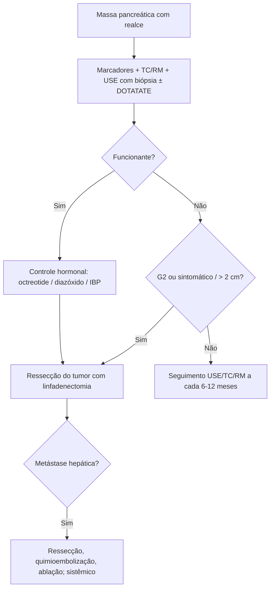

# Tumores Neuroendócrinos de Pâncreas

> Resumo em palavras próprias do Whitebook (Condutas Cirúrgicas > Cirurgia Oncológica), sem fisiopatologia, autoria e referências. Confira detalhes e doses na fonte: https://whitebook.pebmed.com.br/conteudo/?id=53666&categoryId=207&subcategoryId=212

## Visão geral
- Originam-se das células neuroendócrinas das ilhotas. O pâncreas é o sítio de 7% dos TNEs; são 1–2% das neoplasias pancreáticas; 4ª–5ª décadas; incidência crescente com melhor diagnóstico. Comportamento variável (maioria moderadamente maligna, muitas vezes indolente); padrão de secreção pode mudar. **Não funcionantes** são 60–90%. Maioria esporádica; 10–20% ligados a NEM1, von Hippel-Lindau, esclerose tuberosa, neurofibromatose 1 (em geral mais indolentes). Metástases (multifocais) no fígado, depois ossos e linfonodos; a principal causa de morte é a doença hepática difusa. Pior prognóstico: metástase hepática, linfonodos, alto grau.
- **Funcionantes:** insulinoma, gastrinoma, glucagonoma, VIPoma, somatostatinoma. **Não funcionantes:** sintomas vagos (dor), ou achado incidental; doença avançada dá sintomas de invasão ou metástase.

## Diagnóstico
Exige alta suspeição (costuma ser tardio).
- **Marcadores:** sempre na suspeita de síndrome de hipersecreção, e mesmo sem ela (subclínica e para seguimento): cromogranina A, enolase neuroespecífica, pancreastatina, polipeptídeo pancreático de jejum, gastrina, pró-insulina, insulina, glucagon, VIP.
- **Imagem:** TC/RM (massas com realce; sítio primário, fígado, linfonodos, peritônio); medicina nuclear para afinidade por somatostatina (FDG pouco útil, só em alto grau; PET/TC ⁶⁸Ga-DOTATATE é o mais sensível, mas pouco disponível); ecoendoscopia (lesões de 2–3 mm; permite PAAF e grau).
- **Biópsia:** metástase hepática por punção percutânea; massa pancreática por USE. Classifica em tumor neuroendócrino bem diferenciado (baixo grau) × carcinoma neuroendócrino pouco diferenciado (alto grau).
- **Estadiamento TNM 8ª ed.** (alto grau segue o dos carcinomas exócrinos): T1 ≤ 2 cm; T2 > 2 e < 4 cm; T3 > 4 cm ou invade duodeno/colédoco; T4 perfura serosa ou invade órgãos adjacentes (m se múltiplos). N0/N1. M1a só fígado; M1b só extra-hepática; M1c ambas. Estágios: I T1N0; II T2–3N0; III T4N0 ou qualquer T N1; IV M1.
- **OMS 2017:** G1 Ki67 baixo (< 3%, o texto omite o valor); G2 Ki67 3–20% e índice mitótico 10–20 (conforme o texto); G3 Ki67 > 20% e mitótico > 20; carcinoma de pequenas ou grandes células; tumor misto neuroendócrino–não neuroendócrino.

## Tratamento geral
Cirurgia é o pilar; equipe multidisciplinar. Ressecção da doença localizada é a única terapia curativa; ressecar doença hepática reduz secreção e efeito de massa; **transplante hepático** é controverso (recidiva sob imunossupressão), mas previsto na legislação brasileira. Metástases hepáticas: terapia locorregional (quimioembolização, ablação por radiofrequência). Residual: terapia sistêmica — análogos de somatostatina (octreotide, lanreotide; muito eficazes em VIPoma e glucagonoma; nos não funcionantes controlam volume; causam lama biliar e hiperglicemia — fazer colecistectomia e monitorar glicemia); quimioterapia para grau intermediário e alto; em estudo: interferon-α e everolimus. Complicações (hiperglicemia, disabsorção, hipovitaminose, metástases ósseas/cerebrais/espinhais): insulina, dieta, enzimas pancreáticas, radioterapia.

## Síndromes funcionantes
| Tumor | Dados principais | Diagnóstico | Tratamento |
|---|---|---|---|
| **Insulinoma** (mais comum; 4:1.000.000/ano; mulher 2:1, ~50 anos; 90% < 2 cm e benignos; únicos, múltiplos 8% → NEM1) | Tríade de Whipple (hipoglicemia, sintomas, melhora com glicose); fraqueza, fome, visão turva, alteração mental | Glicemia ≤ 40 mg/dL, insulina elevada (valor do limiar ilegível no texto), peptídeo C > 1,7 ng/mL; TC/RM (sensib. 30–66%); ecoendoscopia (93%/95%); amostragem venosa com cálcio já foi padrão-ouro; SPECT com exendina-4. Dif.: hiperplasia de células beta, hipoglicemiantes | Enucleação (ou pancreatectomia parcial); curativa em 85–95%; irressecável: diazóxido 300–500 mg/dia ou verapamil; análogos de somatostatina e mTOR |
| **Gastrinoma** (1–3/1.000.000/ano; homens, 5ª década; pâncreas 50–60%, duodeno 40–50%; 60–90% malignos; NEM1 20–30%; até 50% com metástase; sobrevida 5 anos 62–75%) | Úlcera péptica (Zollinger-Ellison: úlceras múltiplas refratárias, duodeno distal ou jejuno), DRGE, diarreia, hipertrofia gástrica, litíase renal, hipercalcemia. Localização: “triângulo do gastrinoma” (confluência cístico/hepático comum; junção corpo-colo do pâncreas; junção 2ª–3ª porção duodenal) | Gastrina de jejum > 500 pg/mL ou > 5× o limite (patognomônica > 1.000 pg/mL); teste provocativo com gluconato de cálcio ou secretina (positivo se > 200 pg/mL); EDA; TC/RM, USE, cintilografia com octreotide. Dif. de hipergastrinemia: *H. pylori*, insuficiência renal, IBP, obstrução gástrica | Ressecção completa + linfadenectomia (enucleação ou DPC ± preservação do piloro); mesmo incompleta ajuda no controle; IBP padrão-ouro (incompleto, inoperável ou NEM1); NPT se desnutrição; sistêmico em avançado |
| **Glucagonoma** (1:20.000.000/ano; > 5 cm; cauda; maligno, metástase hepática ao diagnóstico) | Eritema migratório necrolítico (abdome inferior, períneo, pés), estomatite, diabetes, perda de peso, anemia, TEV, sintomas neuropsiquiátricos | Glucagon > 1.000 pg/mL; TC/RM, USE, octreoscan. Dif.: hiperglucagonemia familiar; doença de Mahvash | Preparo com nutrição e tromboprofilaxia; análogos de somatostatina; ressecção + linfadenectomia (curativa ou paliativa) |
| **VIPoma** (1:10.000.000/ano; ~50 anos; 90% pâncreas, cauda/corpo; solitário 70–80%; 1–7 cm) | Diarreia aquosa, hipocalemia, acloridria | VIP de jejum > 200 pg/mL; excluir outras diarreias (DII, má-absorção, laxativos, colite microscópica, infecção); imagem fácil pelo volume | Corrigir eletrólitos e acidose; análogos de somatostatina; estabilizar antes de operar; pancreatectomia corpo-caudal; sistêmico se avançado |
| **Somatostatinoma** (cabeça do pâncreas, duodeno ou ampola; quase sempre maligno) | Colelitíase, esteatorreia, hiperglicemia, hipo/acloridria, emagrecimento | Somatostatina > 10 ng/mL (radioimunoensaio); TC, USE, cintilografia | Duodenopancreatectomia |

## Não funcionantes
Em geral > 5 cm, 50% malignos, evolução lenta; sintomas de dor ou compressão (obstrução biliar/intestinal) ou incidentais. Biópsia do tumor ou da metástase; cromogranina A, NSE e pancreastatina para diagnóstico e seguimento. Pode-se acompanhar com USE, TC ou RM a cada 6–12 meses após análise de risco-benefício; ressecção (padrão ou não anatômica) em G2 ou mais, sintomáticos ou por escolha do paciente com bom estado funcional; cirurgia curativa é opção em doença localizada (controverso).

## Fluxograma (refeito, a partir do texto; o original não traz algoritmo)

