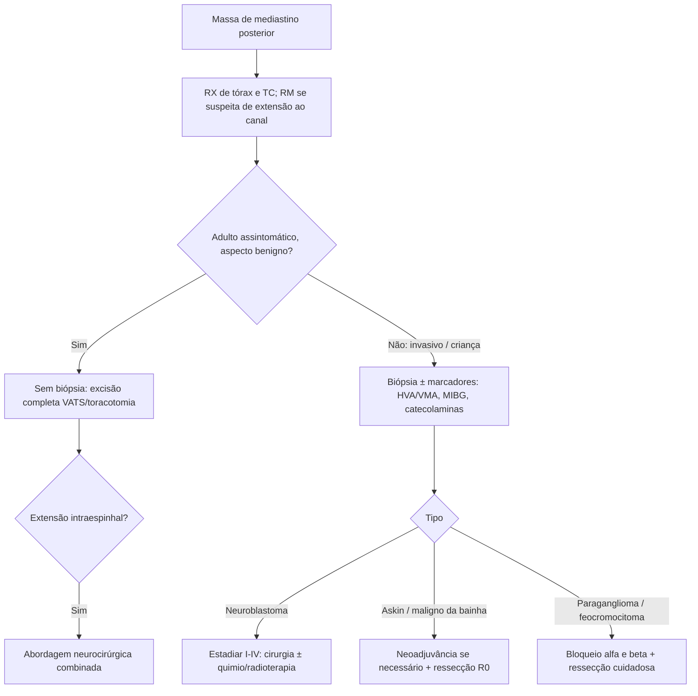

# Tumores Neurogênicos do Mediastino

> Resumo em palavras próprias do Whitebook (Condutas Cirúrgicas > Cirurgia Torácica), sem fisiopatologia, autoria e referências. Confira detalhes e doses na fonte: https://whitebook.pebmed.com.br/conteudo/?id=44931&categoryId=207&subcategoryId=215

**Definição:** neoplasias originadas de estruturas nervosas do mediastino. Respondem por cerca de 20% das massas mediastinais no adulto e 35% na criança; 70–80% são benignos.

## Aspectos gerais
- Mais de 60% das massas do mediastino posterior; localização típica na goteira costovertebral.
- Metade dos pacientes é assintomática (sobretudo adultos). Em crianças ~60% são malignos (neuroblastoma, ganglioneuroblastoma) e, por isso, frequentemente sintomáticos.
- Derivam da crista neuroectodérmica (bainhas nervosas, gânglios espinhais, componente simpático).
- ~90% dos casos em adultos = schwannoma e neurofibroma. Tumores da bainha nervosa predominam em adultos; os de gânglios simpáticos, em crianças.

**Divisão:** bainha de nervo periférico (schwannoma, neurofibroma, tumor maligno da bainha); gânglios simpáticos (ganglioneuroma, ganglioneuroblastoma, neuroblastoma); gânglios parassimpáticos (feocromocitoma, paraganglioma não funcionante); sistema neuroectodérmico periférico (tumor de Askin); nervos frênico, vago e intercostal.

## Diagnóstico
- **Radiografia de tórax (PA e perfil):** geralmente o primeiro exame; só localiza a região do mediastino.
- **TC de tórax:** melhor exame para caracterizar a lesão e a relação com estruturas vizinhas.
- **RM:** melhor para plexo nervoso, vértebras e canal medular; planejamento pré-operatório.
- **Biópsia:** em adultos com tumor provavelmente benigno, assintomático e bom estado geral, não se biopsia antes da cirurgia. Em tumores localmente invasivos é necessária (avaliar neoadjuvância); por punção aspirativa ou métodos cirúrgicos (videotoracoscopia, principalmente em anaplásicos que exigem mais material).

## Schwannoma (neurilemoma)
- Tumor neurogênico mais comum do mediastino; benigno, solitário, de crescimento lento, raramente maligniza. Adultos, ambos os sexos; pode associar-se à neurofibromatose (von Recklinghausen: manchas café com leite, neurofibromas, nódulos de Lisch).
- Encapsulado, heterogêneo, com componentes celular e mixoide; frequentemente sólido, às vezes com cistos; **S-100 positivo**.
- Geralmente assintomático; sintomas por compressão (síndrome da veia cava superior, dispneia, disfagia, dor óssea/fratura patológica) ou extensão intraespinhal (parestesias, paresias).
- **TC:** massas esféricas, bem definidas, junto à coluna, em qualquer ponto do nervo intercostal; calcificações puntiformes e áreas hipodensas (cistos/hemorragia); crescimento pelo forame intervertebral em "ampulheta" (dumbbell) em ~10%; pode envolver a traqueia.
- **Tratamento:** excisão completa (VATS ou toracotomia); com extensão intraespinhal, abordagem neurocirúrgica combinada; recorrência mínima se completa.

## Neurofibroma
- Benigno, adultos, ambos os sexos, associação com neurofibromatose. Não encapsulado, homogêneo, friável, com crescimento desorganizado de todos os elementos do nervo; **plexiforme** (todo o nervo intercostal aumentado) típico da doença de von Recklinghausen.
- Clínica e TC semelhantes às do schwannoma (inclusive dumbbell).
- **Tratamento:** excisão por VATS ou toracotomia; neurocirurgia combinada se houver extensão intraespinhal.

## Tumor maligno da bainha nervosa
- Sarcoma de células fusiformes do mediastino posterior (neurofibroma maligno, schwannoma maligno, fibrossarcoma neurogênico). Ambos os sexos, 3ª–5ª décadas, forte relação com neurofibromatose.
- **Tratamento:** ressecção completa (ideal R0); se irressecável, quimioterapia + radioterapia.

## Ganglioneuroma
- Benigno, do neuroblasto; ~42% dos tumores mediastinais de gânglios autonômicos; diagnosticado a partir dos 3 anos até a idade adulta; preferência por mulheres. Células ganglionares maduras, encapsulado.
- Em geral assintomático; pode causar diarreia por secreção de VIP ou sintomas compressivos.
- **TC:** massa oval/lobulada, homogênea, bem definida, de base larga na face anterolateral da coluna, pode ter calcificações.
- **Tratamento:** excisão completa (risco de malignização).

## Ganglioneuroblastoma
- Padrão intermediário entre ganglioneuroma e neuroblastoma; prognóstico depende da graduação histológica. Crianças, em geral < 10 anos, sem preferência de sexo; encapsulado; sem associação com neurofibromatose.
- Sintomas por compressão, invasão local ou metástases.
- **TC:** de massas bem definidas, oblongas, a massas irregulares e invasivas.
- **Tratamento:** excisão completa quando possível, conforme invasão local e metástases.

## Neuroblastoma
- Tumor sólido maligno extracraniano; neoplasia maligna torácica mais comum da infância. Tórax = 14% dos sítios primários (adrenal 38%). 90–95% em < 5 anos; leve predomínio masculino; não encapsulado, agressivo, com metástases à distância. Associação com von Recklinghausen, NEM e doença de Hirschsprung.
- **Clínica:** dor, déficit neurológico, síndrome de Horner, insuficiência respiratória; ataxia cerebelar/opsoclonus-mioclonus (autoimune); sintomas de catecolaminas/peptídios vasoativos (HAS, rubor, taquicardia, diarreia).
- **Exames:** ácido homovanílico e vanilmandélico urinários (diagnóstico e seguimento); NSE e gangliosídeo GD2; hemograma (medula), hepatograma e função renal (metástases); TC (massa paraespinhal, margens irregulares, heterogênea, calcificações em 80%, invasão e extensão contralateral); RM sempre (osso, partes moles, canal; realce com gadolínio); cintilografia com MIBG (tumor primário e metástases).
- **Estadiamento:** I — não invasivo, bem circunscrito, ipsolateral; II — invasão local sem passar da linha média, linfonodos regionais ipsolaterais; III — além da linha média e linfonodos bilaterais; IV — doença metastática; IV-S — estágio I ou II com metástases limitadas a fígado, pele ou medula óssea.
- **Tratamento:** I — excisão + linfadenectomia mediastinal; II/III — ressecção com linfadenectomia, quimio e radioterapia adjuvantes se excisão parcial; IV — papel da cirurgia controverso, inicialmente quimiorradioterapia (estudos com MIBG radioativo + quimioterapia).
- **Mau prognóstico:** tumores grandes, poucos tipos celulares diferenciados, primário extratorácico, idade > 5 anos. Extensão intraespinhal não piora o prognóstico.

## Paraganglioma
- Paragânglios: aglomerados de células das cristas neurais (medula adrenal, junto à aorta, vasos, coração, próstata, ovários). ~50% não funcionantes. Quemodectomas (corpo carotídeo, glomo aorticopulmonar, corpo vagal). Mais em homens de 30–40 anos; malignização em 10% (pulmão e ossos); cápsula fibrosa.
- Incidentaloma em 50%; sintomas compressivos ou dor torácica; funcionantes podem secretar ACTH, PTH, VIP (Cushing, hipercalcemia, diarreia).
- **Exames:** TC (massa), RM (intensa vascularização), angiografia (massas hipervasculares, grandes artérias nutridoras, drenagem venosa rápida; planejamento), MIBG (só nos funcionantes).
- **Tratamento:** ressecção completa; atenção a grande perda sanguínea; má resposta a radio e quimioterapia.

## Feocromocitoma mediastinal
- < 2% dos feocromocitomas; paraganglioma funcionante, em geral no mediastino anterior (paragânglio branquiomérico/visceral), podendo ser posterior (paragânglio aórtico simpático). Tríade de Carney (leiomiossarcoma gástrico epitelioide, hamartomas pulmonares, feocromocitomas extra-adrenais múltiplos). Em 10% associa-se a NEM 2A/2B, von Hippel-Lindau ou neurofibromatose.
- **Clínica:** sudorese, taquicardia, cefaleia; crises hipertensivas paroxísticas; perda de peso, ansiedade, náuseas/vômitos; compressão (paralisia, Horner, disfagia, dispneia).
- **Exames:** catecolaminas livres e metabólitos (VMA, normetanefrina, metanefrina) em urina de 24 h — geralmente negativos nos extra-adrenais; MIBG (sensibilidade 70%, especificidade 98%); TC (tecido mole com realce intenso e uniforme); RM (hipossinal em T1 e hipersinal em T2).
- **Diferenciais:** metástase de carcinoma renal e melanoma, doença de Castleman, hemangiomas.
- **Tratamento:** alfa-bloqueio inicial, depois beta-bloqueio para taquicardia; embolização pré-operatória eventual; ressecção completa com hemostasia rigorosa; controle pressórico intraoperatório (risco de hipotensão após retirar o tumor — antecipar com reposição volêmica) e atenção à hipoglicemia pós-excisão. Pressão elevada no pós-operatório sugere ressecção incompleta, metástase ou segundo tumor → nova cintilografia MIBG.

## Tumor de Askin (neuroepitelioma)
- Muito raro; crianças e adultos jovens, predomínio feminino e caucasiano. Tumor neuroectodérmico primitivo periférico da região toracopulmonar (família de Ewing); origem em periósteo, partes moles e parede torácica extrapulmonar, podendo invadir o pulmão. Translocação recíproca t(11;22)(q24;q12) (o texto original cita t(1,22), provável erro — conferir na fonte).
- Metástases (pulmão, osso, medula) em 10% ao diagnóstico; geralmente unilateral, crescimento rápido com necrose; sobrevida estimada ~8 meses, recorrência local comum.
- **Clínica:** dor torácica e massa de parede; linfadenopatia regional; 75% parede/costelas, 25% pulmão.
- **TC:** massa paravertebral heterogênea, às vezes com cistos, necrose ou hemorragia, sem calcificação, com derrame pleural e destruição costal. **RM:** maior sensibilidade.
- **Biópsia (essencial):** células pequenas e compactas com pseudorrosetas de Homer-Wright; NSE (80–90%), PGP 9.5, sinaptofisina (50%), Leu-7/CD57 (40%), S-100 e cromogranina (25% cada); FISH para a translocação. Critérios: tumor de nervo periférico, pseudorrosetas, NSE e Leu-7, grânulos neurossecretores e microtúbulos, t(11;22), proto-oncogenes (N-myc, C-myb, C-ets-1), enzimas de neurotransmissores (tirosina hidroxilase, dopamina beta-hidroxilase, acetilcolina transferase).
- **Diferenciais:** linfomas, rabdomiossarcoma alveolar/embrionário, sarcomas de células redondas, neuroblastoma, sarcoma sinovial, tumor desmoplásico de células redondas, meduloblastoma.
- **Tratamento:** ressecção em bloco; ou quimioterapia neoadjuvante → ressecção → quimiorradioterapia adjuvante.

## Fluxograma (refeito, a partir do texto; o original não traz algoritmo)

