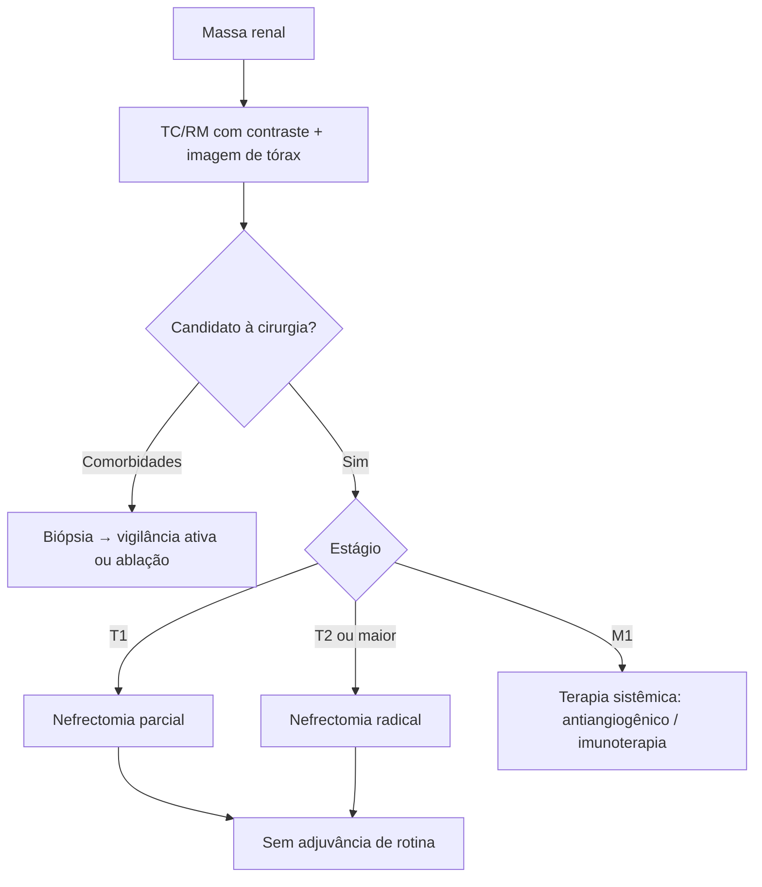

# Tumores Renais

> Resumo em palavras próprias do Whitebook (Condutas Cirúrgicas > Cirurgia Oncológica), sem fisiopatologia, autoria e referências. Confira detalhes e doses na fonte: https://whitebook.pebmed.com.br/conteudo/?id=44548&categoryId=207&subcategoryId=212

## Visão geral
Massas renais são em sua maioria malignas (apenas 15–20% benignas). Terceiro tumor urológico mais comum, porém o mais letal; ~30% já são metastáticos ou localmente avançados ao diagnóstico. Carcinoma de células claras ≈ 85% (e o mais agressivo). Lesões renais císticas são desafio diagnóstico: considerar o risco de neoplasia cística maligna conforme as características.

## Carcinoma de células renais (CCR)
- Antigamente só era descoberto em fase avançada (retroperitônio). Surge entre a 6ª e a 8ª décadas, mais em homens, a partir do túbulo contornado proximal ou do ducto coletor.
- **Fatores de risco:** tabagismo, hipertensão, obesidade, doença renal cística adquirida da DRC, exposição a cádmio/amianto/derivados de petróleo, analgésicos em excesso, fatores genéticos, quimioterapia citotóxica (sobretudo na infância), hepatite C, doença falciforme, cálculos.
- **Tipos:** células claras 75–85%; papilar 10–15%; cromófobo 5–10%; oncocítico 3–7%; ducto coletor e translocação (raros); nefroblastoma (Wilms) 5–6% das malignidades pediátricas. Células claras e papilar originam as duas síndromes familiares mais comuns: von Hippel-Lindau e CCR papilar hereditário.

## Clínica e diagnóstico
- Muitos assintomáticos; ~25% com metástase ou doença locorregional avançada ao diagnóstico. Sintomas: hematúria, massa abdominal, dor, perda de peso. A tríade clássica (dor no flanco, hematúria, massa palpável) ocorre em até 10% e indica doença avançada. Outros: hemorragia, fratura patológica.
- **Paraneoplásicas** (20%): síndrome de Stauffer (hepatopatia reversível sem metástase hepática), sintomas constitucionais, policitemia, VHS e PCR elevados.
- **Avaliação:** história, exame, laboratório; TC com contraste (ou RM de abdome/pelve), imagem do tórax; cintilografia óssea se suspeita.

## TNM
T1a ≤ 4 cm; T1b > 4–7; T2a > 7–10; T2b > 10 (limitado ao rim); T3a veia renal/ramos segmentares, sistema coletor ou gordura perirrenal/do seio renal, sem passar a fáscia de Gerota; T3b veia cava abaixo do diafragma; T3c veia cava acima do diafragma ou invasão da parede; T4 além da fáscia de Gerota (incluindo adrenal ipsilateral contígua). N1 regional. M1. **Estágios:** I T1N0; II T2N0; III T1–2N1 ou T3N0–1; IV T4 ou M1.

## Tratamento
- **Vigilância ativa:** crescimento médio de 0,5 cm/ano, sem metástase nas pequenas massas; imagem a cada 3–6 meses e, estável, a cada 6–12 meses. Candidatos selecionados podem fazer biópsia e vigilância ou ablação (mais para comórbidos que para saudáveis).
- **Ressecção** é o padrão em doença sem metástase ou com metástase solitária; tendência laparoscópica/robótica e **nefrectomia parcial** (poupadora) na maioria dos T1. Princípios: margem negativa, sutura de ramos vasculares segmentares importantes, reparo do sistema coletor. Controle de sangramento: clampeamento atraumático da artéria renal e resfriamento superficial com soro gelado; em videocirurgia, ressecção rápida e clampeamento < 30 min; selantes, hemostáticos e telas absorvíveis. O principal risco a longo prazo é DRC.
- **Nefrectomia radical:** menos complicações que a parcial; adrenal só se envolvida (comprometimento < 10%); laparoscópica ou aberta; ligar a artéria renal antes da veia.
- **Sistêmico:** imunoterapia e terapia antiangiogênica em doença localmente avançada/metastática (neo/adjuvante nos selecionados). 30–40% recidivam após cirurgia; adjuvância de rotina não indicada (benefício de SLD sem ganho de sobrevida global em metanálises; toxicidade). Doença metastática: antiangiogênicos e imunoterapia podem ganhar sobrevida.
- **Prognóstico:** doença confinada ao órgão: 5 anos 80–100% (T1) e 50–80% (T2); avançada até 20%.

## Fluxograma (refeito, a partir do texto; o original traz figuras ilustrativas)

