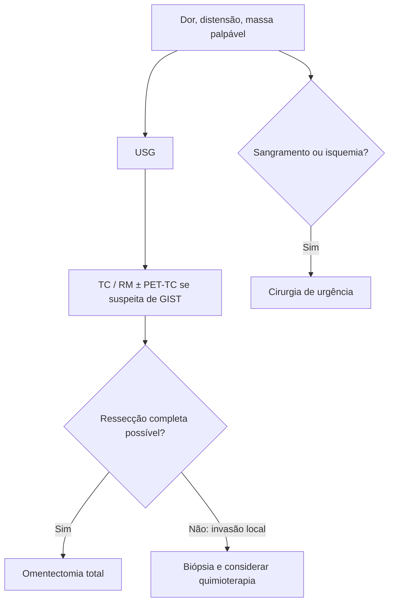

# Tumores Sólidos de Omento

> Resumo em palavras próprias do Whitebook (Condutas Cirúrgicas > Cirurgia Geral e do Aparelho Digestivo), sem fisiopatologia, autoria e referências. Confira detalhes e doses na fonte: https://whitebook.pebmed.com.br/conteudo/?id=45179&categoryId=207&subcategoryId=211

**Definição:** massas sólidas raras de espectro histológico variado. Os tumores secundários (metástases) são muito mais frequentes que os primários (benignos e malignos, de origem mesenquimal, lipídica, muscular lisa etc.).

**Tipos histológicos:** GIST, leiomiossarcoma, hemangiopericitoma, fibrossarcoma, lipoblastoma, leiomioblastoma, teratoma, schwannoma, sarcoma de células fusiformes, lipossarcoma, lipoma, leiomioma, fibroma, mesotelioma.

## Quadro clínico
Dor e distensão abdominal com massa palpável (a dor costuma piorar em decúbito dorsal e melhorar parcialmente em pé); náusea e vômito; ascite.

## Diagnóstico
- **USG:** exame inicial; mostra massa em abdome médio e se sólida ou cística, mas não define a origem.
- **TC:** detalha anatomia, geralmente define a origem e o deslocamento/compressão de estruturas.
- **RM:** informação semelhante à TC, com custo e tempo maiores.
- **PET-TC:** sobretudo na suspeita de GIST (distingue tecido benigno, maligno e cicatriz necrótica).
- **Angiografia:** malignos são hipervascularizados com neovascularização; mostra a artéria nutridora.
- **Diferenciais:** metástases (cólon, estômago, pâncreas, ovários), tumores primários (EGIST, tumor fibroso solitário; EGISTs são semelhantes a GIST fora do TGI e frequentemente CD117+), tumores mesentéricos, abdominais, de submucosa gástrica e pancreáticos.

## Prognóstico
Marcadores de malignidade: tamanho, pleomorfismo, atividade mitótica, necrose, metástases. Evolução depende do tipo histológico. Primários malignos têm sobrevida média de apenas ~6 meses, mesmo sem metástases; benignos têm sobrevida alta.

## Tratamento
- Sem consenso por raridade; alguns estudos sugerem benefício da quimioterapia.
- **Cirurgia** para diagnóstico e tratamento: excisão completa por **omentectomia total**. Contraindicada se a ressecção total for impossível por invasão local. Sangramento ou isquemia intestinal indicam abordagem de urgência.

## Fluxograma (refeito, a partir do texto; o texto original não traz uma figura)

