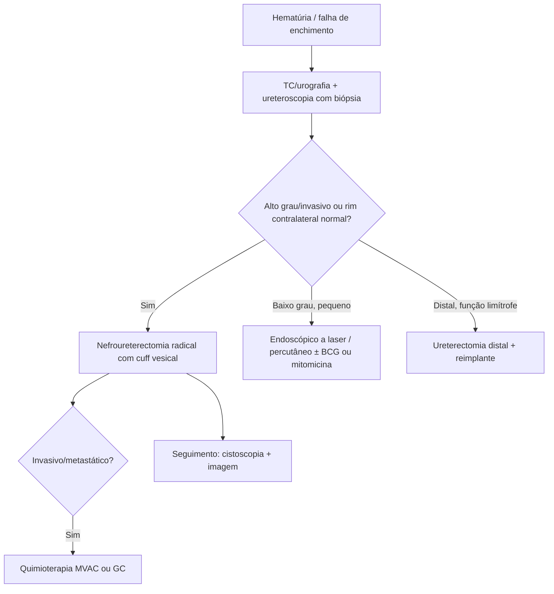

# Tumores Uroteliais da Pelve Renal e Ureter

> Resumo em palavras próprias do Whitebook (Condutas Cirúrgicas > Cirurgia Oncológica), sem fisiopatologia, autoria e referências. Confira detalhes e doses na fonte: https://whitebook.pebmed.com.br/conteudo/?id=44550&categoryId=207&subcategoryId=212

**Definição:** raros, cerca de 5% das neoplasias uroteliais e 5–7% das renais. Homens 2×, 6ª–7ª décadas; frequentemente sincrônicos com tumores de outras partes do trato urinário/bexiga. Fatores: tabaco, analgésicos, indústria de borracha e têxtil, ciclofosfamida, cafeína, hereditariedade; infecção crônica, obstrução e cálculos ligam-se a adenocarcinoma e escamoso.

## Clínica
Hematúria em 70–80%; dor lombar 30–40%; massa palpável rara; anorexia, emagrecimento e dor óssea sugerem metástase.

## Diagnóstico
- Radiologia e ureteroscopia. Falha de enchimento na urografia ou TC é típica; citologia seletiva, cistoscopia e ureteropielografia retrógrada (útil na azotemia e na alergia a contraste). TC/RM mostram massa e extensão, invasão e metástases; TC exclui cálculo e coágulo; RM é melhor em partes moles e na invasão de gordura perirrenal, periureteral, perivesical. PET/PET-CT: recorrência, metástases, fibrose × necrose, linfonodos.
- **Ureteroscopia** com biópsia sob visão direta (concordância 90–92% com o grau final); escovado retrógrado: VPP 75–100%, sensibilidade 91%, especificidade 88%; citologia até 80% nos indiferenciados. Não há respaldo para o receio de disseminação pela biópsia — é a conduta de escolha nas lesões suspeitas do trato superior.
- **Estadiamento TNM (AJCC):** Ta papilífero não invasivo; Tis in situ; T1 tecido subepitelial; T2 muscular; T3 pelve — além da muscular, na gordura peripélvica ou parênquima; ureter — gordura periureteral; T4 estruturas adjacentes. N1 um linfonodo ≤ 2 cm; N2 um > 2 cm ou vários. M0/M1.

## Tratamento
- **Padrão-ouro:** nefroureterectomia radical em alto grau ou invasivo com rim contralateral normal; também em baixo grau extenso, multifocal ou recorrente. Aberta: rim, ureter e cuff vesical de ~1 cm, gordura perirrenal, fáscia de Gerota e linfonodos perirrenais; acessos combinados (lombotomia/subcostal + Gibson/mediana infraumbilical), podendo ser extraperitoneal. Laparoscopia é opção em muitos centros, sem prejuízo oncológico aparente.
- **Ressecção distal do ureter:** função limítrofe e tumor distal com pelve e ureter proximal livres; reimplante com bexiga psoica ou flap de Boari. Ressecção segmentar é exceção.
- **Endoscópico/conservador:** rim único, função fraca, tumores pequenos de baixo grau; laser é preferido ao eletrodo. Perfuração ureteral 0–10,2% (cateter duplo J ou nefrostomia); estenose 4,9–13,6%; irrigação > 200 mmHg é citada como risco. Mitomicina C 40 mg em 100 mL e BCG como adjuvantes em recorrentes/alto grau. **Percutâneo:** melhor visão, mais instrumentos, acesso após derivações urinárias. Recorrência local: 5–33% (baixo grau) e 6–66% (alto grau); cai com BCG tópico por nefrostomia ou duplo J como indutor de refluxo.
- **Quimioterapia:** MVAC (metotrexato, vimblastina, doxorrubicina, cisplatina) na invasiva/metastática; remissões completas raras, sobrevida média 12–24 meses na metastática. Gencitabina + cisplatina (GC) pode substituir MVAC; toxicidade do GC: granulocitopenia, anemia, plaquetopenia, náusea, mucosite, celulite. Adjuvância pode retardar recorrência em alto risco, mas faltam estudos randomizados para pelve/ureter.

## Seguimento
Individualizado. Cistoscopia e citologia: trimestral no 1º ano, semestral nos anos 2–3, anual depois; endoscopia ipsilateral a cada 6 meses; pielografia ascendente contralateral ou urografia/TC anual. Exame físico, RX de tórax e laboratório (cálcio, FA, enzimas hepáticas, hemograma, função renal) a cada 3 meses no 1º ano, 6 meses nos anos 2–3, depois anual; TC/RM de abdome e pelve a cada 6 meses por 2 anos e depois anual até o 5º; cintilografia óssea se suspeita ou FA alta.

## Fluxograma (refeito, a partir do texto; o original não traz algoritmo)

