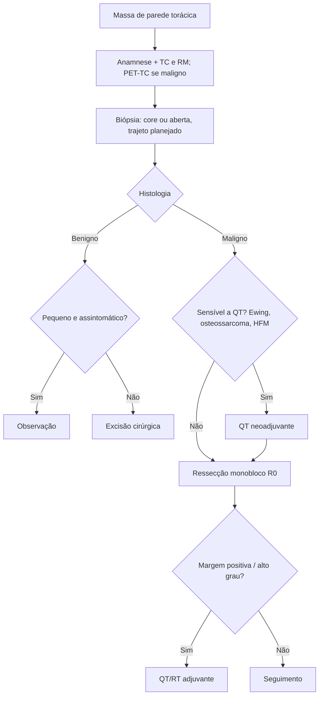

# Tumores da Parede Torácica

> Resumo em palavras próprias do Whitebook (Condutas Cirúrgicas > Cirurgia Torácica), sem autoria e referências. Confira detalhes e doses na fonte: https://whitebook.pebmed.com.br/conteudo/?id=39194&categoryId=207&subcategoryId=215

## Introdução
- **Definição:** neoplasias dos componentes osteocartilaginosos (costelas, esterno, clavícula) ou dos tecidos moles (músculo, gordura, conjuntivo) da parede torácica. Raros (< 1% de todos os tumores); podem ser benignos, malignos ou não neoplásicos.
- Cerca de 50–60% dos tumores da parede são malignos (muitos são metástases ou invasão por contiguidade de mama, pulmão, pleura, mediastino). Dos malignos primários, ~45% são sarcomas de partes moles e 55% ósseos/cartilaginosos; entre os ósseos, 85% nas costelas.
- **Etiologia:** benignos — osteocondroma, condroma, lipoma, cistos (displasia fibrosa), reações inflamatórias. Primários malignos — condrossarcoma, sarcoma osteogênico, Ewing, plasmacitoma solitário, linfoma, Askin; partes moles: histiocitoma fibroso maligno, leiomiossarcoma, lipossarcoma, neurofibrossarcoma, rabdomiossarcoma, desmoide, hemangiopericitoma, linfangiossarcoma. Metastáticos (carcinoma, sarcoma) e por invasão local (mama, pulmão, pleura, mediastino, melanoma).

## Clínica
- ~20% assintomáticos. Massa de crescimento progressivo; dor (contínua, inespecífica — sugere invasão periosteal ou neural, mais em malignos); sintomas constitucionais (febre, mal-estar; típico de Ewing); sintomas compressivos.
- **Anamnese:** neoplasia prévia. **Fatores de risco:** irradiação local, vinil/arsênio, imunodeficiência, trauma prévio (queimaduras, cicatrizes), irritantes crônicos (corpos estranhos), neurofibromatose, Paget, infarto ósseo, síndromes hereditárias (retinoblastoma hereditário, Li-Fraumeni, Gardner).

## Diagnóstico
- **TC de tórax** (retração cortical em massas costais; exclui metástases) e **RM** (superior para extensão em partes moles e canal medular; margens cirúrgicas) são complementares. **PET-TC com FDG:** estadiamento sistêmico, atividade metabólica, metástases (sarcomas de alto grau).
- **Biópsia:** a incisão ou o trajeto da agulha (Tru-Cut) não deve comprometer futuros retalhos; evitar hematomas (disseminação); amostra adequada.
  - *Core biopsy:* segura e eficaz; às cegas ou guiada (USG/TC); permite neoadjuvância sem esperar cicatrização; limita o tecido a ser removido depois.
  - *Biópsia aberta:* quando a core não é conclusiva, histologia incomum, lesões ósseas císticas; excisional (tumores < 5 cm, margem mínima de 1 cm) ou incisional (> 5 cm). Se a excisional revelar malignidade, reoperar para ressecção radical com grandes margens.

## Tratamento
- Da observação (benignos) à ressecção radical e terapia multimodal (sarcomas).
- **Benignos** pequenos e assintomáticos (condroma, lipoma): observar; cirurgia se sintomáticos, grandes ou potencialmente malignos (condroma → condrossarcoma).
- **Malignos:** ressecção em monobloco com margens livres (R0) é o pilar. Margem em baixo grau 1–2 cm; sarcoma de alto grau 4 cm, com costela acima e abaixo. Não limitar a ressecção por medo de não fechar o defeito (deformidades posteriores geralmente não exigem reconstrução; anteriores e laterais sim). Equipe multidisciplinar (torácica, plástica, neurocirurgia). **Margens livres = principal fator prognóstico.**
- **Complicações:** necrose de retalho, hematoma, deformidade torácica, alteração de cicatrização, infecção.
- **Adjuvância (QT/RT):** seletiva em sarcomas de alto grau com margem positiva ou doença residual. **Neoadjuvância:** tumores grandes, ressecabilidade limítrofe ou muito sensíveis à QT (Ewing, osteossarcoma, histiocitoma fibroso maligno).

## Tumores benignos específicos
- **Displasia fibrosa** (> 30% dos benignos): 30–40 anos, sem predileção de sexo; crescimento lento, indolor, na porção lateral/posterior das costelas; fraturas patológicas eventuais; RX com expansão fusiforme "em bolha de sabão"/vidro fosco. Suspeitar de síndrome de Albright se lesões múltiplas + pigmentação cutânea + puberdade precoce. Excisão se sintomas compressivos ou para diagnóstico.
- **Condroma** (15–20%): 20–30 anos; tumoração lenta e assintomática na junção costocondral anterior; RX lesão osteolítica com margens escleróticas; medula (encondroma) ou periósteo. Ressecção com margem ampla (difícil diferenciar de condrossarcoma).
- **Osteocondroma:** origem no córtex costal, homens jovens; assintomático (crescimento interno) ou doloroso (externo); RX massa óssea pedunculada com cápsula cartilaginosa viável; osteocondromatose familiar se múltiplos. Ressecção completa.
- **Granuloma eosinofílico/histiocitose** (componente benigno da histiocitose fibrosa): sexo masculino; lesões expansivas costais e cranianas. Ressecção se solitário (RT local se múltiplos).
- **Osteoma osteoide:** raro, córtex dos arcos vertebrais ou costelas, homens jovens; dor em pontada noturna que melhora com analgésicos simples; RX "ninho" radiolucente com margem esclerótica. Conservador ou ressecção do arco costal se dor/estética.
- **Cisto ósseo aneurismático:** costelas, trauma prévio, crianças/adolescentes; massas indolores ou dolorosas, lesões líticas. Ressecção completa se dor.

## Tumores malignos específicos
- **Condrossarcoma:** tumor primário torácico mais comum; homens 30–60 anos; parede anterior (esterno, junções costocondrais); pode derivar de condroma/osteocondroma ou trauma; massa fixa, lenta, indolor, com destruição cortical; clínica/radiologia semelhantes ao condroma (histologia define). Ressecção com margem mínima de 4 cm; RT se irressecável ou não R0. Sobrevida em 5 anos 92%; recorrência 10% se R0 (75% se margem positiva).
- **Osteossarcoma:** apenas 3% na parede; distribuição bimodal (jovens e > 40 anos); massa de crescimento rápido e dolorosa; associado a Paget, infarto ósseo, irradiação; metástases comuns (pulmão, fígado, ossos). QT neoadjuvante + cirurgia.
- **Sarcoma de Ewing:** terceiro tumor maligno torácico mais comum; o mais comum em crianças e adultos jovens; só 15% na parede; maioria desenvolve metástases (doença sistêmica); dor intermitente; "casca de cebola" no RX. QT neoadjuvante + ressecção; RT adjuvante se não R0.
- **Plasmocitoma solitário:** raro; excluir mieloma múltiplo; corpo vertebral mais comum (10–15% em costelas/esterno); homens, qualquer idade; dor óssea sem massa palpável; lesão osteolítica. RT local (QT se evoluir para mieloma); cirurgia só para diagnóstico.
- **Lipossarcoma** (raro): homens 40–50 anos; massa indolor, em geral > 9 cm. Ressecção.
- **Histiocitoma fibroso maligno:** após irradiação local; 60–70 anos; massas bem definidas ou lobuladas, assintomáticas, realce heterogêneo sem calcificações na TC; extremamente agressivo. Ressecção com grandes margens.
- **Linfoma:** < 2% dos tumores torácicos; mais comum não Hodgkin B. Ressecção + QT adjuvante ou apenas QT/RT.
- **Rabdomiossarcoma:** infância ou homens > 50 anos; origem em músculo estriado da parede/diafragma; tumor volumoso, assintomático, com áreas necróticas/císticas.
- **Condrossarcoma/osteossarcoma extraósseo e outros do conjuntivo:** crianças e jovens; grandes massas com calcificação/ossificação na TC.
- **Tumor desmoide:** neoplasia mesenquimal de crescimento lento, sem metástases, de tecido musculoaponeurótico; qualquer idade (20–30 anos), associada à gestação e à polipose adenomatosa familiar; infiltrativa; dor, deformidade, limitação funcional; alta recorrência. Ressecção R0 sem comprometer função (QT/RT adjuvantes se margem positiva); recorrências frequentes/irressecabilidade: QT, antiestrogênios, imatinibe, sorafenibe.
- **Metástases:** 20–30% das neoplasias torácicas, por extensão direta, via linfática ou hematogênica; o esterno é o osso mais comum de metástase óssea solitária. Tratamento controverso, conforme histologia, número de metástases e idade.

## Fluxograma (refeito, a partir do texto; o original não traz algoritmo)

