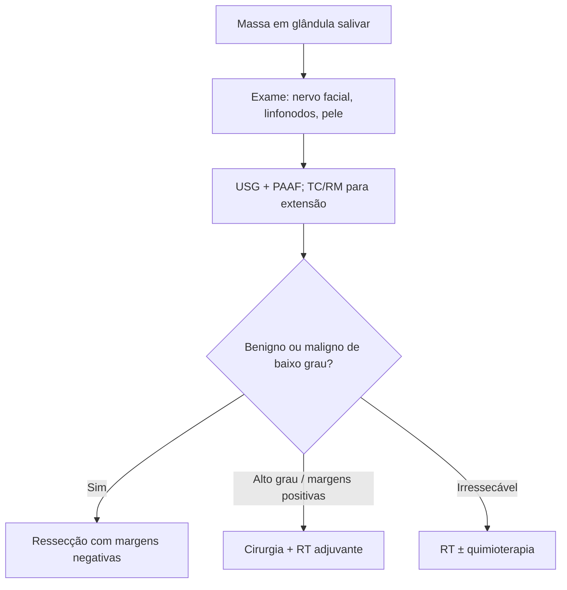

# Tumores de Glândulas Salivares

> Resumo em palavras próprias do Whitebook (Condutas Cirúrgicas > Cirurgia de Cabeça e Pescoço), sem autoria e referências. Confira detalhes e doses na fonte: https://whitebook.pebmed.com.br/conteudo/?id=44927&categoryId=207&subcategoryId=289

**Definição:** grupo raro de tumores, heterogêneo em local, histologia e comportamento.

## Epidemiologia
- **Parótida:** 80–85% dos tumores salivares; ~75% benignos e ~25% malignos. Submandibular, sublingual e glândulas menores: menos frequentes e **muito mais malignos** (submandibular 40–45%, sublingual 70–90%, menores 50–75%).
- Benigno mais comum: **adenoma pleomórfico** (~metade). Malignos mais comuns: **mucoepidermoide** e **carcinoma adenoide cístico** (metade dos malignos).
- Fatores: radiação (benignos e malignos); **tumor de Warthin ligado ao tabagismo**; vírus (herpes-vírus, EBV, HIV); ocupacionais (borracha, salão de beleza, níquel). Sem fator predominante.

## Clínica
- Investigar: tempo e velocidade de crescimento, dor, dormência, assimetria facial, câncer de pele prévio (CEC, melanoma no couro cabeludo/face).
- Exame: tamanho, mobilidade, fixação (pele/profundidade), trismo, assimetria faríngea ou bucal, dor; pele/couro cabeludo, nervo facial e linfonodos cervicais.
- Massa indolor ou edema glandular; **paralisia do nervo facial com massa parotídea sugere malignidade**. Intraorais: massa submucosa indolor ou úlcera (palato, lábio, mucosa jugal). Cavidade nasal/seio maxilar: obstrução, congestão, alteração visual, trismo. Nasofaringe: doença avançada (base de crânio, nervos cranianos).
- Alto grau → linfonodos regionais; metástase à distância: pulmão, osso, fígado.

## Diagnóstico
TC (osso temporal e mandíbula) e RM (partes moles, invasão perineural, extensão intracraniana) para extensão e planejamento; **USG** (glândulas superficiais; guia punção); **PAAF/biópsia** para tecido, benigno × maligno. Em Warthin, avaliar ambas as parótidas (multifocal/bilateral).

## Tratamento
Ressecção completa com margens negativas. Benignos e malignos de baixo grau: cirurgia isolada. Alto grau, margens positivas ou outros fatores de risco: cirurgia + radioterapia adjuvante. Irressecáveis: RT isolada ou com quimioterapia.

## Fluxograma (refeito, a partir do texto; o original não traz algoritmo)

