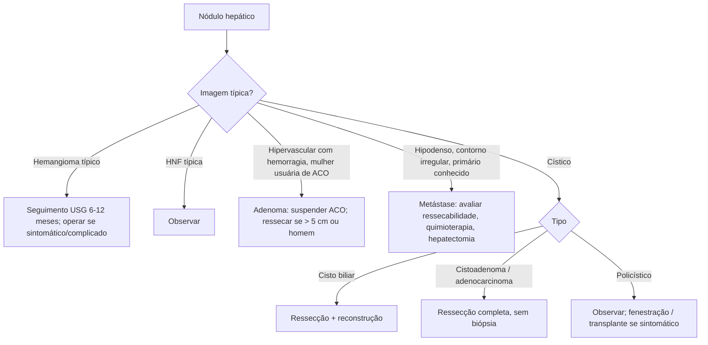

# Tumores do Fígado

> Resumo em palavras próprias do Whitebook (Condutas Cirúrgicas > Cirurgia Geral e do Aparelho Digestivo), sem fisiopatologia, autoria e referências. Confira detalhes e doses na fonte: https://whitebook.pebmed.com.br/conteudo/?id=22592&categoryId=207&subcategoryId=211

## Hemangioma hepático
- Tumor benigno mais comum do fígado (1–20% da população); mulheres 4:1; média de 45 anos; em geral único e < 5 cm (> 5 cm = gigante); sem malignização; cresce por ectasia vascular.
- **Clínica:** quase sempre achado incidental. Possíveis: dor e febre (Blumgart-Bornman-Terblanche), plenitude pós-prandial, ruptura com choque, coagulopatia de consumo (Kasabach-Merritt), síndrome compartimental (gigantes), ICC por shunt (crianças).
- **Imagem:** USG — massa bem delimitada, homogênea, hiperecoica (bom para seguimento); TC — realce nodular periférico precoce e preenchimento centrípeto tardio; RM — lesão lisa com realce periférico típico. Pode formar massa fibrosa por trombose/involução, difícil de distinguir de maligna. **Biópsia contraindicada** (sangramento, resultado inespecífico).
- **Conduta:** expectante nas assintomáticas típicas, USG a cada 6–12 meses. **Operar** se sintomático, dúvida diagnóstica, crescimento rápido, complicação (ruptura, Kasabach-Merritt): ressecção anatômica; enucleação com controle de influxo em alguns casos; embolização em crianças.

## Hiperplasia nodular focal
- 2º tumor benigno mais comum; mulheres de 20–40 anos; associação fraca com ACO; única, < 5 cm; ruptura/sangramento raros; nunca descreveu-se malignização.
- Assintomática (achado) ou dor inespecífica. **TC/RM:** lesão única hipervascular na fase arterial, isodensa/isointensa na portal, cicatriz fibrosa central (só em 15%) em fígado normal.
- **Conduta:** expectante se diagnóstico certo pela imagem. Sem imagem característica considerar ressecção (difícil excluir maligno, p. ex. carcinoma fibrolamelar; punção nem sempre elucida). Sintomáticos: seguimento; ressecção se sintomas persistentes ou crescimento.

## Adenoma hepático
- Mulheres (11:1) em idade fértil (20–40 anos); ACO > 5 anos, esteroides anabolizantes. Única (mais comum, lobo direito) ou múltiplas (12–30%); **adenomatose = ≥ 10 lesões**. Risco de malignização ~5% e de ruptura/hemorragia 30–50% (maior > 5 cm). Dor em HCD em 50–75%.
- **Moleculares:** mutação de β-catenina (maior risco maligno), HNF1A, inflamatório, não especificado.
- **Imagem:** lesão hipervascular com área central hipovascular (hemorragia/necrose); fase arterial hipercaptante heterogênea; difícil: só a ressecção define.
- **Conduta:** pequenos assintomáticos podem regredir suspendendo ACO ou após a gestação; mulheres assintomáticas ≤ 5 cm: seguimento; **sintomático ou > 5 cm: ressecção**; **homens: ressecção em qualquer tamanho** (risco de transformação); hemorragia: embolização da artéria hepática como ponte para ressecção; adenomatose irressecável: transplante.

## Metástase hepática
- Tumor maligno hepático mais comum (20× os primários); fígado é o 2º sítio de metástase; colorretal é o principal (circulação portal); outros: TGI alto, pâncreas, vias biliares, mama, rim, colo uterino, neuroendócrino.
- Clínica: pode ser assintomática; dor, ascite, icterícia, perda de peso, massa em casos avançados. **Sincrônica** (antes, junto ou até 6 meses do primário) × **metacrônica** (> 6 meses).
- **Diagnóstico:** USG — hipodensas de contorno irregular (não define); TC — lesões hipodensas, hipocaptantes, às vezes com halo hipercaptante, melhor na fase portal; RM — mais acurada para < 1 cm e para doença extra-hepática; **CEA** para recorrência de câncer colorretal. No colorretal, lesão compatível dispensa biópsia; CEA normal com TC/RM normais exclui metástase em 95%.
- **Ressecabilidade:** volume residual > 20–30% (sem hepatopatia), melhor por volumetria.
- **Tratamento:** em geral doença avançada; exceções: colorretal e neuroendócrina. *Sincrônica:* ressecar o primário e depois hepatectomia após quimioterapia, ou ambos juntos. *Metacrônica:* ressecar se possível + quimioterapia. Quimioterapia neoadjuvante pode viabilizar a ressecção. Metas: margens negativas e máximo de parênquima. Exclui cirurgia: doença extra-hepática (exceto pulmonar) e margem livre impossível. Extensão: metastasectomia limitada a hepatectomia segmentar anatômica. No Brasil, transplante não é autorizado para colorretal. *Neuroendócrinas:* análogos de somatostatina, embolização, ablação; ressecção se completa e de baixa morbidade, ou se refratária/síndrome hormonal; **transplante** pode ser indicado (legislação brasileira) em metástase irressecável de tumor neuroendócrino com primário já retirado ou indetectável e sem doença extra-hepática.
- **Pior prognóstico:** tumor indiferenciado, mucinoso, invasão profunda, linfonodos, intervalo livre < 12 meses, sincrônica, margem < 1 cm ou comprometida, ≥ 3 nódulos, > 5 cm, CEA pré-operatório > 200 ng/mL, satélites, doença extra-hepática.

## Cisto biliar (cisto de colédoco)
- Dilatação cística da árvore biliar, associada à junção pancreatobiliar anômala; < 1/100.000; mulheres 3–4×; pré-maligno (10–30%).
- Tríade dor, icterícia e massa (mais em crianças; a maioria tem 1–2 elementos); prurido, náusea, vômito, emagrecimento.
- **Tipos (Todani):** I fusiforme do colédoco (mais comum); II divertículo verdadeiro extra-hepático; III coledococele; IV intra e extra-hepático; V doença de Caroli.
- **Diagnóstico:** USG inicial; colangiorressonância (sensibilidade até 100%) para cisto, cálculos, obstrução e junção anômala.
- **Tratamento:** cirurgia com ressecção completa do cisto e reconstrução biliar; a drenagem enteral sem ressecção não é mais indicada (estase, infecção, malignização).

## Doença policística hepática
- Autossômica dominante; > 3 cistos; mais em mulheres; associada a cistos em rim, pâncreas e baço.
- Geralmente assintomática; aumenta com a idade; compressão (saciedade precoce, dispneia, dor), síndrome compartimental; raramente insuficiência hepática. Achado de USG/TC.
- **Conduta:** expectante; sintomática — fenestração, ressecção parcial ou transplante em doença difusa com pouco parênquima preservado.

## Cistoadenoma biliar (neoplasia cística mucinosa não invasiva)
- Raro (< 5% dos cistos hepáticos); mulheres 9:1, 5ª década; variantes serosa e mucinosa; malignização ~20%.
- Geralmente único, grande (10–20 cm), multiloculado, conteúdo mucoide; dor; complicações: infecção, hemorragia, ruptura, compressão biliar/vascular.
- **Imagem:** USG é a mais sensível; cistos multiloculados de parede irregular, septos/vegetações, captação, dilatação biliar.
- **Tratamento:** ressecção com parênquima adjacente.

## Cistoadenocarcinoma
- Degeneração de um cistoadenoma; 6ª década; crescimento lento (~12 cm); sobrevida em 5 anos 57%; recorrência 10%.
- Suspeitar com icterícia, perda de peso, ascite ou mudança de imagem de cisto; RM mostra conteúdo hemorrágico/proteináceo. **Biópsia por punção ou destelhamento contraindicada** (carcinomatose peritoneal). Tratamento: ressecção completa.

## Fluxograma (refeito, a partir do texto; o original traz um atlas de cisto hepático)

