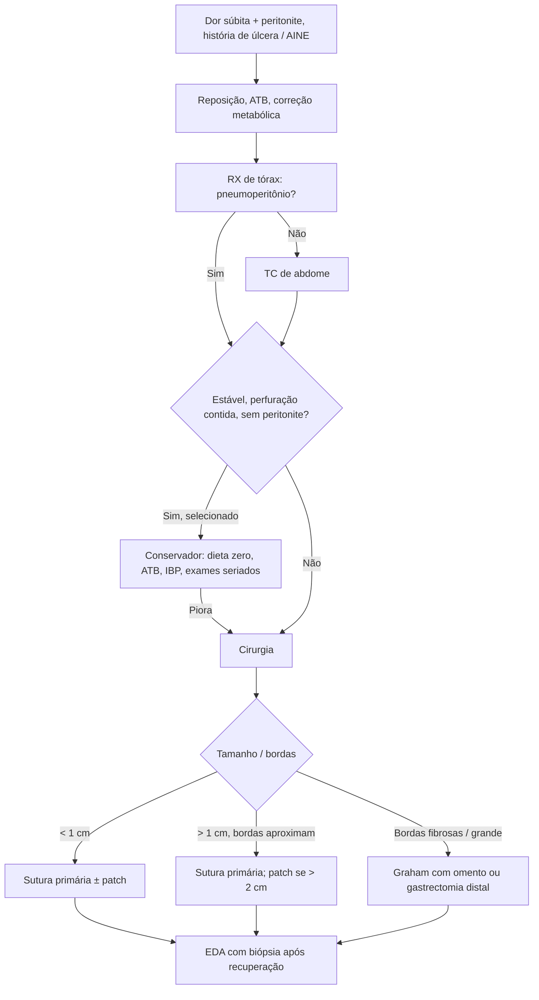

# Úlcera Péptica Perfurada

> Resumo em palavras próprias do Whitebook (Condutas Cirúrgicas > Cirurgia Geral e do Aparelho Digestivo), sem fisiopatologia, autoria e referências. Confira detalhes e doses na fonte: https://whitebook.pebmed.com.br/conteudo/?id=64015&categoryId=207&subcategoryId=211

**Definição:** ruptura completa da parede gástrica ou duodenal com extravasamento de conteúdo para a cavidade, causando peritonite química.

## Epidemiologia e fatores
- Acomete 2–10% das úlceras pépticas; principal causa de mortalidade da doença ulcerosa (até 30%) e principal indicação cirúrgica atual.
- *H. pylori* em 50–80%; AINE (inibição da COX-1); álcool, tabagismo, corticoide, dieta salgada, estresse fisiológico.

## Quadro clínico
- Uso recente de AINE, úlcera ou *H. pylori* prévios. Dor abdominal súbita, difusa e intensa, que pode amenizar com o tempo; irradiação para ombros e pescoço (pneumoperitônio); piora ao mover.
- Choque após 12–24 h (peritonite química evolui para infecciosa).
- Exame: abdome em tábua, dor nos quadrantes superiores, defesa, Blumberg, distensão em casos avançados, taquicardia, taquipneia, febre, hipotensão.

## Diagnóstico
- Suspeitar com dor súbita, irritação peritoneal e história de úlcera ou AINE. Labs inespecíficos (leucocitose, acidose, amilase).
- **RX de tórax** para pneumoperitônio (acurácia ~**85%**). Se negativo: **TC de abdome** (padrão-ouro), preferencialmente com contraste oral; mostra pneumoperitônio e líquido livre.
- **Diferenciais:** neoplasia gástrica, diverticulite ou apendicite perfuradas, perfuração intestinal por tumor, pancreatite, isquemia mesentérica, ruptura de AAA, Boerhaave, colecistite complicada.

## Tratamento
Reposição volêmica, correção hidroeletrolítica/metabólica, antibiótico empírico (gram-negativos entéricos, anaeróbios e flora oral).
- **Cirurgia:**
  - Perfuração **< 1 cm**: sutura primária ± omentopexia (patch).
  - **> 1 cm** com bordas aproximáveis sem tensão: sutura primária; patch omental fortemente recomendado se **> 2 cm**.
  - Maiores ou com bordas fibrosas (úlcera crônica): reparo de Graham com omento sadio ou gastrectomia distal, se as condições permitirem.
  - Perfurações muito grandes (> 3 cm) com descrição de fechamento duodenal com omento/serosa e Y de Roux: excluir temporariamente o piloro com gastroenteroanastomose (Billroth II ou Y de Roux).
  - **Laparoscopia** em estáveis (menos morbidade, infecção de ferida e internação, em mãos experientes).
- **Conservador** só em casos selecionados: perfuração contida, estabilidade e ausência de peritonite. Dieta zero, analgesia, antibiótico IV, IBP; monitorização hemodinâmica e exames seriados; sem melhora → cirurgia. Tratamento endoscópico ainda não é padrão.
- **Biópsia intraoperatória** da úlcera (quando não há gastrectomia) é questionada (pode aumentar o defeito e o risco de fístula); recomenda-se EDA com biópsia após a recuperação.

## Fluxograma (refeito, a partir do texto)

