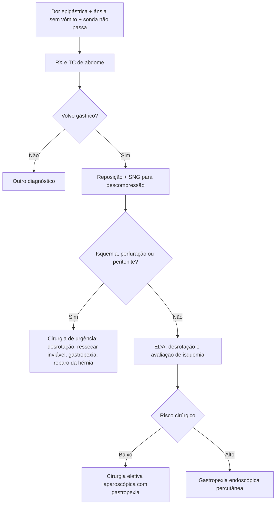

# Volvo Gástrico

> Resumo em palavras próprias do Whitebook (Condutas Cirúrgicas > Cirurgia Geral e do Aparelho Digestivo), sem fisiopatologia, autoria e referências. Confira detalhes e doses na fonte: https://whitebook.pebmed.com.br/conteudo/?id=39195&categoryId=207&subcategoryId=211

**Definição:** rotação anormal do estômago além dos limites anatômicos, com obstrução gástrica (rotação sem obstrução não é volvo). Sinônimos: vólvulo gástrico, torção do estômago.

## Epidemiologia e causas
- Rara; três picos (crianças, adultos na 5ª década, idosos frágeis ou acamados); sexos iguais. **Organoaxial** é o mais comum em adultos (60%); **mesenteroaxial** é mais comum em crianças, com apresentação mais crônica. Costuma associar-se à hérnia paraesofágica ou diafragmática (traumática ou congênita).
- O estômago é fixado pela cárdia, pelos ligamentos (gastroduodenal, gastro-hepático, gastroesplênico, gastrocólico) e por vasos curtos; alterações dessa fixação favorecem a rotação, com obstrução, atraso de esvaziamento e, nos casos graves, isquemia, necrose e perfuração.
- **Primário** (10–30%; ligamentos ausentes, alongados ou lesados por tumor/aderência/deformidade; em geral mesenteroaxial parcial) e **secundário** (60%; hérnias paraesofágicas/diafragmáticas — pode haver compressão vascular, refluxo maciço e necrose esofágica). Na classificação do texto: primário 25%, secundário 75%.

## Fatores de risco
Idade > 50, anormalidades diafragmáticas (hérnia paraesofágica/hiatal, eventração, paralisia, disfunção do frênico), esplenomegalia, corpos estranhos (balão gástrico, gastrostomia), cifoescoliose, cirurgia torácica prévia.

## Clínica
- **Aguda (rotação > 180°):** dor súbita em abdome superior ou tórax inferior com obstrução gástrica (náusea, vômitos não bilosos incoercíveis ou ânsia sem vômito, distensão); **tríade de Borchardt** (epigastralgia, ânsia sem vômito, impossibilidade de passar sonda nasogástrica) em ~70%; também hematêmese (fissuras, úlceras de Cameron), disfagia, dispneia; sinais inespecíficos (taquicardia, desidratação, febre, timpanismo, peritonismo). Mais discreta se estômago intratorácico ou hérnia prévia. Pode evoluir para isquemia, perfuração e sepse.
- **Crônica:** vaga, subclínica, obstrução parcial intermitente por meses/anos (desconforto epigástrico, disfagia, distensão, regurgitação, dispepsia, saciedade precoce); pode simular pancreatite, úlcera ou causar anemia crônica.

## Diagnóstico
Exige suspeição e imagem.
- **Laboratório:** hipocalemia e alcalose hipoclorêmica, leucocitose, anemia, enzimas pancreáticas elevadas.
- **RX:** grande bolha única esférica no abdome superior ou tórax com nível, sonda mal posicionada, nível retrocardíaco, delgado colapsado. **Contraste baritado** pela sonda: sinal do “bico de pássaro”, inversão gástrica, enchimento incompleto. Pode mostrar elevação do hemidiafragma, hérnia, fraturas costais.
- **TC (alta sensibilidade, sempre que suspeito):** distensão, ponto de transição antipilórico, antro no mesmo nível ou acima do fundo, septo linear no ponto de torção, ausência de realce parietal ± pneumatose (isquemia), sinal do redemoinho; complicações (pneumoperitônio, líquido) e causas anatômicas.
- **EDA:** diagnostica só 28–45%, mas é o melhor método para isquemia/necrose da mucosa e avalia rotação e obstrução.
- **Tipos:** I — organoaxial (60%, secundário): rotação no eixo longitudinal (cárdia–piloro), antro anterossuperior e fundo posteroinferior, obstrução em cárdia e piloro; II — mesenteroaxial (30%): rotação no eixo horizontal (entre pequena e grande curvatura), ponto de torção entre piloro e antro, obstrução completa mais rara; complexo (10%).
- **Diferenciais:** gastroparesia, obstrução por brida, gastrite, esofagite, colecistite, íleo metabólico, pancreatite, IAM, TEP, divertículo epifrênico, estase gástrica pós-operatória.

## Tratamento
Depende de sintomas, grau de obstrução, isquemia, hérnia paraesofágica e comorbidades; estrangulamento é mais comum em torção > 180° e organoaxial. Achado incidental assintomático: observar (ou gastropexia eletiva).
- **Inicial:** reposição volêmica e correção hidroeletrolítica; **descompressão por SNG** (pode reverter a rotação e permitir cirurgia programada, se sem peritonite); redução endoscópica precoce se sem isquemia/perfuração; avaliar viabilidade gástrica.
- **EDA terapêutica** (casos selecionados; recorrência até 64%): sob anestesia geral com proteção de via aérea; desrotação e descompressão. Alto risco cirúrgico: desrotação + **gastropexia endoscópica** com duas gastrostomias (corpo e antro), fixação em 3–4 pontos, transiluminação e compressão digital; não serve se o estômago não reposiciona ou há órgão interposto; em geral não é tratamento definitivo isolado.
- **Cirurgia** (urgência se isquemia/falha inicial; eletiva para prevenir recidiva): laparoscopia preferencial (menos morbidade, internação e custo; melhor visão do hiato e mediastino posterior) ou laparotomia. Passos: desfazer a rotação, avaliar viabilidade (gastrectomia parcial/total se inviável), reduzir hérnia e corrigir defeitos, **gastropexia** (fixar corpo e fundo ao diafragma/parede anterior); gastrostomia no mesmo tempo em alto risco nutricional.
- **Comparação:** cirurgia clássica — detorção, fixação e correção da hérnia, anestesia geral, recorrência baixa, indicada em isquemia, perfuração, falha inicial; gastropexia endoscópica — evita recorrência após redução, sedação, não corrige hérnia, recorrência moderada, evidência de relatos de caso, para alto risco.
- **Complicações:** avulsão omental, isquemia, perfuração gástrica, necrose pancreática, ruptura de vasos esplênicos, sepse.

## Fluxograma (refeito, a partir do texto; o original é uma ilustração)

