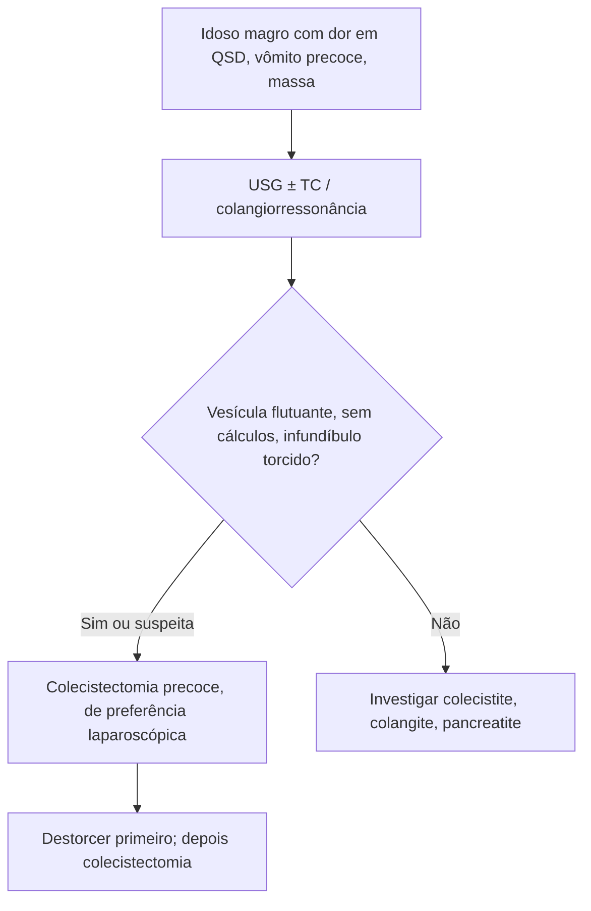

# Volvo de Vesícula Biliar

> Resumo em palavras próprias do Whitebook (Condutas Cirúrgicas > Cirurgia Geral e do Aparelho Digestivo), sem fisiopatologia, autoria e referências. Confira detalhes e doses na fonte: https://whitebook.pebmed.com.br/conteudo/?id=45413&categoryId=207&subcategoryId=211

**Definição:** torção da vesícula ao redor do eixo axial, com comprometimento vascular; rara, quase nunca diagnosticada antes da cirurgia; típica de idosos frágeis. Sinônimos: torção da vesícula, vólvulo vesicular.

## Aspectos gerais
A torção pode ser completa (> 180°) ou incompleta (< 180°), em vesículas com mesentério redundante; o idoso tem maior predisposição pela perda de gordura e atrofia tecidual que deixa a vesícula “solta”. Fatores: movimentos bruscos, peristalse intensa, cifoescoliose, visceroptose e artéria cística tortuosa por aterosclerose.

## Clínica (tríades clássicas)
1. Idade avançada, magreza, deformidade da coluna.
2. Dor no quadrante superior direito, vômito precoce, história curta.
3. Massa abdominal, ausência de toxemia ou icterícia e discrepância entre pulso e temperatura.
A torção incompleta cursa com dor recorrente lentamente progressiva; a completa, com quadro agudo.

## Diagnóstico
- **Laboratório:** leucograma inicialmente normal; com necrose, leucocitose com desvio; provas hepáticas normais ou levemente alteradas.
- **USG** (mais confiável): vesícula grande, flutuante, anterior, sem cálculos, infundíbulo cônico em descontinuidade com o lúmen; espessamento e distensão inespecíficos; o **sinal do nó do ducto cístico** pode ajudar.
- **TC:** vesícula flutuante (distendida, anterior, sem cálculos).
- **Colangiorressonância:** distorção em “V” das vias biliares extra-hepáticas por tração do cístico, com afunilamento e interrupção.
- **Diferenciais:** cólica biliar, colecistite aguda, colangite, coledocolitíase, hepatite, pancreatite.

## Tratamento
**Colecistectomia precoce**, de preferência laparoscópica. O primeiro passo é **destorcer** a vesícula, para evitar lesão inadvertida do colédoco.

## Fluxograma (refeito, a partir do texto; o texto original não traz uma figura)

