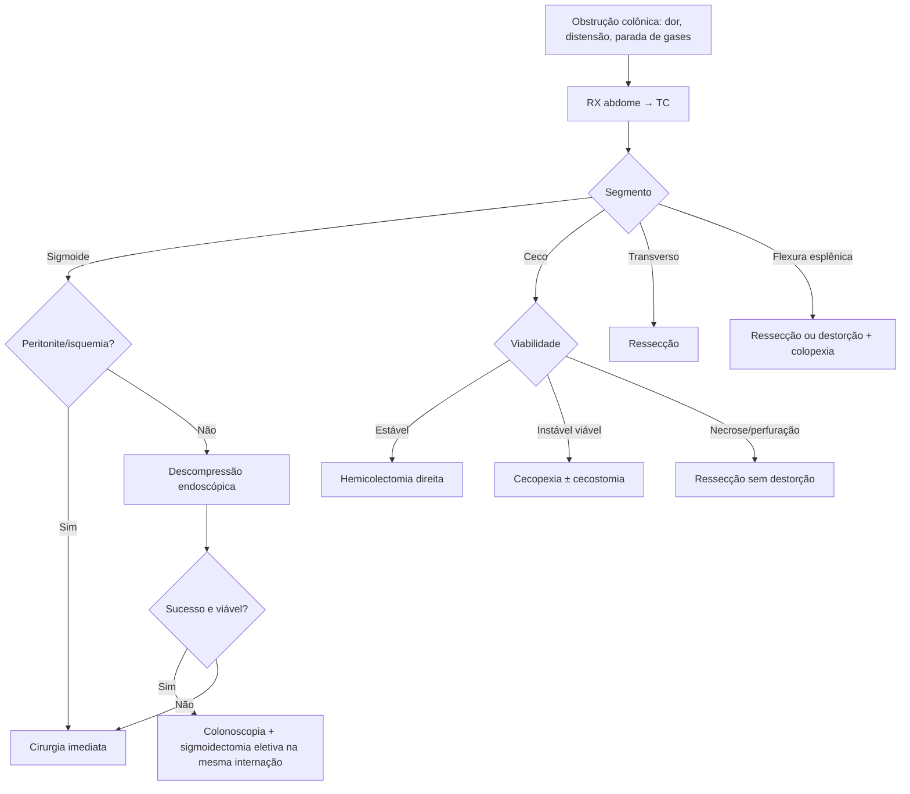

# Volvos Colônicos

> Resumo em palavras próprias do Whitebook (Condutas Cirúrgicas > Cirurgia em Coloproctologia), sem fisiopatologia, autoria e referências. Confira detalhes e doses na fonte: https://whitebook.pebmed.com.br/conteudo/?id=39196&categoryId=207&subcategoryId=213

**Definição:** torção de um segmento do cólon em seu mesentério, com obstrução em alça fechada e risco de isquemia, gangrena e perfuração (estase venosa → isquemia → perfuração). Responde por 10–15% das obstruções do cólon. Sinônimos: torção do cólon.

## Epidemiologia e fatores
Segmentos: sigmoide 60–80%, ceco 15–30%, transverso 2–5%, flexura esplênica ~1%. Sigmoide: idosos (> 70), negros, diabéticos, distúrbios neuropsiquiátricos; ceco: mulheres jovens. **Risco:** falta de fixação retroperitoneal, cólon longo/redundante, mesentério alongado, dismotilidade, constipação crônica, dieta pobre em fibras, laxativos, psicotrópicos, Parkinson, Chagas, sedentarismo, gestação, institucionalizados, cirurgia abdominal prévia.

## Clínica e exame
Dor abdominal intensa (cólica; contínua e muito intensa tardiamente), distensão, náusea/vômito, parada de gases e fezes; episódios recorrentes (destorção espontânea); tardiamente, peritonite, gangrena, perfuração, sepse. Exame: distensão, timpanismo, peristalse intensa e descoordenada → aperistalse, peritonite tardia, ampola retal vazia.

## Diagnóstico
- Laboratório: hemograma, PCR, eletrólitos, lactato, função renal; leucocitose, febre e peritonismo sugerem isquemia.
- **Radiografia de abdome** (AP em pé e deitado + tórax em pé): diagnóstica em até 60%; sinal do “U invertido”, “grão de café”, ausência de gás no reto, pneumoperitônio.
- **TC:** em geral o exame de escolha, diagnóstico em ~100%; sinal do redemoinho (*whirl*), bico de pássaro, ausência de gás retal, distensão; pneumatose indica sofrimento, pneumoperitônio indica perfuração.
- **Diferenciais:** megacólon tóxico, Ogilvie, tumor de cólon, bridas, invaginação, isquemia mesentérica, diverticulite, apendicite.

## Tratamento por tipo
- **Estabilização geral:** monitorização, hidratação, correção hidreletrolítica, antibióticos, SNG, analgesia, antieméticos, nutrição; acionar cirurgia geral e endoscopia.
- **Sigmoide:** instabilidade clínica, perfuração ou peritonite → cirurgia imediata. Estável: **descompensação endoscópica** (retossigmoidoscopia flexível ou rígida) é a eleição — sucesso 55–94%, avalia a viabilidade (isquemia → cirurgia). Falha ou impossibilidade → cirurgia. Recidiva após descompressão até 86% → **sigmoidectomia** na mesma internação (salvo risco proibitivo); colonoscopia antes da cirurgia para excluir neoplasia; **sigmoidopexia** é inferior à ressecção e não é indicada.
- **Ceco** (1–3% das obstruções de cólon; causas: fusão incompleta do mesentério, bridas, gestação, atonia, colonoscopia, Hirschsprung): tratamento em geral cirúrgico; redução colonoscópica ou por enema de bário raramente eficaz e arriscada (não indicada). Estável: ressecção ileocólica/hemicolectomia direita com anastomose primária. Instável com cólon viável: cecopexia ± cecostomia. Isquemia, necrose ou perfuração: ressecção do segmento comprometido, preferencialmente **sem destorção prévia** (evitar reperfusão), com anastomose ileocólica ou ileostomia terminal conforme condições.
- **Transverso** (Escandinávia, Índia, África, Leste Europeu; mesentério longo, sem fixação das flexuras, má rotação, constipação, obstrução distal): TC diagnóstica; ressecção cirúrgica é a eleição.
- **Flexura esplênica** (raríssimo; falta de fixação congênita ou pós-cirúrgica): ressecção ou destorção com colopexia conforme achados.

## Fluxograma (refeito, a partir do texto; o original não traz algoritmo)

